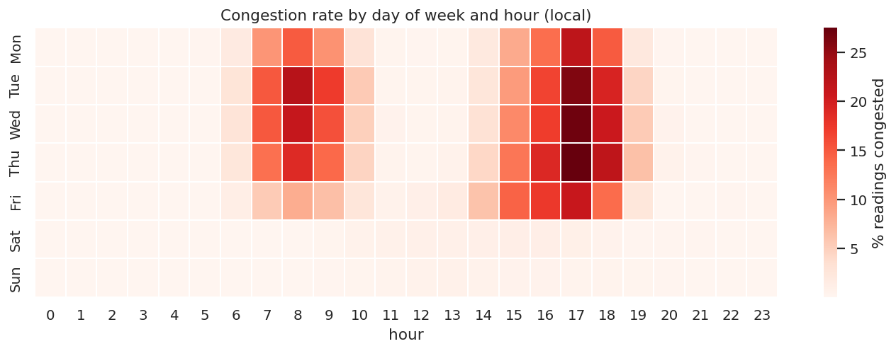
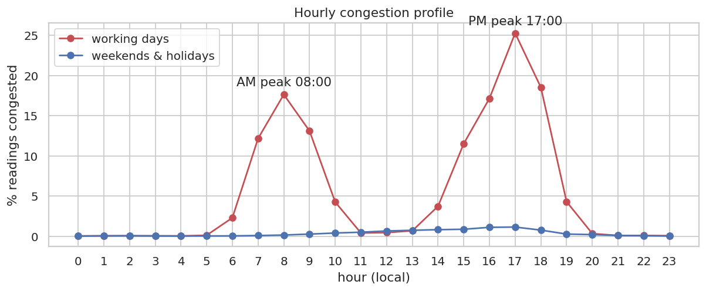
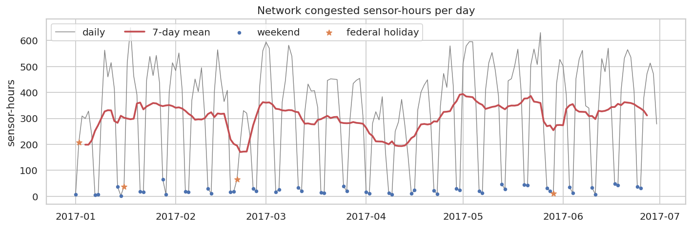

# Q1 — Daily and weekly congestion patterns

**Question.** When during the day and the week does congestion occur, how strong are the peaks, and how do weekends and holidays differ from working days?

## Method

- Observed readings only; congestion = speed < 35 mph; times are local (Pacific).
- `groupBy(dow, hour)` → congestion rate and mean speed (7 × 24 profile).
- `groupBy(is_workday, hour)` → working-day vs weekend/holiday hourly curves; AM/PM peak = hour with the highest rate in 6–10h / 15–19h.
- `groupBy(date_local)` → daily congestion rate and congested sensor-hours (Σ congested readings × 5 min / 60).
- Week-of-year aggregation for week-to-week variation.

## Key findings

- Working-day **PM peak at 17:00** (25.3% of readings congested) is 1.4× the **AM peak at 08:00** (17.6%); midday 0.5%, night 0.04%.
- Working days average 5.51% congested readings vs 0.30% on weekends (18.6×). The 4 federal holidays average 1.03%, much closer to weekends than to working days (3.5× the weekend level).
- Most congested weekday: **Thu** (6.14%, 477 congested sensor-hours/day); lightest: Fri (4.28%).
- A typical working day accumulates 428 congested sensor-hours (worst day 2017-01-18, Wed: 650).
- Week-to-week variation of the working-day rate is moderate (coefficient of variation 0.17 over 26 weeks), so the weekly cycle is stable.

## Tables

**Hourly congestion rate and mean speed, working days vs weekends/holidays** ([CSV](tables/q1_hourly_profile.csv))

| hour | workday_rate | workday_mean_speed | weekend_holiday_rate | weekend_holiday_mean_speed |
|---|---|---|---|---|
| 0 | 0.000 | 66.570 | 0.000 | 66.760 |
| 1 | 0.000 | 66.342 | 0.000 | 66.634 |
| 2 | 0.000 | 66.245 | 0.001 | 66.564 |
| 3 | 0.000 | 66.252 | 0.000 | 66.490 |
| 4 | 0.000 | 66.660 | 0.000 | 66.582 |
| 5 | 0.001 | 66.844 | 0.000 | 66.770 |
| 6 | 0.023 | 62.017 | 0.000 | 66.527 |
| 7 | 0.122 | 55.737 | 0.001 | 66.427 |
| 8 | 0.176 | 52.880 | 0.001 | 66.028 |
| 9 | 0.131 | 55.396 | 0.003 | 65.416 |
| 10 | 0.043 | 59.961 | 0.004 | 64.823 |
| 11 | 0.004 | 62.830 | 0.005 | 64.242 |

_12 of 24 rows shown; full table in the CSV._

**Day-of-week summary (holidays excluded)** ([CSV](tables/q1_day_of_week.csv))

| dow_name | days | mean_rate | mean_congested_sensor_hours | mean_speed | rank_by_congestion |
|---|---|---|---|---|---|
| Mon | 22 | 0.049 | 384.864 | 61.832 | 4 |
| Tue | 26 | 0.060 | 465.099 | 61.251 | 3 |
| Wed | 26 | 0.061 | 474.920 | 61.065 | 2 |
| Thu | 26 | 0.061 | 476.859 | 61.041 | 1 |
| Fri | 26 | 0.043 | 332.455 | 61.962 | 5 |
| Sat | 25 | 0.004 | 28.427 | 65.280 | 6 |
| Sun | 26 | 0.002 | 17.689 | 65.577 | 7 |

**Five days with the most congested sensor-hours** ([CSV](tables/q1_worst_days.csv))

| date_local | dow_name | rate | congested_sensor_hours |
|---|---|---|---|
| 2017-01-18 | Wed | 0.084 | 650.083 |
| 2017-05-25 | Thu | 0.081 | 630.917 |
| 2017-05-03 | Wed | 0.077 | 596.000 |
| 2017-05-04 | Thu | 0.076 | 595.417 |
| 2017-03-01 | Wed | 0.076 | 594.083 |

**Daily series** ([CSV](tables/q1_daily.csv))

| date_local | is_holiday | is_workday | rate | congested_sensor_hours | mean_speed | dow_name |
|---|---|---|---|---|---|---|
| 2017-01-01 | no | no | 0.001 | 7.500 | 66.959 | Sun |
| 2017-01-02 | yes | no | 0.027 | 207.917 | 64.125 | Mon |
| 2017-01-03 | no | yes | 0.040 | 309.500 | 61.662 | Tue |
| 2017-01-04 | no | yes | 0.039 | 299.833 | 61.299 | Wed |
| 2017-01-05 | no | yes | 0.042 | 328.167 | 62.249 | Thu |
| 2017-01-06 | no | yes | 0.030 | 235.167 | 62.865 | Fri |
| 2017-01-07 | no | no | 0.001 | 4.583 | 64.270 | Sat |
| 2017-01-08 | no | no | 0.001 | 7.417 | 63.626 | Sun |
| 2017-01-09 | no | yes | 0.042 | 324.000 | 61.573 | Mon |
| 2017-01-10 | no | yes | 0.073 | 563.167 | 58.425 | Tue |
| 2017-01-11 | no | yes | 0.059 | 460.167 | 61.011 | Wed |
| 2017-01-12 | no | yes | 0.066 | 515.083 | 60.625 | Thu |

_12 of 181 rows shown; full table in the CSV._

**Congestion rate by ISO day of week × hour** ([CSV](tables/q1_dow_hour.csv))

| dow | hour | rate | mean_speed | readings |
|---|---|---|---|---|
| 1 | 0 | 0.000 | 66.740 | 101,287 |
| 1 | 1 | 0.001 | 66.513 | 101,280 |
| 1 | 2 | 0.000 | 66.412 | 101,269 |
| 1 | 3 | 0.000 | 66.421 | 101,256 |
| 1 | 4 | 0.000 | 66.783 | 101,256 |
| 1 | 5 | 0.002 | 66.855 | 101,256 |
| 1 | 6 | 0.018 | 62.861 | 101,269 |
| 1 | 7 | 0.101 | 57.254 | 101,278 |
| 1 | 8 | 0.150 | 54.590 | 101,212 |
| 1 | 9 | 0.104 | 57.043 | 101,160 |
| 1 | 10 | 0.030 | 61.008 | 101,134 |
| 1 | 11 | 0.003 | 63.118 | 101,124 |

_12 of 168 rows shown; full table in the CSV._

## Figures

**Congestion rate by day of week × hour**

**Working-day vs weekend/holiday hourly profile**

**Daily congested sensor-hours with weekly cycle and holidays**

## Interpretation & implications for TrafficSense

- Hour of day and working-day status explain most of the variation in congestion; they are already model features (`hour`, `slot_of_day`, `is_weekend`, `is_holiday`, cyclical encodings).
- The PM peak is the critical operating window: dashboard alerts and model evaluation should report PM-peak performance separately.
- Holidays sit far closer to weekends than to working days, which confirms the separate `is_holiday` flag.

## Limitations

- Rates are shares of 5-minute sensor readings, not vehicle-weighted: PEMS-BAY has speeds only, no flows.
- Six months (Jan–Jun 2017) cover no summer or holiday-season peaks.

_Computed in 30.3 s · 2026-10-20 12:25 UTC._
