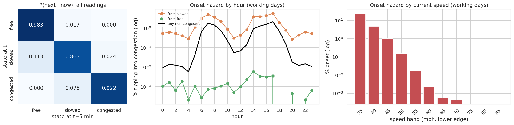
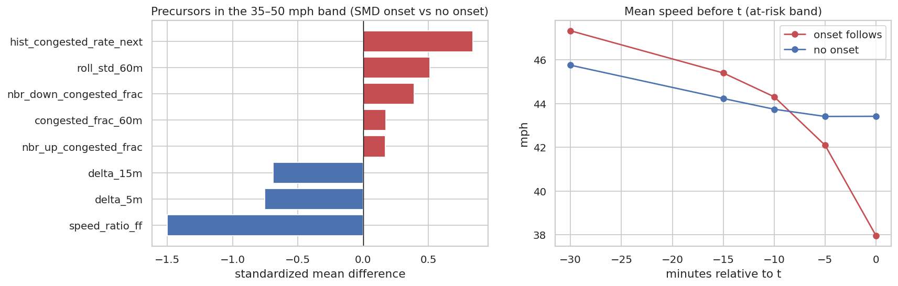

# Q10 — Congestion onset and state transitions

**Question.** How does traffic move between free, slowed and congested states, how likely is a new congestion onset at each time and speed, and which signals precede an onset?

## Method

- Three states per observed reading: free (≥ 60 mph), slowed (35–60), congested (< 35). The transition from t to t + 5 min uses `lead()` over a window per sensor ordered by UTC time; both readings must be observed.
- First-order Markov transition matrix (overall and by working-day hour). Expected dwell time in a state = 5 min / (1 − P(stay)). Stationary distribution from the matrix, compared with the observed state shares.
- Onset hazard = P(congested at t+5 | not congested at t), by hour and by 5-mph speed band.
- Precursors (training split of the feature table only, so no test data is used): standardized mean difference (SMD) between onset rows (now not congested, next congested) and non-onset rows. Computed overall and within the at-risk band 35–50 mph, so the comparison is not just 'slow vs fast'.

## Key findings

- States are sticky: P(stay) = 0.983 free, 0.863 slowed, 0.922 congested, giving expected dwell times of 287, 36 and 64 min.
- Congestion is almost always entered via 'slowed': P(free → congested) = 1.3e-05 vs P(slowed → congested) = 0.0240 (1,791×).
- The first-order chain reproduces the state mix: stationary shares free 83.2%, slowed 12.8%, congested 3.9% vs observed free 83.2%, slowed 12.8%, congested 3.9%.
- Onset hazard on working days peaks at **17:00** (2.08% of non-congested readings tip into congestion within 5 min). By speed: 23.4% in the 35–40 mph band vs 0.001% at ≥ 60 mph.
- Strongest precursors in the at-risk band (|SMD|): speed_ratio_ff -1.50 (onset 0.56 vs 0.65); hist_congested_rate_next +0.84 (onset 0.38 vs 0.16); delta_5m -0.75 (onset -4.14 vs 0.01).
- Speed trajectory before an onset (at-risk band, training split): 47.3 → 38.0 mph over 30 min, vs 45.8 → 43.4 mph without an onset.

## Tables

**Transition matrix P(state at t+5 | state at t), dwell time and stationary distribution** ([CSV](tables/q10_transition_matrix.csv))

| from | to_free | to_slowed | to_congested | expected_dwell_min | stationary_share | observed_share |
|---|---|---|---|---|---|---|
| free | 0.983 | 0.017 | 0.000 | 287.034 | 0.832 | 0.832 |
| slowed | 0.113 | 0.863 | 0.024 | 36.485 | 0.128 | 0.128 |
| congested | 0.000 | 0.078 | 0.922 | 63.983 | 0.039 | 0.039 |

**Working-day onset probability by hour, from free, from slowed, and either** ([CSV](tables/q10_onset_hazard_by_hour.csv))

| hour | free | slowed | onset_prob_any |
|---|---|---|---|
| 0 | 0.000 | 0.005 | 0.000 |
| 1 | 0.000 | 0.006 | 0.000 |
| 2 | 0.000 | 0.005 | 0.000 |
| 3 | 0.000 | 0.004 | 0.000 |
| 4 | 0.000 | 0.003 | 0.000 |
| 5 | 0.000 | 0.011 | 0.000 |
| 6 | 0.000 | 0.032 | 0.007 |
| 7 | 0.000 | 0.050 | 0.017 |
| 8 | 0.000 | 0.036 | 0.014 |
| 9 | 0.000 | 0.022 | 0.007 |
| 10 | 0.000 | 0.008 | 0.002 |
| 11 | 0.000 | 0.003 | 0.001 |

_12 of 24 rows shown; full table in the CSV._

**Onset probability by 5-mph speed band** ([CSV](tables/q10_onset_hazard_by_speed.csv))

| speed_band | is_workday | onset_prob | n |
|---|---|---|---|
| 35 | no | 0.169 | 10,367 |
| 35 | yes | 0.234 | 166,451 |
| 40 | yes | 0.047 | 166,098 |
| 40 | no | 0.027 | 13,749 |
| 45 | no | 0.006 | 24,717 |
| 45 | yes | 0.010 | 195,772 |
| 50 | yes | 0.001 | 325,410 |
| 50 | no | 0.001 | 56,808 |
| 55 | no | 0.000 | 232,512 |
| 55 | yes | 0.000 | 970,687 |
| 60 | no | 0.000 | 1,460,325 |
| 60 | yes | 0.000 | 3,625,680 |

_12 of 21 rows shown; full table in the CSV._

**Precursor signals: standardized mean difference, onset vs no onset (training split)** ([CSV](tables/q10_precursors.csv))

| scope | feature | description | mean_onset | mean_no_onset | smd | onset_rows | no_onset_rows |
|---|---|---|---|---|---|---|---|
| all non-congested rows | speed_ratio_ff | speed / free-flow speed | 0.566 | 0.951 | -5.739 | 33,711 | 10,673,603 |
| all non-congested rows | roll_std_60m | speed std over the last hour | 6.488 | 1.400 | 1.847 | 33,711 | 10,673,603 |
| all non-congested rows | hist_congested_rate_next | historical congestion rate for the target slot | 0.372 | 0.014 | 1.728 | 33,711 | 10,673,603 |
| all non-congested rows | nbr_down_congested_frac | share of downstream neighbours congested | 0.293 | 0.019 | 1.252 | 33,711 | 10,673,603 |
| all non-congested rows | nbr_up_congested_frac | share of upstream neighbours congested | 0.265 | 0.020 | 1.107 | 33,711 | 10,673,603 |
| all non-congested rows | delta_15m | speed change over the last 15 min (mph) | -7.332 | 0.127 | -0.949 | 33,711 | 10,673,603 |
| all non-congested rows | delta_5m | speed change over the last 5 min (mph) | -4.080 | 0.034 | -0.885 | 33,711 | 10,673,603 |
| all non-congested rows | congested_frac_60m | share of the last hour congested | 0.173 | 0.009 | 0.821 | 33,711 | 10,673,603 |
| at-risk band 35–50 mph | speed_ratio_ff | speed / free-flow speed | 0.562 | 0.649 | -1.502 | 33,156 | 348,004 |
| at-risk band 35–50 mph | hist_congested_rate_next | historical congestion rate for the target slot | 0.375 | 0.161 | 0.841 | 33,156 | 348,004 |
| at-risk band 35–50 mph | delta_5m | speed change over the last 5 min (mph) | -4.136 | 0.007 | -0.753 | 33,156 | 348,004 |
| at-risk band 35–50 mph | delta_15m | speed change over the last 15 min (mph) | -7.445 | -0.814 | -0.689 | 33,156 | 348,004 |

_12 of 16 rows shown; full table in the CSV._

**Mean speed over the 30 min before t (at-risk band, training split)** ([CSV](tables/q10_pre_onset_trajectory.csv))

| onset_next | speed_lag_30m | speed_lag_15m | speed_lag_10m | speed_lag_5m | speed |
|---|---|---|---|---|---|
| 0 | 45.757 | 44.234 | 43.743 | 43.413 | 43.419 |
| 1 | 47.331 | 45.401 | 44.312 | 42.093 | 37.957 |

## Figures

**Transition matrix and onset hazard by hour and by speed**

**Which signals precede a congestion onset**

## Interpretation & implications for TrafficSense

- Since onsets come almost exclusively from 'slowed', the dashboard can show an 'at risk' state (35–50 mph and falling) as an early warning before the model's congestion alert fires.
- The strongest precursors (falling speed, congested neighbours, recurring slot) correspond to existing features, which supports the Phase 3 design (see Q17 for their measured contribution).
- Long dwell times explain why persistence is a strong 5-minute baseline (Q16).

## Limitations

- The Markov chain is first-order and pooled over sensors; real dynamics depend on longer history (captured by lags/rolling features).
- SMD shows association, not causation; precursors overlap (correlated features).

_Computed in 86.2 s · 2026-10-20 14:03 UTC._
