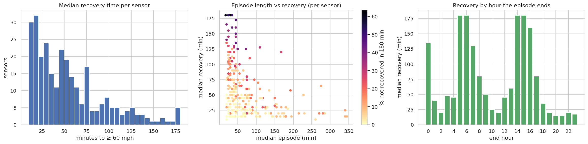
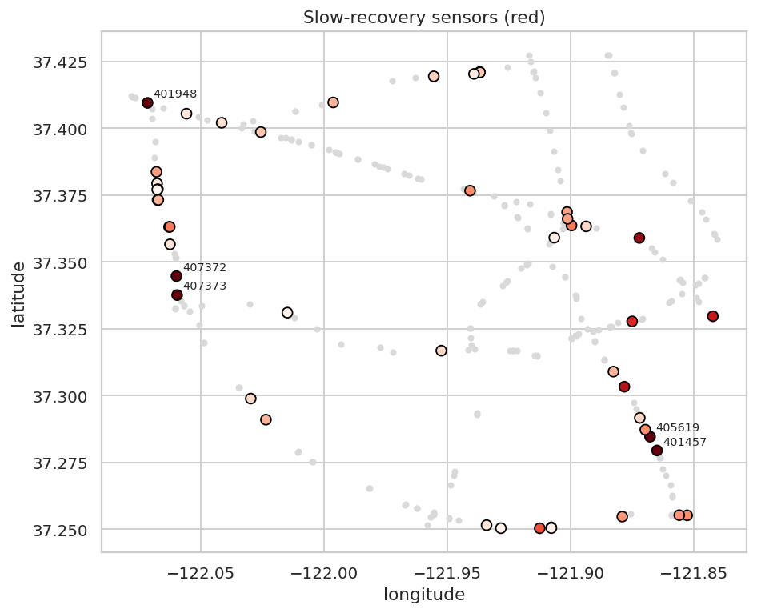

# Q11 — Congestion recovery performance across sensors

**Question.** Which sensors recover slowly from congestion, how consistent is their recovery, and does recovery depend on time of day or episode length?

## Method

- Sustained episodes (≥ 15 min) from the shared episode table. Recovery time = minutes from the episode end until speed ≥ 60 mph (censored at 180 min).
- Per sensor with ≥ 10 sustained episodes: median and IQR of recovery time, share recovered within 30/60 min and not within 180 min, and median episode length.
- Peer comparison: each sensor's median recovery vs the median of its road-graph neighbours (both directions), giving a recovery gap in minutes and a z-score across sensors.
- Drivers: Spearman correlation of recovery with episode duration; recovery by the hour in which the episode ends.

## Key findings

- 284 sensors have ≥ 10 sustained episodes. The median sensor recovers to free flow in **45 min**, but sensors range from 10 to 180 min (IQR across sensors 25–75 min).
- **47 slow-recovery sensors** are ≥ 1 sd slower than average *and* slower than their neighbours; worst 407373: median 180 min (peers 105 min), 51.9% of episodes not recovered within 180 min.
- Recovery depends on when an episode ends: median 180 min for episodes ending at 14:00 vs 15 min at 20:00 (hours with ≥ 200 episodes). Demand that remains high delays full recovery.
- Longer episodes recover faster (episode-level Spearman ρ = -0.37 between duration and recovery time), likely because long episodes typically end as evening demand falls, while short ones end inside busy periods that keep speeds below free flow. Across sensors, total congested time and median recovery have rank correlation -0.16.
- Recovery is unpredictable at many sensors: median within-sensor IQR is 60 min.

## Tables

**Slow-recovery sensors (≥ 1 sd slower than average and slower than neighbours)** ([CSV](tables/q11_slow_recovery_sensors.csv))

| sensor_id | sustained_episodes | median_recovery_min | peer_median_recovery_min | recovery_gap_vs_peers_min | recovery_iqr_min | share_recovered_30min | share_recovered_60min | share_not_recovered | median_duration_min |
|---|---|---|---|---|---|---|---|---|---|
| 407,373 | 104 | 180.000 | 105.000 | 75.000 | 55.000 | 0.029 | 0.077 | 0.519 | 25.000 |
| 407,372 | 117 | 180.000 | 86.250 | 93.750 | 55.000 | 0.051 | 0.085 | 0.615 | 25.000 |
| 401,948 | 165 | 180.000 | 90.000 | 90.000 | 90.000 | 0.042 | 0.164 | 0.503 | 35.000 |
| 405,619 | 11 | 180.000 | 45.000 | 135.000 | 22.500 | 0.182 | 0.182 | 0.636 | 30.000 |
| 401,457 | 10 | 180.000 | 45.000 | 135.000 | 93.750 | 0.000 | 0.200 | 0.600 | 17.500 |
| 402,362 | 150 | 172.500 | 40.000 | 132.500 | 78.750 | 0.020 | 0.067 | 0.473 | 45.000 |
| 400,837 | 111 | 165.000 | 45.000 | 120.000 | 75.000 | 0.018 | 0.045 | 0.396 | 20.000 |
| 407,361 | 363 | 160.000 | 68.750 | 91.250 | 115.000 | 0.102 | 0.245 | 0.438 | 35.000 |
| 402,359 | 13 | 160.000 | 55.000 | 105.000 | 50.000 | 0.077 | 0.154 | 0.385 | 45.000 |
| 403,404 | 175 | 155.000 | 30.000 | 125.000 | 85.000 | 0.074 | 0.143 | 0.337 | 25.000 |
| 407,360 | 360 | 150.000 | 62.500 | 87.500 | 115.000 | 0.125 | 0.244 | 0.428 | 45.000 |
| 400,750 | 234 | 145.000 | 45.000 | 100.000 | 98.750 | 0.047 | 0.141 | 0.338 | 45.000 |

_12 of 47 rows shown; full table in the CSV._

**Ten fastest-recovering sensors** ([CSV](tables/q11_fastest_recovery.csv))

| sensor_id | sustained_episodes | median_recovery_min | peer_median_recovery_min | recovery_gap_vs_peers_min | recovery_iqr_min | share_recovered_30min | share_recovered_60min | share_not_recovered | median_duration_min |
|---|---|---|---|---|---|---|---|---|---|
| 403,329 | 13 | 10.000 | 45.000 | -35.000 | 5.000 | 1.000 | 1.000 | 0.000 | 20.000 |
| 400,394 | 147 | 10.000 | 41.250 | -31.250 | 5.000 | 0.857 | 0.912 | 0.041 | 260.000 |
| 402,056 | 72 | 15.000 | 47.500 | -32.500 | 16.250 | 0.792 | 0.903 | 0.000 | 62.500 |
| 400,911 | 139 | 15.000 | 55.000 | -40.000 | 72.500 | 0.705 | 0.741 | 0.029 | 70.000 |
| 400,895 | 165 | 15.000 | 50.000 | -35.000 | 20.000 | 0.758 | 0.812 | 0.103 | 340.000 |
| 407,173 | 33 | 15.000 | 45.000 | -30.000 | 5.000 | 0.909 | 1.000 | 0.000 | 50.000 |
| 401,163 | 164 | 15.000 | 45.000 | -30.000 | 15.000 | 0.780 | 0.823 | 0.079 | 195.000 |
| 402,119 | 86 | 15.000 | 40.000 | -25.000 | 25.000 | 0.721 | 0.872 | 0.000 | 35.000 |
| 401,129 | 60 | 15.000 | 85.000 | -70.000 | 6.250 | 0.817 | 0.900 | 0.000 | 57.500 |
| 407,200 | 167 | 15.000 | 15.000 | 0.000 | 45.000 | 0.707 | 0.754 | 0.084 | 155.000 |

**Recovery by the hour the episode ends** ([CSV](tables/q11_by_end_hour.csv))

| end_hour | episodes | median_recovery_min | share_not_recovered |
|---|---|---|---|
| 0 | 13 | 135.000 | 0.385 |
| 1 | 26 | 40.000 | 0.154 |
| 2 | 31 | 20.000 | 0.161 |
| 3 | 22 | 47.500 | 0.182 |
| 4 | 13 | 45.000 | 0.308 |
| 5 | 44 | 180.000 | 0.545 |
| 6 | 166 | 180.000 | 0.608 |
| 7 | 1,710 | 130.000 | 0.236 |
| 8 | 4,117 | 80.000 | 0.093 |
| 9 | 4,945 | 50.000 | 0.072 |
| 10 | 3,717 | 25.000 | 0.076 |
| 11 | 361 | 20.000 | 0.183 |

_12 of 24 rows shown; full table in the CSV._

**Recovery metrics for all sensors with enough episodes** ([CSV](tables/q11_all_sensors.csv))

| sensor_id | sustained_episodes | median_duration_min | median_recovery_min | recovery_iqr_min | share_recovered_30min | share_recovered_60min | share_not_recovered | congested_minutes | peer_median_recovery_min | recovery_gap_vs_peers_min | recovery_z | latitude | longitude |
|---|---|---|---|---|---|---|---|---|---|---|---|---|---|
| 400,001 | 95 | 40.000 | 65.000 | 110.000 | 0.347 | 0.484 | 0.084 | 5,220 | - | - | 0.224 | 37.364 | -121.901 |
| 400,017 | 169 | 180.000 | 30.000 | 65.000 | 0.509 | 0.716 | 0.213 | 28,840 | - | - | -0.655 | 37.253 | -121.945 |
| 400,030 | 207 | 55.000 | 100.000 | 130.000 | 0.126 | 0.353 | 0.285 | 12,635 | 40.000 | 60.000 | 1.103 | 37.359 | -121.907 |
| 400,040 | 162 | 30.000 | 95.000 | 78.750 | 0.099 | 0.253 | 0.148 | 6,245 | 45.000 | 50.000 | 0.977 | 37.295 | -121.873 |
| 400,045 | 193 | 80.000 | 50.000 | 155.000 | 0.352 | 0.560 | 0.269 | 15,715 | 40.000 | 10.000 | -0.153 | 37.363 | -121.902 |
| 400,052 | 146 | 90.000 | 20.000 | 33.750 | 0.651 | 0.842 | 0.000 | 13,795 | 55.000 | -35.000 | -0.906 | 37.256 | -121.875 |
| 400,057 | 326 | 55.000 | 65.000 | 115.000 | 0.301 | 0.482 | 0.169 | 21,870 | 62.500 | 2.500 | 0.224 | 37.335 | -121.936 |
| 400,059 | 155 | 30.000 | 100.000 | 92.500 | 0.058 | 0.219 | 0.155 | 6,995 | 60.000 | 40.000 | 1.103 | 37.250 | -121.908 |
| 400,065 | 175 | 80.000 | 60.000 | 77.500 | 0.303 | 0.526 | 0.074 | 15,170 | 45.000 | 15.000 | 0.098 | 37.320 | -121.890 |
| 400,069 | 148 | 285.000 | 20.000 | 35.000 | 0.628 | 0.797 | 0.047 | 37,905 | 50.000 | -30.000 | -0.906 | 37.386 | -121.977 |
| 400,073 | 72 | 40.000 | 25.000 | 65.000 | 0.611 | 0.681 | 0.069 | 7,200 | 25.000 | 0.000 | -0.781 | 37.256 | -121.956 |
| 400,084 | 170 | 135.000 | 57.500 | 85.000 | 0.353 | 0.524 | 0.053 | 23,345 | 67.500 | -10.000 | 0.036 | 37.329 | -122.012 |

_12 of 284 rows shown; full table in the CSV._

## Figures

**How recovery varies between sensors and through the day**

**Where recovery is slow**

## Interpretation & implications for TrafficSense

- **Recommendation:** prioritise the slow-recovery sensors for incident-clearance response and for a review of ramp metering or merge geometry: they lose the most time after the queue starts to clear.
- The dashboard should show expected recovery time per sensor (its median) when an episode ends, not just 'cleared'.
- End-hour effects show recovery is demand-driven; recovery forecasts should condition on time of day.

## Limitations

- Recovery is censored at 180 min and at missing data; censored episodes are counted as 180 min in medians.
- Without incident logs, slow recovery cannot be attributed to incidents versus geometry.

_Computed in 13.2 s · 2026-10-20 13:32 UTC._
