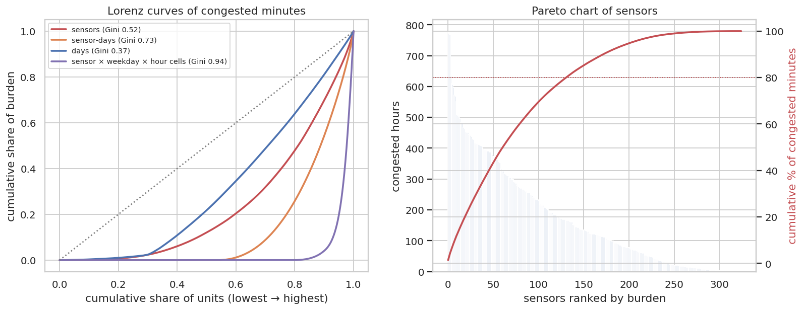

# Q12 — Concentration of congestion burden (Pareto analysis)

**Question.** How concentrated is the congestion burden across sensors, days and times, does the 80/20 rule hold, and how well would targeting the worst locations work on future data?

## Method

- Burden measures per observed reading: **congested minutes** (5 min if speed < 35 mph) and **delay** = max(0, 60/speed − 60/free-flow) minutes per vehicle-mile, using the train-period free-flow speed.
- Units: sensors, sensor-days, days, and sensor × weekday × hour cells (325 × 7 × 24). For each: Lorenz curve, Gini coefficient, share carried by the top 10%/20%, and the share of units needed for 50%/80% of the burden.
- Out-of-sample targeting: select the top-20% sensors in the first half of the period (Jan–Mar) and measure the share of second-half (Apr–Jun) burden they capture, against the best possible (top 20% chosen in hindsight).

## Key findings

- Across sensors the 80/20 rule is softened: the top 20% of sensors carry **52.1%** of congested minutes (Gini 0.52); half of all congestion sits on 19.1% of sensors, and 80% on 40.6%.
- Delay is less concentrated: top 20% of sensors carry 41.3% (Gini 0.35 vs 0.52), because moderate slowdowns at many sensors add delay without crossing the 35 mph threshold.
- In space-time the burden is far more concentrated: the top 10% of sensor × weekday × hour cells carry **95.9%** of congested minutes (Gini 0.94); 80% of the burden sits in 5.0% of cells.
- Across days the burden is evenly spread (Gini 0.37; top 10% of days = 18.9%), so congestion is a daily routine rather than a few extreme days.
- Targeting works out of sample: the top-20% sensors chosen on Jan–Mar data capture **51.9%** of Apr–Jun congested minutes, 98.9% of the hindsight-optimal 52.4% (overlap 90.8%).

## Tables

**Concentration by unit and burden measure** ([CSV](tables/q12_concentration.csv))

| unit | measure | units | gini | top10pct_share | top20pct_share | units_for_50pct | units_for_80pct |
|---|---|---|---|---|---|---|---|
| sensors | congested minutes | 325 | 0.525 | 0.298 | 0.521 | 0.191 | 0.406 |
| sensors | delay | 325 | 0.347 | 0.242 | 0.413 | 0.265 | 0.575 |
| sensor-days | congested minutes | 58,778 | 0.731 | 0.457 | 0.742 | 0.113 | 0.228 |
| sensor-days | delay | 58,778 | 0.532 | 0.364 | 0.558 | 0.166 | 0.408 |
| days | congested minutes | 181 | 0.374 | 0.189 | 0.359 | 0.293 | 0.519 |
| days | delay | 181 | 0.286 | 0.172 | 0.323 | 0.331 | 0.586 |
| sensor × weekday × hour cells | congested minutes | 54,600 | 0.936 | 0.959 | 1.000 | 0.023 | 0.050 |
| sensor × weekday × hour cells | delay | 54,600 | 0.755 | 0.686 | 0.806 | 0.045 | 0.192 |

**Out-of-sample targeting: top-20% sensors chosen on Jan–Mar, evaluated on Apr–Jun** ([CSV](tables/q12_targeting.csv))

| measure | selected_sensors | h2_share_captured | oracle_share | overlap_with_oracle | efficiency_vs_oracle |
|---|---|---|---|---|---|
| congested minutes | 65 | 0.519 | 0.524 | 0.908 | 0.989 |
| delay | 65 | 0.403 | 0.416 | 0.831 | 0.969 |

**Fifteen heaviest sensor × weekday × hour cells** ([CSV](tables/q12_top_cells.csv))

| sensor_id | dow | hour | congested_hours | delay |
|---|---|---|---|---|
| 400,372 | 3 | 15 | 26.000 | 1,003.098 |
| 400,586 | 3 | 17 | 26.000 | 737.315 |
| 400,172 | 3 | 17 | 26.000 | 651.974 |
| 400,172 | 5 | 17 | 26.000 | 662.001 |
| 400,394 | 3 | 17 | 26.000 | 636.861 |
| 400,394 | 5 | 16 | 26.000 | 611.487 |
| 400,586 | 5 | 15 | 26.000 | 655.170 |
| 400,654 | 3 | 7 | 26.000 | 589.969 |
| 400,586 | 2 | 16 | 26.000 | 677.729 |
| 400,394 | 5 | 17 | 26.000 | 665.968 |
| 403,414 | 3 | 17 | 26.000 | 1,302.863 |
| 400,172 | 4 | 16 | 26.000 | 642.347 |

_12 of 15 rows shown; full table in the CSV._

**Sensors ranked by congested minutes with cumulative share** ([CSV](tables/q12_sensors.csv))

| sensor_id | cmin | delay | cum_share |
|---|---|---|---|
| 400,586 | 46,665 | 21,547.583 | 0.014 |
| 400,172 | 46,330 | 20,480.187 | 0.028 |
| 400,895 | 46,100 | 25,962.509 | 0.042 |
| 400,069 | 38,005 | 28,223.168 | 0.053 |
| 400,971 | 36,565 | 17,600.329 | 0.064 |
| 400,973 | 36,340 | 16,597.523 | 0.075 |
| 400,104 | 35,750 | 14,543.926 | 0.086 |
| 400,394 | 34,315 | 14,122.145 | 0.096 |
| 400,372 | 34,165 | 24,759.326 | 0.106 |
| 403,414 | 33,025 | 19,642.519 | 0.116 |
| 400,567 | 30,525 | 11,401.425 | 0.126 |
| 407,360 | 30,450 | 12,976.219 | 0.135 |

_12 of 325 rows shown; full table in the CSV._

## Figures

**Lorenz curves and Pareto chart**

## Interpretation & implications for TrafficSense

- **Recommendation:** a targeted programme (signal/ramp-metering review, incident patrols) on the top 20% of sensors would address about 52% of future congestion, and the choice can be made from past data.
- Because burden concentrates in specific sensor × weekday × hour cells, interventions can be time-limited (e.g. weekday PM peaks only) rather than all-day.
- The dashboard's watch-list should be driven by the cell ranking (sensor × weekday × hour), not just by sensor.

## Limitations

- Burden is per sensor-reading; without traffic volumes it is not vehicle-weighted.
- Sensors are points of unequal spacing; a long uncovered segment can hide burden (see Q13 on coverage).

_Computed in 5.9 s · 2026-10-20 13:32 UTC._
