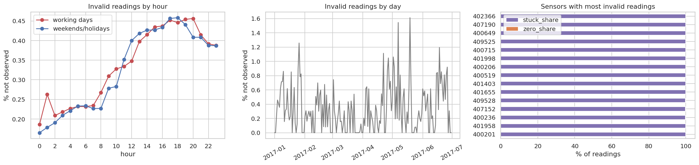
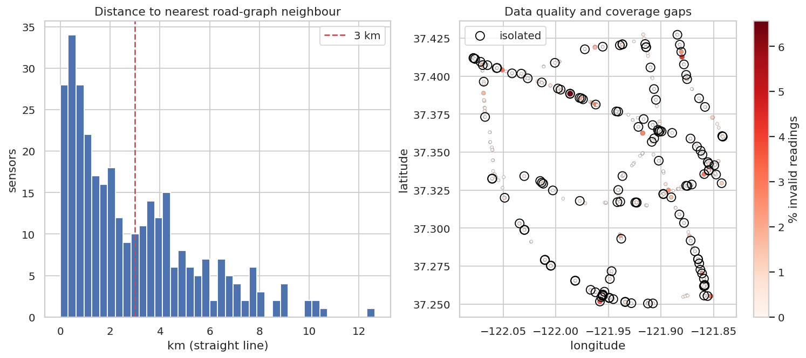

# Q13 — Missing data and sensor coverage bias

**Question.** Where and when are readings missing or invalid, is missingness related to congestion (so that rates and models are biased), and how evenly do sensors cover the network?

## Method

- Quality flags from cleaning (Phase 3): observed / imputed (forward-filled ≤ 15 min) / missing, and the reason (zero reading, stuck detector, ...). Shares by hour, by date and by sensor.
- Missing-not-at-random check: for each (sensor, day, hour) cell, compare the congestion rate of its observed readings when the cell has invalid readings vs when it is complete, **stratified by hour** (difference averaged over hours).
- Label loss: stuck-detector readings whose raw value was below 35 mph (removed as stuck, possibly true congestion).
- Model coverage: share of the clean grid kept in the feature table, by hour and split, and the congestion rate of dropped vs kept observed rows (excluding the structural 7-day warm-up).
- Spatial coverage: great-circle distance from each sensor to its nearest **road-graph** neighbour (either direction); co-located sensors (< 100 m, usually the opposite carriageway) are counted separately. Sensors without a graph neighbour within 3 km are isolated.

## Key findings

- Data are 99.67% observed, 0.009% forward-filled and 0.32% missing. Almost all invalid readings come from stuck detectors (55,980), and they are concentrated: the worst 15 sensors hold 44.0% of all invalid readings.
- Missingness by time: working-day share ranges 0.19%–0.46% by hour (highest at 20:00); worst day 2017-05-19 (1.61%, 218 sensors affected on the worst day).
- There is a modest missing-not-at-random effect: hour-cells containing invalid readings have a congestion rate +0.57 pp (+20% relative) different from complete cells at the same hour (base 2.84%); invalid readings occur somewhat more often around congestion. Across sensors, Spearman ρ between invalid share and congestion rate = 0.01.
- Label loss: 1,294 stuck readings were below 35 mph (2.3% of stuck readings, 0.19% of all congested readings). They were removed as implausible flat lines and slightly understate congestion.
- Model coverage after the warm-up: the feature table keeps 99.36% of observed rows. Dropped rows have congestion rate 2.84% vs 4.00% kept, a bias towards free-flow periods in what the model never sees.
- Spatial coverage: 214 sensors have another sensor within 100 m (typically the opposite carriageway). Spacing to the nearest **road-graph** neighbour is a median 2.12 km (max 12.6 km); 135 sensors have no graph neighbour within 3 km, so congestion on those stretches is observed at a single point.

## Tables

**Final quality of the 16.9M grid readings** ([CSV](tables/q13_quality.csv))

| quality | readings | share |
|---|---|---|
| missing | 54,970 | 0.003 |
| observed | 16,881,199 | 0.997 |
| imputed | 1,531 | 0.000 |

**Invalid-reading reasons and how they were resolved** ([CSV](tables/q13_issues.csv))

| issue | quality | count |
|---|---|---|
| stuck_sensor | imputed | 1,010 |
| non_positive | imputed | 521 |
| stuck_sensor | missing | 54,970 |

**Fifteen sensors with the most invalid readings** ([CSV](tables/q13_worst_sensors.csv))

| sensor_id | not_observed_share | stuck_share | zero_share | congestion_rate | nn_km |
|---|---|---|---|---|---|
| 402,366 | 0.066 | 0.999 | 0.001 | 0.032 | 4.555 |
| 407,190 | 0.042 | 0.999 | 0.001 | 0.075 | 0.494 |
| 400,649 | 0.036 | 0.999 | 0.001 | 0.001 | 4.135 |
| 409,525 | 0.032 | 0.999 | 0.001 | 0.010 | 0.511 |
| 400,715 | 0.031 | 1.000 | 0.000 | 0.000 | 10.424 |
| 401,998 | 0.031 | 1.000 | 0.000 | 0.019 | 2.749 |
| 400,206 | 0.030 | 1.000 | 0.000 | 0.069 | 4.309 |
| 400,519 | 0.030 | 0.999 | 0.001 | 0.017 | 0.870 |
| 401,403 | 0.029 | 0.999 | 0.001 | 0.022 | 7.122 |
| 401,655 | 0.029 | 1.000 | 0.000 | 0.029 | 6.198 |
| 409,528 | 0.027 | 0.999 | 0.001 | 0.040 | 0.511 |
| 407,152 | 0.026 | 0.998 | 0.002 | 0.001 | 4.908 |

_12 of 15 rows shown; full table in the CSV._

**Congestion rate of observed readings in hour-cells with vs without invalid readings** ([CSV](tables/q13_mnar_by_hour.csv))

| hour | rate_complete_cells | rate_cells_with_invalid |
|---|---|---|
| 0 | 0.000 | 0.000 |
| 1 | 0.000 | 0.000 |
| 2 | 0.000 | 0.000 |
| 3 | 0.000 | 0.000 |
| 4 | 0.000 | 0.000 |
| 5 | 0.001 | 0.000 |
| 6 | 0.016 | 0.000 |
| 7 | 0.085 | 0.046 |
| 8 | 0.123 | 0.103 |
| 9 | 0.092 | 0.071 |
| 10 | 0.031 | 0.062 |
| 11 | 0.004 | 0.023 |

_12 of 24 rows shown; full table in the CSV._

**Observed rows kept vs dropped by the feature table (after warm-up)** ([CSV](tables/q13_model_coverage.csv))

| kept | congestion_rate | rows |
|---|---|---|
| dropped | 0.028 | 104,457 |
| kept in features | 0.040 | 16,123,162 |

**Sensors more than 3 km from their nearest neighbour** ([CSV](tables/q13_isolated_sensors.csv))

| sensor_id | latitude | longitude | nn_km |
|---|---|---|---|
| 400,001 | 37.364 | -121.901 | inf |
| 400,240 | 37.258 | -121.954 | inf |
| 400,017 | 37.253 | -121.945 | inf |
| 407,202 | 37.361 | -121.842 | inf |
| 400,677 | 37.320 | -122.049 | inf |
| 400,560 | 37.325 | -122.003 | inf |
| 407,332 | 37.407 | -122.070 | 12.638 |
| 401,845 | 37.333 | -122.061 | 10.528 |
| 400,715 | 37.256 | -121.955 | 10.424 |
| 400,499 | 37.331 | -122.015 | 10.235 |
| 402,119 | 37.421 | -121.915 | 10.029 |
| 407,323 | 37.396 | -122.069 | 9.966 |

_12 of 135 rows shown; full table in the CSV._

## Figures

**When and where readings are missing or invalid**

**Spatial coverage and per-sensor data quality**

## Interpretation & implications for TrafficSense

- **Recommendation:** send the worst stuck-detector sensors for maintenance first; a handful of detectors cause most invalid data.
- The cleaning rule for stuck congested readings is conservative; report congestion rates with that small known under-count, and keep the `quality` flag visible in the dashboard.
- Evaluate the model separately for low-quality sensors; their feature gaps reduce coverage.
- Isolated sensors represent long road sections. New detectors or probe data (GPS) would close the coverage gaps.

## Limitations

- The true speed during invalid periods is unknown, so the MNAR test can only use the observed readings around them.
- Spatial coverage uses straight-line distance; road distance between sensors is longer.

_Computed in 25.7 s · 2026-10-20 13:32 UTC._
