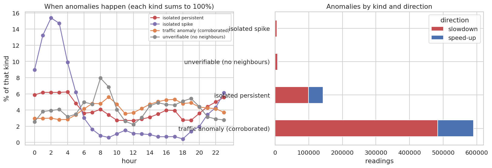
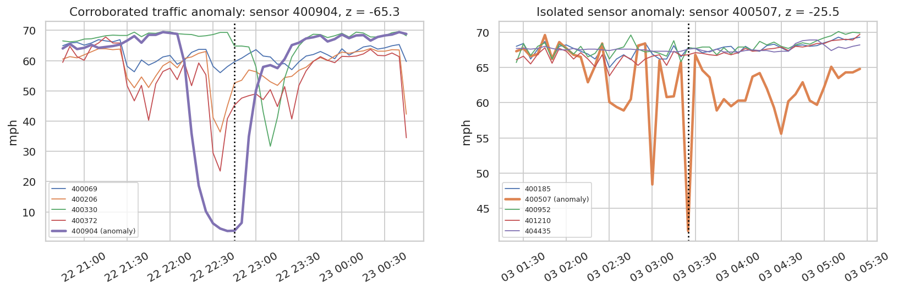

# Q14 — Traffic anomalies versus sensor anomalies

**Question.** When a sensor reports an unusual speed, is it a real traffic event (seen by neighbouring sensors too) or a sensor problem (an isolated glitch)?

## Method

- Robust baseline per (sensor, working day vs not, 5-min slot): median speed and MAD over all observed readings. Modified z = (speed − median) / (1.4826 · MAD), with the spread floored at 1 mph. Anomaly: |z| ≥ 3.5 (Iglewicz & Hoaglin's cut-off).
- Corroboration: an anomaly is a **traffic anomaly** if at least one road-graph neighbour (either direction) deviates in the same direction with |z| ≥ 2.0 at the same timestamp. A spatial join of the anomalies with the edge list and the z-table does this.
- Uncorroborated anomalies are **sensor-suspect**: an *isolated spike* if the sensor's own readings before and after are normal (|z| < 2.0), otherwise *isolated persistent* (a local event or sensor drift). Sensors without neighbours are 'unverifiable'.
- Cross-check: per-sensor rate of isolated anomalies vs the share of invalid readings found by cleaning.

## Key findings

- 748,806 anomalous readings (4.44% of 16,881,199 observed): **78.9% are traffic anomalies** corroborated by a neighbour, 19.1% isolated persistent, 0.9% isolated spikes and 1.2% unverifiable.
- Traffic anomalies are mostly slowdowns (81.9%) and cluster in peak hours (39.8% at 06–10/15–19h), while isolated anomalies are spread through the day (28.2% in the same hours).
- Isolated spikes are concentrated on few sensors: the 15 most spike-prone sensors carry 49.5% of all spikes.
- Spike rate and the invalid-reading share from cleaning are essentially unrelated across sensors (Spearman ρ = -0.02). Spikes therefore reveal a *different* kind of sensor problem than the stuck/zero readings found in cleaning.

## Tables

**Anomaly classification** ([CSV](tables/q14_kinds.csv))

| kind | slowdown | speed-up | total | share |
|---|---|---|---|---|
| traffic anomaly (corroborated) | 483,650 | 106,942 | 590,592 | 0.789 |
| isolated persistent | 99,206 | 43,495 | 142,701 | 0.191 |
| unverifiable (no neighbours) | 7,459 | 1,658 | 9,117 | 0.012 |
| isolated spike | 4,904 | 1,492 | 6,396 | 0.009 |

**Sensors whose anomalies are mostly uncorroborated (≥ 20 anomalies)** ([CSV](tables/q14_suspect_sensors.csv))

| sensor_id | anomalies | isolated_share | isolated spike | isolated persistent | traffic anomaly (corroborated) | invalid_share |
|---|---|---|---|---|---|---|
| 407,323 | 4,188.000 | 0.900 | 50.000 | 3,719.000 | 419.000 | 0.000 |
| 400,222 | 2,188.000 | 0.771 | 16.000 | 1,671.000 | 501.000 | 0.003 |
| 400,519 | 1,248.000 | 0.720 | 8.000 | 891.000 | 349.000 | 0.030 |
| 401,457 | 5,703.000 | 0.711 | 3.000 | 4,052.000 | 1,648.000 | 0.003 |
| 401,958 | 1,778.000 | 0.666 | 7.000 | 1,177.000 | 594.000 | 0.023 |
| 400,185 | 5,678.000 | 0.652 | 25.000 | 3,678.000 | 1,975.000 | 0.006 |
| 401,351 | 1,912.000 | 0.630 | 420.000 | 785.000 | 707.000 | 0.000 |
| 401,555 | 7,053.000 | 0.623 | 89.000 | 4,307.000 | 2,657.000 | 0.000 |
| 413,845 | 3,862.000 | 0.622 | 2.000 | 2,401.000 | 1,459.000 | 0.000 |
| 400,065 | 3,543.000 | 0.605 | 14.000 | 2,128.000 | 1,401.000 | 0.014 |
| 407,172 | 792.000 | 0.582 | 8.000 | 453.000 | 331.000 | 0.000 |
| 400,238 | 3,385.000 | 0.581 | 7.000 | 1,960.000 | 1,418.000 | 0.000 |

_12 of 15 rows shown; full table in the CSV._

**Anomalies by hour and kind** ([CSV](tables/q14_by_hour.csv))

| hour | isolated persistent | isolated spike | traffic anomaly (corroborated) | unverifiable (no neighbours) |
|---|---|---|---|---|
| 0 | 8,379 | 575 | 17,543 | 234 |
| 1 | 8,827 | 846 | 17,532 | 347 |
| 2 | 8,826 | 984 | 17,715 | 360 |
| 3 | 8,824 | 941 | 16,614 | 371 |
| 4 | 8,895 | 634 | 16,747 | 289 |
| 5 | 6,902 | 397 | 20,101 | 318 |
| 6 | 5,157 | 193 | 24,461 | 454 |
| 7 | 5,297 | 104 | 28,366 | 431 |
| 8 | 5,840 | 54 | 28,283 | 725 |
| 9 | 4,859 | 39 | 33,109 | 625 |
| 10 | 3,892 | 68 | 27,913 | 369 |
| 11 | 3,877 | 96 | 20,980 | 238 |

_12 of 24 rows shown; full table in the CSV._

**Per-sensor anomaly counts** ([CSV](tables/q14_per_sensor.csv))

| sensor_id | isolated persistent | isolated spike | traffic anomaly (corroborated) | unverifiable (no neighbours) | anomalies | isolated_share | invalid_share | spikes_per_10k |
|---|---|---|---|---|---|---|---|---|
| 400,435 | 20.000 | 2.000 | 2,095.000 | 0.000 | 2,117.000 | 0.010 | 0.000 | 0.385 |
| 400,709 | 1,716.000 | 0.000 | 1,628.000 | 0.000 | 3,344.000 | 0.513 | 0.000 | 0.000 |
| 400,869 | 714.000 | 14.000 | 1,132.000 | 0.000 | 1,860.000 | 0.391 | 0.000 | 2.695 |
| 401,817 | 100.000 | 5.000 | 1,818.000 | 0.000 | 1,923.000 | 0.055 | 0.000 | 0.963 |
| 403,414 | 13.000 | 2.000 | 2,682.000 | 0.000 | 2,697.000 | 0.006 | 0.000 | 0.385 |
| 407,181 | 608.000 | 44.000 | 1,041.000 | 0.000 | 1,693.000 | 0.385 | 0.000 | 8.471 |
| 400,429 | 94.000 | 5.000 | 1,327.000 | 0.000 | 1,426.000 | 0.069 | 0.000 | 0.963 |
| 400,934 | 166.000 | 4.000 | 2,648.000 | 0.000 | 2,818.000 | 0.060 | 0.007 | 0.770 |
| 401,996 | 23.000 | 8.000 | 390.000 | 0.000 | 421.000 | 0.074 | 0.000 | 1.540 |
| 402,282 | 12.000 | 7.000 | 1,556.000 | 0.000 | 1,575.000 | 0.012 | 0.000 | 1.348 |
| 403,329 | 74.000 | 4.000 | 2,054.000 | 0.000 | 2,132.000 | 0.037 | 0.000 | 0.770 |
| 413,878 | 14.000 | 0.000 | 1,708.000 | 0.000 | 1,722.000 | 0.008 | 0.000 | 0.000 |

_12 of 325 rows shown; full table in the CSV._

## Figures

**Traffic vs sensor anomalies: timing and direction**

**Examples: neighbours confirm a traffic event (left) but not a sensor glitch (right)**

## Interpretation & implications for TrafficSense

- **Recommendation:** suppress dashboard alerts for uncorroborated isolated spikes (or flag them 'unconfirmed'), and only escalate anomalies that a neighbour confirms.
- Sensors in the suspect table should be checked by maintenance; their isolated anomalies would otherwise trigger false congestion alerts.
- Neighbour corroboration can run in the streaming job with the same graph join (Phase 7).

## Limitations

- Corroboration needs a neighbour within the DCRNN graph; isolated sensors cannot be verified.
- A real but very local event (e.g. a lane closure right at one detector) can look like a sensor anomaly.
- The thresholds (|z| ≥ 3.5, neighbour |z| ≥ 2.0) are conventional; results scale with them.

_Computed in 65.6 s · 2026-10-20 13:34 UTC._
