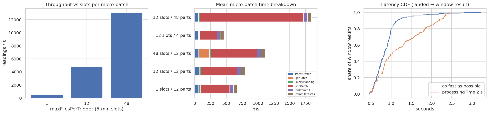

# Q15 — Simulated-stream throughput and latency benchmarks

**Question.** Can Spark Structured Streaming process the PEMS-BAY sensor stream fast enough for real-time 5-minute predictions on this machine, and which settings matter?

## Method

- Replay of real test-period readings from 2017-06-05: one CSV file per 5-minute slot (325 readings), landed atomically (write, then rename) into a directory watched by the Structured Streaming **file source**.
- Query: stream–static join with the train-period sensor statistics (broadcast), congestion flag, speed ratio, then `groupBy(window(ts, 15 min, 5 min), sensor_id)` with `withWatermark(10 min)` (stateful), output mode *update*, `foreachBatch` sink. Checkpoints go to the Linux scratch disk.
- Throughput: 576 pre-landed slots (187,200 readings), `trigger(availableNow=True)`, varying `maxFilesPerTrigger` (1 / 12 / 48 slots per micro-batch) and `spark.sql.shuffle.partitions` (state-store partitions: 4 / 12 / 48). Metrics come from `StreamingQuery.recentProgress`.
- Latency: 120 slots landed live, one every 0.5 s (600× real time), with the default trigger (next batch as soon as possible) and `processingTime='2 seconds'`. Latency per output row = sink time − landing time of the newest reading in that window.
- Model scoring: Q16's saved PipelineModel applied to static batches of 1 slot, 1 hour and 4 hours of feature rows (median of 5 timed runs after a warm-up).

## Key findings

- Peak throughput **13,096 readings/s** (40.5 five-minute slots per second) with 48 slots per micro-batch and 12 shuffle partitions: about **12,146× faster than real time** for the 325-sensor network (one slot arrives every 300 s).
- Micro-batch size matters: one slot per batch reaches only 469 readings/s (median batch 652 ms, dominated by fixed per-batch overhead: planning 24 ms, commit 125 ms).
- State-store partitions: 4 → 8,187 readings/s (batch p50 448 ms), 12 → 4,725 readings/s (batch p50 684 ms), 48 → 2,067 readings/s (batch p50 1828 ms). Each partition is a separate state store, so too many small partitions add overhead.
- End-to-end latency (file landed → window result in the sink) at 600× real-time arrival: median **0.83 s**, p95 1.42 s with the default trigger; 1.04 s / 2.32 s with a 2 s processing-time trigger. Both are far below the 5-minute prediction horizon.
- Model scoring (Logistic regression): 322 rows (one slot) in a median 138 ms; 82,628 rows/s for a 4-hour batch. Scoring adds well under a second per slot.

## Tables

**Throughput by micro-batch size and shuffle partitions (trigger availableNow)** ([CSV](tables/q15_throughput.csv))

| max_files_per_trigger | shuffle_partitions | files | input_rows | wall_s | rows_per_s | slots_per_s | batches | rows | batch_ms_p50 | batch_ms_p95 | mean_latestOffset_ms | mean_getBatch_ms | mean_queryPlanning_ms | mean_addBatch_ms | mean_walCommit_ms | mean_commitOffsets_ms |
|---|---|---|---|---|---|---|---|---|---|---|---|---|---|---|---|---|
| 1 | 12 | 96 | 31,199 | 66.583 | 468.574 | 1.442 | 96 | 31,199 | 652.500 | 814.750 | 62.833 | 5.854 | 23.531 | 461.312 | 59.948 | 64.562 |
| 12 | 12 | 576 | 186,320 | 39.434 | 4,724.873 | 14.607 | 48 | 186,320 | 684.000 | 1,320.950 | 68.875 | 6.521 | 23.562 | 569.625 | 64.062 | 68.208 |
| 48 | 12 | 576 | 186,320 | 14.227 | 13,096.078 | 40.486 | 12 | 186,320 | 1,076.500 | 1,582.700 | 64.250 | 169.583 | 25.417 | 727.333 | 62.083 | 63.667 |
| 12 | 4 | 576 | 186,320 | 22.757 | 8,187.470 | 25.311 | 48 | 186,320 | 447.500 | 532.950 | 55.229 | 5.167 | 18.104 | 273.271 | 53.438 | 56.104 |
| 12 | 48 | 576 | 186,320 | 90.152 | 2,066.741 | 6.389 | 48 | 186,320 | 1,827.500 | 2,120.850 | 60.854 | 5.500 | 20.042 | 1,633.396 | 58.542 | 63.021 |

**End-to-end latency with live arrivals (600× real time)** ([CSV](tables/q15_latency.csv))

| trigger | files | arrival_interval_s | simulated_speedup | latency_ms_p50 | latency_ms_p95 | latency_ms_max | output_rows | batches | rows | batch_ms_p50 | batch_ms_p95 | mean_latestOffset_ms | mean_getBatch_ms | mean_queryPlanning_ms | mean_addBatch_ms | mean_walCommit_ms | mean_commitOffsets_ms |
|---|---|---|---|---|---|---|---|---|---|---|---|---|---|---|---|---|---|
| as_fast_as_possible | 120 | 0.500 | 600.000 | 829.644 | 1,416.674 | 3,220.404 | 98,677 | 92 | 38,951 | 608.500 | 1,002.700 | 66.283 | 4.587 | 18.891 | 444.326 | 60.946 | 65.978 |
| processingTime_2_s | 120 | 0.500 | 600.000 | 1,037.238 | 2,324.329 | 2,459.639 | 59,077 | 31 | 38,951 | 503.000 | 613.500 | 82.032 | 3.645 | 13.645 | 321.516 | 50.516 | 50.871 |

**Model scoring latency on micro-batch-sized inputs** ([CSV](tables/q15_scoring.csv))

| batch | rows | median_ms | p95_ms | rows_per_s | model |
|---|---|---|---|---|---|
| 1 slot (5 min) | 322 | 138.487 | 145.591 | 2,325.135 | Logistic regression |
| 1 hour | 3,855 | 174.726 | 186.451 | 22,063.129 | Logistic regression |
| 4 hours | 15,411 | 186.510 | 195.498 | 82,628.494 | Logistic regression |

## Figures

**Streaming throughput, batch-time breakdown and latency distribution**

## Interpretation & implications for TrafficSense

- A single laptop processes the 325-sensor stream several orders of magnitude faster than real time, so Phase 7 can afford the full feature set plus model scoring in each 5-minute micro-batch.
- Use small, regular micro-batches (default or a few-second processing-time trigger) for latency, and around 12 shuffle partitions (≈ cores) for the state store. Larger batches only help when catching up a backlog.
- Per-batch fixed overhead (planning, offset/commit logs) dominates small batches; Kafka will change the source overhead but not the stateful aggregation or the commit costs.

## Limitations

- File source and accelerated replay stand in for Kafka; network, broker and serialization costs are not included yet.
- Single machine in local mode (shared CPU with the driver); results are for this laptop, not a cluster.
- Latency is measured from file landing to the sink; production latency also includes sensor → Kafka transport.

_Computed in 503.5 s · 2026-10-20 13:54 UTC._
