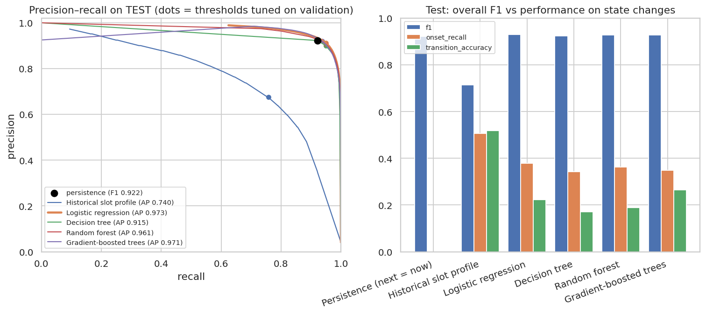
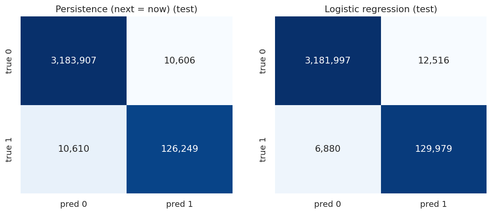

# Q16 — Five-minute-ahead congestion prediction: comparative metrics

**Question.** How well do Spark MLlib models predict whether a sensor will be congested in the next 5 minutes, compared with simple baselines, and where do they add value?

## Method

- Training data: random 8% sample of the **training period only** (890,194 rows, 3.8% positive), class-weighted so both classes carry equal weight (w₊ = 13.1, w₋ = 0.52). All 41 Phase-3 features.
- Models (Spark MLlib Pipeline: VectorAssembler → classifier): Logistic regression {'maxIter': 60, 'regParam': 0.001, 'standardization': True}; Decision tree {'maxDepth': 10, 'minInstancesPerNode': 50}; Random forest {'numTrees': 60, 'maxDepth': 10, 'subsamplingRate': 0.7, 'featureSubsetStrategy': 'sqrt'}; Gradient-boosted trees {'maxIter': 60, 'maxDepth': 6, 'stepSize': 0.1, 'subsamplingRate': 0.8}.
- Baselines: **persistence** (next state = current state) and **historical profile** (train-period congestion rate of this sensor at the target's weekday and slot).
- Threshold for each model = maximum F1 on **validation**, then applied unchanged to **test** (persistence uses its natural 0/1 output).
- Evaluation from one Spark aggregation per model and split (counts per day × current state × label × 500 probability buckets): precision, recall, F1, PR-AUC (average precision), ROC-AUC, onset recall, clearance accuracy, transition accuracy and false-alarm rate. Test-F1 confidence intervals come from a day-block bootstrap (1,000 resamples of test days).

## Key findings

- Best model on validation: **Logistic regression**. Test F1 **0.931** (95% CI 0.927–0.934), PR-AUC 0.973, ROC-AUC 0.999, precision 0.912, recall 0.950 at threshold 0.924.
- It beats persistence (F1 0.922) by **+0.008** F1 (95% CI +0.007 to +0.009; better in 100.0% of bootstrap resamples), a statistically clear gain.
- The value is in **state changes**: the model catches 37.9% of congestion onsets and correctly predicts 6.5% of clearances (persistence: 0% and 0% by construction); transition accuracy 22.2%, at a false-alarm rate of 0.08% on stable free-flow rows.
- The historical-profile baseline alone reaches F1 0.714 (PR-AUC 0.740): recurrence helps, but live state dominates at 5 minutes.
- Model ranking by test F1: Logistic regression 0.931, Gradient-boosted trees 0.929, Random forest 0.927, Decision tree 0.924. Training on 890,194 rows took Logistic regression 19s, Decision tree 7s, Random forest 47s, Gradient-boosted trees 89s.

## Tables

**Test metrics (thresholds tuned on validation) with day-block bootstrap CIs vs persistence** ([CSV](tables/q16_test_metrics.csv))

| model | key | precision | recall | f1 | pr_auc | roc_auc | onset_recall | clearance_accuracy | transition_accuracy | false_alarm_rate | threshold | train_s | rows | f1_ci_low | f1_ci_high | delta_vs_persistence | delta_ci_low | delta_ci_high | share_boot_better |
|---|---|---|---|---|---|---|---|---|---|---|---|---|---|---|---|---|---|---|---|
| Logistic regression | logistic_regression | 0.912 | 0.950 | 0.931 | 0.973 | 0.999 | 0.379 | 0.065 | 0.222 | 0.001 | 0.924 | 19.374 | 3,331,372 | 0.927 | 0.934 | 0.008 | 0.007 | 0.009 | 1.000 |
| Gradient-boosted trees | gbt | 0.920 | 0.938 | 0.929 | 0.971 | 0.999 | 0.348 | 0.180 | 0.264 | 0.001 | 0.940 | 89.485 | 3,331,372 | 0.925 | 0.932 | 0.006 | 0.005 | 0.007 | 1.000 |
| Random forest | random_forest | 0.906 | 0.950 | 0.927 | 0.961 | 0.999 | 0.363 | 0.015 | 0.189 | 0.001 | 0.922 | 47.367 | 3,331,372 | 0.924 | 0.931 | 0.005 | 0.004 | 0.006 | 1.000 |
| Decision tree | decision_tree | 0.900 | 0.949 | 0.924 | 0.915 | 0.996 | 0.344 | 0.000 | 0.172 | 0.001 | 0.934 | 7.404 | 3,331,372 | 0.920 | 0.927 | 0.001 | 0.001 | 0.002 | 1.000 |
| Persistence (next = now) | persistence | 0.923 | 0.922 | 0.922 | 0.854 | 0.960 | 0.000 | 0.000 | 0.000 | 0.000 | 0.500 | 0.000 | 3,331,372 | 0.919 | 0.926 | 0.000 | 0.000 | 0.000 | 0.000 |
| Historical slot profile | historical_profile | 0.675 | 0.757 | 0.714 | 0.740 | 0.950 | 0.507 | 0.531 | 0.519 | 0.014 | 0.278 | 0.000 | 3,331,372 | 0.674 | 0.741 | -0.209 | -0.247 | -0.183 | 0.000 |

**Validation metrics** ([CSV](tables/q16_val_metrics.csv))

| model | key | precision | recall | f1 | pr_auc | roc_auc | onset_recall | clearance_accuracy | transition_accuracy | false_alarm_rate | threshold | train_s | rows |
|---|---|---|---|---|---|---|---|---|---|---|---|---|---|
| Persistence (next = now) | persistence | 0.928 | 0.927 | 0.927 | 0.864 | 0.962 | 0.000 | 0.000 | 0.000 | 0.000 | 0.500 | 0.000 | 1,661,630 |
| Historical slot profile | historical_profile | 0.769 | 0.768 | 0.769 | 0.813 | 0.961 | 0.470 | 0.547 | 0.508 | 0.011 | 0.278 | 0.000 | 1,661,630 |
| Logistic regression | logistic_regression | 0.919 | 0.953 | 0.935 | 0.977 | 0.999 | 0.365 | 0.056 | 0.210 | 0.001 | 0.924 | 19.374 | 1,661,630 |
| Decision tree | decision_tree | 0.907 | 0.952 | 0.929 | 0.921 | 0.996 | 0.338 | 0.000 | 0.169 | 0.001 | 0.934 | 7.404 | 1,661,630 |
| Random forest | random_forest | 0.913 | 0.953 | 0.932 | 0.965 | 0.999 | 0.358 | 0.017 | 0.187 | 0.001 | 0.922 | 47.367 | 1,661,630 |
| Gradient-boosted trees | gbt | 0.925 | 0.945 | 0.935 | 0.975 | 0.999 | 0.345 | 0.167 | 0.256 | 0.001 | 0.940 | 89.485 | 1,661,630 |

**Top-20 feature importances (Gradient-boosted trees)** ([CSV](tables/q16_importances.csv))

| feature | importance | group |
|---|---|---|
| speed | 0.492 | current |
| speed_ratio_ff | 0.418 | current |
| delta_5m | 0.016 | lag |
| delta_15m | 0.009 | lag |
| hist_congested_rate_next | 0.005 | profile |
| speed_lag_5m | 0.004 | lag |
| roll_mean_15m | 0.004 | rolling |
| roll_min_60m | 0.004 | rolling |
| roll_std_60m | 0.004 | rolling |
| sensor_congested_rate | 0.003 | sensor |
| tod_cos | 0.003 | temporal |
| slot_of_day | 0.003 | temporal |

_12 of 20 rows shown; full table in the CSV._

**Training time and scoring throughput (val + test, including aggregation)** ([CSV](tables/q16_training.csv))

| model | train_seconds | scoring_rows_per_second |
|---|---|---|
| Logistic regression | 19.374 | 388,809.914 |
| Decision tree | 7.404 | 428,300.182 |
| Random forest | 47.367 | 153,245.041 |
| Gradient-boosted trees | 89.485 | 178,196.300 |

## Figures

**Precision–recall curves and transition metrics on the test period**

**Confusion matrices on test (colour = row-normalised rate, numbers = counts)**

## Interpretation & implications for TrafficSense

- Deploy **Logistic regression** in the streaming pipeline (saved as a Spark PipelineModel at `data/models/pems_bay/best_model`) with threshold 0.924. Report the persistence baseline beside it on the dashboard so users can judge its added value.
- Judge the model on onset/clearance metrics, not overall accuracy: on stable rows persistence is almost always right.
- Class weights shift probabilities upwards; use the tuned threshold, and do not read raw probabilities as calibrated risks (see Q18 calibration).

## Limitations

- Trained on a 8% sample of the training period to fit a 7.6 GB laptop; more data and hyper-parameter search (CrossValidator with time-blocked folds) may improve the tree models.
- PR-AUC/ROC-AUC are computed from a 500-bucket histogram of probabilities (the same approximation MLlib uses with numBins).
- One random seed per model; the bootstrap captures test-day variability, not training variability.

_Computed in 322.1 s · 2026-10-20 13:39 UTC._
