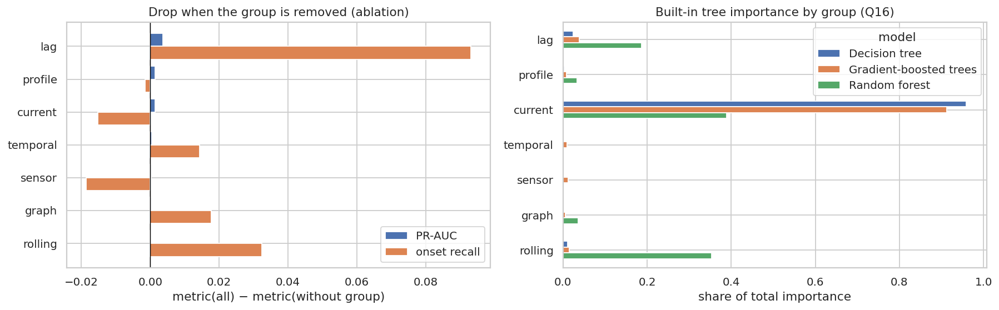

# Q17 — Feature-group contribution and ablation

**Question.** Which groups of engineered features actually drive the 5-minute congestion predictions, and which are redundant?

## Method

- Compact GBT {'maxIter': 30, 'maxDepth': 5, 'stepSize': 0.15, 'subsamplingRate': 0.8} trained on a 3% class-weighted sample of the training period (332,431 rows) for every variant, with the same seed and sample.
- Variants: all features; **leave one group out** for each of the 7 groups (temporal (9), current (4), lag (9), rolling (7), graph (4), sensor (6), profile (2)); and a minimal model using only the current state and lags.
- Validation days are split chronologically: the threshold is tuned (max F1) on the first half and metrics are reported on the second half. The contribution of a group = metric(all) − metric(without group).
- For comparison, the built-in tree importances of the Q16 models (from the model registry) are summed per group.

## Key findings

- With all 41 features the compact GBT reaches PR-AUC 0.978, F1 0.934 and onset recall 31.1% on the held-out validation days.
- Largest contribution: **lag** (removing it lowers PR-AUC by 0.004 and onset recall by 9.3 pp), followed by profile (0.001 PR-AUC).
- For predicting **onsets**, the most important group is **lag** (−9.3 pp onset recall when removed).
- Groups whose removal changes PR-AUC by less than 0.005: lag, profile, current, temporal, sensor, graph, rolling. They are redundant given the others, because their information is also carried by correlated features.
- A minimal model with only the current state and lags (13 features) reaches PR-AUC 0.977 (-0.001 vs all) and onset recall 32.0% (+0.9 pp).
- Built-in importance (Decision tree, Q16) ranks current (95.9%) and lag (2.4%) highest. Importance measures how often a group is used, ablation how much it is irreplaceable; the two need not agree when features are correlated.

## Tables

**Leave-one-group-out ablation (contribution = all − without; higher = more important)** ([CSV](tables/q17_ablation.csv))

| group | features | contribution_pr_auc | contribution_onset_recall | delta_f1 | delta_transition_accuracy | delta_false_alarm_rate | pr_auc | onset_recall | train_s |
|---|---|---|---|---|---|---|---|---|---|
| lag | 32 | 0.004 | 0.093 | -0.001 | -0.054 | -0.000 | 0.975 | 0.218 | 18.283 |
| profile | 39 | 0.001 | -0.002 | 0.000 | -0.009 | -0.000 | 0.977 | 0.312 | 19.619 |
| current | 37 | 0.001 | -0.015 | -0.003 | 0.058 | 0.000 | 0.977 | 0.326 | 19.120 |
| temporal | 32 | 0.000 | 0.014 | 0.001 | -0.015 | -0.000 | 0.978 | 0.296 | 18.482 |
| sensor | 35 | 0.000 | -0.019 | 0.000 | -0.005 | 0.000 | 0.978 | 0.329 | 22.256 |
| graph | 37 | 0.000 | 0.018 | 0.001 | -0.016 | -0.000 | 0.978 | 0.293 | 21.405 |
| rolling | 34 | 0.000 | 0.032 | 0.001 | -0.008 | -0.000 | 0.978 | 0.278 | 19.126 |

**All variants with absolute metrics (held-out validation days)** ([CSV](tables/q17_variants.csv))

| variant | features | train_s | pr_auc | f1 | onset_recall | clearance_accuracy | transition_accuracy | false_alarm_rate | delta_pr_auc | delta_f1 | delta_onset_recall | delta_clearance_accuracy | delta_transition_accuracy | delta_false_alarm_rate |
|---|---|---|---|---|---|---|---|---|---|---|---|---|---|---|
| all features | 41 | 26.569 | 0.978 | 0.934 | 0.311 | 0.161 | 0.236 | 0.001 | 0.000 | 0.000 | 0.000 | 0.000 | 0.000 | 0.000 |
| without temporal | 32 | 18.482 | 0.978 | 0.935 | 0.296 | 0.144 | 0.220 | 0.001 | -0.000 | 0.001 | -0.014 | -0.016 | -0.015 | -0.000 |
| without current | 37 | 19.120 | 0.977 | 0.931 | 0.326 | 0.261 | 0.293 | 0.001 | -0.001 | -0.003 | 0.015 | 0.100 | 0.058 | 0.000 |
| without lag | 32 | 18.283 | 0.975 | 0.934 | 0.218 | 0.146 | 0.182 | 0.000 | -0.004 | -0.001 | -0.093 | -0.014 | -0.054 | -0.000 |
| without rolling | 34 | 19.126 | 0.978 | 0.935 | 0.278 | 0.177 | 0.228 | 0.001 | -0.000 | 0.001 | -0.032 | 0.017 | -0.008 | -0.000 |
| without graph | 37 | 21.405 | 0.978 | 0.935 | 0.293 | 0.147 | 0.220 | 0.001 | -0.000 | 0.001 | -0.018 | -0.014 | -0.016 | -0.000 |
| without sensor | 35 | 22.256 | 0.978 | 0.934 | 0.329 | 0.132 | 0.231 | 0.001 | -0.000 | 0.000 | 0.019 | -0.029 | -0.005 | 0.000 |
| without profile | 39 | 19.619 | 0.977 | 0.935 | 0.312 | 0.142 | 0.227 | 0.001 | -0.001 | 0.000 | 0.002 | -0.019 | -0.009 | -0.000 |
| current + lag only | 13 | 16.340 | 0.977 | 0.935 | 0.320 | 0.102 | 0.211 | 0.001 | -0.001 | 0.001 | 0.009 | -0.058 | -0.024 | 0.000 |

**Built-in tree importance summed per feature group (Q16 models)** ([CSV](tables/q17_importance_by_group.csv))

| group | Decision tree | Gradient-boosted trees | Random forest |
|---|---|---|---|
| current | 0.959 | 0.912 | 0.389 |
| graph | 0.001 | 0.005 | 0.035 |
| lag | 0.024 | 0.038 | 0.186 |
| profile | 0.003 | 0.008 | 0.033 |
| rolling | 0.011 | 0.015 | 0.353 |
| sensor | 0.001 | 0.012 | 0.001 |
| temporal | 0.001 | 0.010 | 0.002 |

**Feature groups** ([CSV](tables/q17_groups.csv))

| group | features |
|---|---|
| temporal | hour, slot_of_day, day_of_week, is_weekend, is_holiday, tod_sin, tod_cos, dow_sin, dow_cos |
| current | speed, is_imputed, congested_now, speed_ratio_ff |
| lag | speed_lag_5m, speed_lag_10m, speed_lag_15m, speed_lag_30m, speed_lag_60m, speed_target_slot_1d, speed_target_slot_1w, delta_5m, delta_15m |
| rolling | roll_mean_15m, roll_mean_30m, roll_mean_60m, roll_std_60m, roll_min_60m, congested_frac_60m, imputed_count_60m |
| graph | nbr_up_speed, nbr_down_speed, nbr_up_congested_frac, nbr_down_congested_frac |
| sensor | latitude, longitude, in_degree, out_degree, ff_speed, sensor_congested_rate |
| profile | hist_speed_next, hist_congested_rate_next |

## Figures

**Feature-group contribution: ablation vs built-in importance**

## Interpretation & implications for TrafficSense

- Keep the lag and profile groups in the streaming feature pipeline; they carry most of the signal.
- Redundant groups (lag, profile, current, temporal, sensor, graph, rolling) could be dropped from the streaming job to cut latency and state size, with negligible accuracy loss.
- Ablation is the evidence to quote in the report; built-in importances are biased towards high-cardinality, frequently split features.

## Limitations

- Ablation uses a compact GBT on a 3% sample, chosen for runtime; absolute metrics are lower than Q16's full models, but all variants are compared under identical conditions.
- Leave-one-group-out underestimates groups whose information is duplicated elsewhere (correlated features).

_Computed in 241.1 s · 2026-10-20 13:43 UTC._
