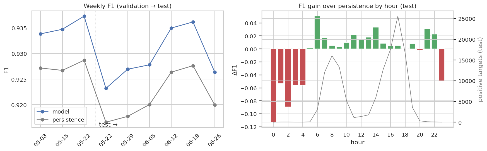
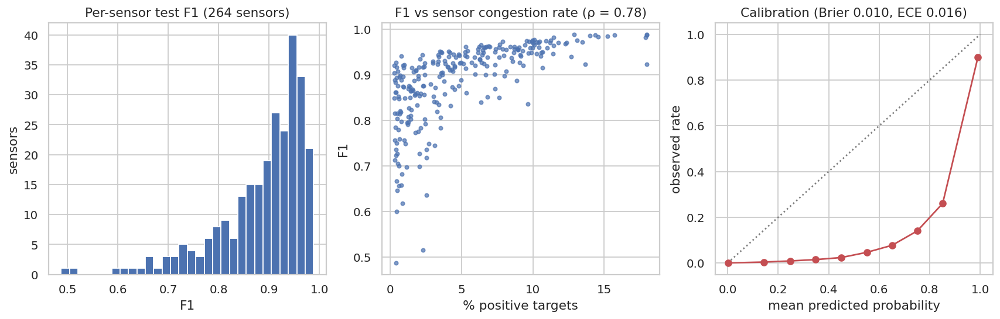

# Q18 — Model generalization across time periods and sensors

**Question.** Does the selected model perform consistently across weeks, months, times of day, day types and individual sensors, and can it generalize to sensors it was not trained on?

## Method

- Model: **Logistic regression** from Q16, threshold 0.924 (tuned on validation); its saved validation and test predictions are segmented. Every segment also gets the persistence baseline (gain = F1 − persistence F1).
- Time: ISO week (validation + test), month, hour of day and day type (test). Drift is the trend of weekly F1.
- Sensors: per-sensor test F1 for sensors with ≥ 30 positive targets; relation to congestion level.
- Calibration on test: reliability by probability decile, Brier score, expected calibration error (ECE).
- Sensor hold-out: about 20% of sensors are hidden (deterministic hash). A compact GBT is trained (a) on all sensors, (b) on the other 80% only, and (c) on the other 80% without sensor-specific history (sensor + profile groups, a 'cold-start' sensor). All three are evaluated on the hidden sensors' test rows, with thresholds tuned on validation rows of the training sensors.

## Key findings

- Across 9 weeks (validation + test), weekly F1 ranges 0.923–0.937 (std 0.005) with a trend of -0.004 per 10 weeks: no meaningful drift.
- By month: 2017-05 F1 0.933 (gain +0.008), 2017-06 F1 0.932 (gain +0.008).
- By hour (test), the model adds most over persistence at 06:00 (+0.051 F1); F1 is lowest at 05:00 (0.725, 113 positives; hours with ≥ 100 positives). Day types: holiday 0.672, weekend 0.905, working day 0.931.
- Per sensor (264 sensors with ≥ 30 positives): median F1 0.916, IQR 0.852–0.949. Spearman ρ = 0.78 with the sensor's congestion rate, so the model is better on frequently congested sensors.
- Sensor hold-out (65 hidden sensors): F1 0.910 when trained on all sensors, 0.909 when the sensors are unseen (-0.001), and 0.908 for a cold-start sensor without history features (persistence 0.905).
- Calibration (test): Brier 0.0102, ECE 0.016. Probabilities are over-confident (above observed rates) as expected from class weighting, so use the tuned threshold rather than raw probabilities.

## Tables

**Weekly performance (validation + test)** ([CSV](tables/q18_weeks.csv))

| split | week | f1 | persistence_f1 | gain_vs_persistence | precision | recall | onset_recall | transition_accuracy | positives | rows |
|---|---|---|---|---|---|---|---|---|---|---|
| val | 2017-05-08 | 0.934 | 0.927 | 0.007 | 0.916 | 0.952 | 0.360 | 0.205 | 28,764.000 | 645,219.000 |
| val | 2017-05-15 | 0.935 | 0.927 | 0.008 | 0.918 | 0.952 | 0.366 | 0.215 | 29,468.000 | 647,004.000 |
| val | 2017-05-22 | 0.937 | 0.929 | 0.009 | 0.921 | 0.954 | 0.369 | 0.211 | 26,537.000 | 369,407.000 |
| test | 2017-05-22 | 0.923 | 0.917 | 0.007 | 0.901 | 0.947 | 0.403 | 0.228 | 3,632.000 | 278,107.000 |
| test | 2017-05-29 | 0.927 | 0.918 | 0.009 | 0.908 | 0.947 | 0.375 | 0.218 | 22,994.000 | 650,077.000 |
| test | 2017-06-05 | 0.928 | 0.920 | 0.008 | 0.908 | 0.948 | 0.367 | 0.217 | 27,220.000 | 649,184.000 |
| test | 2017-06-12 | 0.935 | 0.926 | 0.009 | 0.917 | 0.954 | 0.393 | 0.226 | 27,983.000 | 648,573.000 |
| test | 2017-06-19 | 0.936 | 0.928 | 0.009 | 0.920 | 0.953 | 0.391 | 0.234 | 29,892.000 | 643,876.000 |
| test | 2017-06-26 | 0.926 | 0.920 | 0.006 | 0.907 | 0.947 | 0.363 | 0.213 | 25,138.000 | 461,555.000 |

**Monthly performance** ([CSV](tables/q18_months.csv))

| month | f1 | persistence_f1 | gain_vs_persistence | precision | recall | onset_recall | transition_accuracy | positives | rows |
|---|---|---|---|---|---|---|---|---|---|
| 2017-05 | 0.933 | 0.926 | 0.008 | 0.916 | 0.951 | 0.367 | 0.213 | 100,089.000 | 2,219,214 |
| 2017-06 | 0.932 | 0.923 | 0.008 | 0.913 | 0.950 | 0.379 | 0.222 | 121,539.000 | 2,773,788 |

**Performance by hour of day (test)** ([CSV](tables/q18_hours.csv))

| hour | f1 | persistence_f1 | gain_vs_persistence | precision | recall | onset_recall | transition_accuracy | positives | rows |
|---|---|---|---|---|---|---|---|---|---|
| 0.000 | 0.240 | 0.353 | -0.113 | 0.188 | 0.333 | 0.000 | 0.000 | 9.000 | 139,017.000 |
| 1.000 | 0.492 | 0.545 | -0.053 | 0.432 | 0.571 | 0.154 | 0.120 | 56.000 | 139,542.000 |
| 2.000 | 0.514 | 0.603 | -0.089 | 0.444 | 0.610 | 0.167 | 0.087 | 59.000 | 139,534.000 |
| 3.000 | 0.326 | 0.381 | -0.055 | 0.246 | 0.483 | 0.235 | 0.103 | 29.000 | 139,498.000 |
| 4.000 | 0.286 | 0.341 | -0.056 | 0.214 | 0.429 | 0.143 | 0.074 | 21.000 | 139,387.000 |
| 5.000 | 0.725 | 0.724 | 0.001 | 0.659 | 0.805 | 0.459 | 0.310 | 113.000 | 139,346.000 |
| 6.000 | 0.911 | 0.861 | 0.051 | 0.911 | 0.912 | 0.602 | 0.527 | 3,050.000 | 139,331.000 |
| 7.000 | 0.920 | 0.904 | 0.017 | 0.909 | 0.932 | 0.457 | 0.309 | 12,078.000 | 139,348.000 |
| 8.000 | 0.931 | 0.926 | 0.005 | 0.913 | 0.950 | 0.344 | 0.189 | 16,026.000 | 139,254.000 |
| 9.000 | 0.936 | 0.932 | 0.004 | 0.912 | 0.961 | 0.306 | 0.159 | 13,276.000 | 139,131.000 |
| 10.000 | 0.885 | 0.875 | 0.010 | 0.827 | 0.952 | 0.211 | 0.126 | 5,108.000 | 138,995.000 |
| 11.000 | 0.889 | 0.868 | 0.021 | 0.874 | 0.905 | 0.254 | 0.209 | 1,125.000 | 138,984.000 |

_12 of 24 rows shown; full table in the CSV._

**Performance by day type (test)** ([CSV](tables/q18_day_types.csv))

| day_type | f1 | persistence_f1 | gain_vs_persistence | precision | recall | onset_recall | transition_accuracy | positives | rows |
|---|---|---|---|---|---|---|---|---|---|
| holiday | 0.672 | 0.703 | -0.031 | 0.750 | 0.609 | 0.000 | 0.250 | 128.000 | 93,099.000 |
| weekend | 0.905 | 0.904 | 0.001 | 0.895 | 0.915 | 0.278 | 0.190 | 3,499.000 | 924,780.000 |
| working day | 0.931 | 0.923 | 0.008 | 0.913 | 0.951 | 0.383 | 0.223 | 133,232.000 | 2,313,493 |

**Sensor hold-out experiment (metrics on hidden sensors' test rows)** ([CSV](tables/q18_sensor_holdout.csv))

| setting | features | train_rows | f1 | pr_auc | precision | recall | onset_recall | transition_accuracy |
|---|---|---|---|---|---|---|---|---|
| trained on all sensors | 41 | 334,122 | 0.910 | 0.960 | 0.903 | 0.917 | 0.275 | 0.223 |
| trained without hidden sensors | 41 | 267,058 | 0.909 | 0.957 | 0.898 | 0.920 | 0.263 | 0.195 |
| cold start (no sensor history features) | 33 | 267,058 | 0.908 | 0.958 | 0.899 | 0.918 | 0.255 | 0.190 |
| persistence baseline | 1 | 0 | 0.905 | 0.822 | 0.905 | 0.905 | 0.000 | 0.000 |

**Reliability by predicted-probability decile (test)** ([CSV](tables/q18_calibration.csv))

| bin | n | mean_predicted | observed_rate |
|---|---|---|---|
| 0 | 3,097,308 | 0.003 | 0.000 |
| 1 | 22,562.000 | 0.143 | 0.004 |
| 2 | 12,641.000 | 0.247 | 0.009 |
| 3 | 9,417.000 | 0.348 | 0.015 |
| 4 | 8,205.000 | 0.449 | 0.024 |
| 5 | 7,687.000 | 0.551 | 0.046 |
| 6 | 8,258.000 | 0.651 | 0.077 |
| 7 | 9,285.000 | 0.751 | 0.140 |
| 8 | 10,430.000 | 0.851 | 0.260 |
| 9 | 145,579.000 | 0.991 | 0.901 |

**Per-sensor test performance (weakest first)** ([CSV](tables/q18_sensors.csv))

| sensor_id | f1 | precision | recall | onset_recall | positives | rows | positive_rate |
|---|---|---|---|---|---|---|---|
| 401,541 | 0.487 | 0.528 | 0.452 | 0.000 | 42.000 | 10,366.000 | 0.004 |
| 400,922 | 0.515 | 0.562 | 0.475 | 0.000 | 238.000 | 10,366.000 | 0.023 |
| 401,560 | 0.600 | 0.588 | 0.612 | 0.095 | 49.000 | 10,367.000 | 0.005 |
| 401,351 | 0.617 | 0.500 | 0.807 | 0.370 | 88.000 | 10,366.000 | 0.008 |
| 400,964 | 0.635 | 0.633 | 0.638 | 0.020 | 265.000 | 10,367.000 | 0.026 |
| 402,284 | 0.646 | 0.547 | 0.788 | 0.000 | 52.000 | 10,366.000 | 0.005 |
| 402,057 | 0.657 | 0.616 | 0.703 | 0.240 | 64.000 | 10,366.000 | 0.006 |
| 400,343 | 0.658 | 0.738 | 0.593 | 0.000 | 81.000 | 10,366.000 | 0.008 |
| 402,372 | 0.667 | 0.689 | 0.646 | 0.062 | 48.000 | 10,367.000 | 0.005 |
| 400,514 | 0.682 | 0.699 | 0.667 | 0.103 | 87.000 | 10,366.000 | 0.008 |
| 403,404 | 0.697 | 0.689 | 0.706 | 0.081 | 119.000 | 10,366.000 | 0.011 |
| 400,837 | 0.699 | 0.727 | 0.673 | 0.000 | 214.000 | 10,366.000 | 0.021 |

_12 of 264 rows shown; full table in the CSV._

## Figures

**Generalization over time: weekly F1 and hourly gain over persistence**

**Generalization across sensors and probability calibration**

## Interpretation & implications for TrafficSense

- Performance is stable over the validation and test weeks, so a monthly retraining schedule with weekly monitoring of F1 against persistence is sufficient.
- New sensors: the model still beats persistence without sensor history (cold start), but accuracy improves once a few weeks of history exist for the sensor-statistics and profile features.
- On the dashboard, show the per-sensor reliability (F1 from this analysis) next to each prediction.

## Limitations

- Six months of data allow only short-term drift analysis; seasonal drift (summer/holidays) is not covered.
- The hold-out experiment uses compact models on a small sample; its absolute F1 is lower than Q16's, so compare settings with each other.
- Hidden sensors are still neighbours of training sensors, so spatial generalization to a different city is not tested.

_Computed in 131.1 s · 2026-10-20 13:45 UTC._
