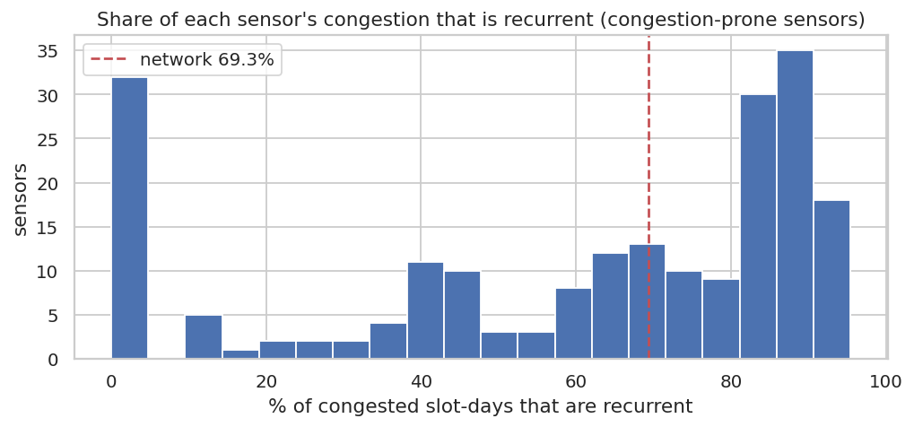
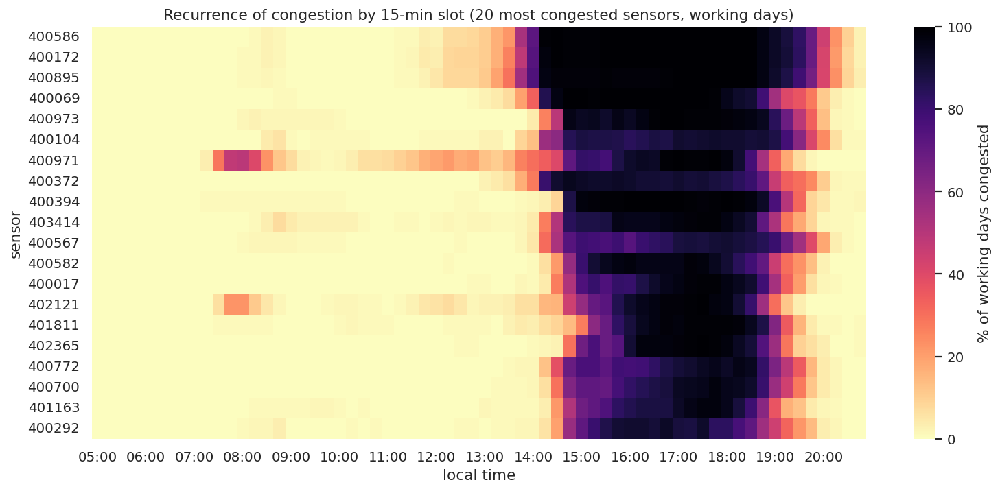
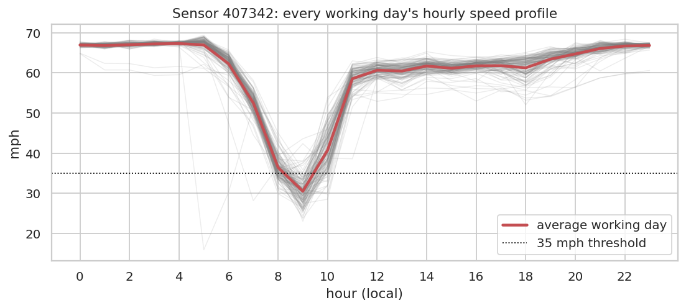

# Q2 — Consistency of recurring traffic profiles

**Question.** Is congestion recurrent (same place, same time, most working days) or sporadic, and how consistent are each sensor's daily speed profiles from day to day?

## Method

- Working days only (weekends and federal holidays excluded), observed readings.
- `groupBy(sensor, date, slot15).max(congested)` → was the sensor congested in that 15-min slot that day?
- Recurrence of a (sensor, slot15) = share of working days it was congested; ≥ 50% = **recurrent** slot. Each congested sensor-slot-day is classified as recurrent or non-recurrent (the FHWA recurrent/non-recurrent split).
- Profile consistency: hourly mean speed per (sensor, day) vs the sensor's average working-day profile, using Spark's `corr` aggregate and the RMSE per day, then the median per sensor.
- Timing consistency: for congestion-prone sensors, the standard deviation across days of the first congested 15-min slot in the PM window (15–20h).

## Key findings

- **69.3%** of all congested sensor-slot-days on working days are **recurrent** (the slot is congested on ≥ 50% of working days); the remaining 30.7% are non-recurrent (incidents, special events, demand spikes). Total: 246,448 congested sensor-slot-days.
- Of 210 congestion-prone sensors (≥ 2% of working-day readings congested), 109 are highly recurrent (≥ 70% of their congestion is recurrent) and 42 are mostly sporadic (< 30%).
- Daily speed profiles of congestion-prone sensors closely follow their average profile: median day-vs-average correlation 0.96, median RMSE 4.1 mph.
- PM congestion starts at a consistent time: median day-to-day standard deviation of the onset is 38 minutes (sensor 407342 is the most consistent profile, r = 0.99).
- 115 sensors rarely congest (< 2%); their profiles are flat, so correlation is not meaningful for them.

## Tables

**Congestion-prone sensors (≥ 2% of working-day readings), most congested first** ([CSV](tables/q2_prone_sensors.csv))

| sensor_id | workday_congestion_rate | congested_slot_days | recurrent_share | median_profile_corr | median_profile_rmse_mph | pm_congested_days | median_pm_onset | pm_onset_std_min |
|---|---|---|---|---|---|---|---|---|
| 400,586 | 0.253 | 3,173.000 | 0.934 | 0.984 | 3.522 | 126.000 | 15:00 | 2.673 |
| 400,172 | 0.253 | 3,175.000 | 0.913 | 0.984 | 3.988 | 126.000 | 15:00 | 2.673 |
| 400,895 | 0.252 | 3,139.000 | 0.930 | 0.985 | 3.718 | 125.000 | 15:00 | 9.746 |
| 400,069 | 0.208 | 2,627.000 | 0.907 | 0.980 | 4.398 | 126.000 | 15:00 | 0.000 |
| 400,973 | 0.199 | 2,509.000 | 0.904 | 0.976 | 4.035 | 126.000 | 15:00 | 9.807 |
| 400,104 | 0.195 | 2,481.000 | 0.940 | 0.976 | 4.528 | 121.000 | 15:00 | 38.213 |
| 400,971 | 0.191 | 2,630.000 | 0.717 | 0.923 | 6.606 | 126.000 | 15:00 | 18.947 |
| 400,372 | 0.188 | 2,363.000 | 0.883 | 0.967 | 5.650 | 118.000 | 15:00 | 13.557 |
| 400,394 | 0.187 | 2,369.000 | 0.954 | 0.986 | 3.389 | 126.000 | 15:00 | 3.980 |
| 403,414 | 0.178 | 2,274.000 | 0.928 | 0.977 | 4.170 | 125.000 | 15:00 | 13.872 |
| 400,567 | 0.171 | 2,154.000 | 0.938 | 0.970 | 5.502 | 113.000 | 15:00 | 35.885 |
| 400,582 | 0.164 | 2,091.000 | 0.913 | 0.975 | 4.321 | 126.000 | 15:00 | 16.120 |

_12 of 210 rows shown; full table in the CSV._

**Consistency metrics for all sensors** ([CSV](tables/q2_all_sensors.csv))

| sensor_id | workday_congestion_rate | congested_slot_days | recurrent_share | median_profile_corr | median_profile_rmse_mph | pm_onset_std_min | pm_congested_days | median_pm_onset_slot |
|---|---|---|---|---|---|---|---|---|
| 400,586 | 0.253 | 3,173.000 | 0.934 | 0.984 | 3.522 | 2.673 | 126.000 | 60.000 |
| 400,172 | 0.253 | 3,175.000 | 0.913 | 0.984 | 3.988 | 2.673 | 126.000 | 60.000 |
| 400,895 | 0.252 | 3,139.000 | 0.930 | 0.985 | 3.718 | 9.746 | 125.000 | 60.000 |
| 400,069 | 0.208 | 2,627.000 | 0.907 | 0.980 | 4.398 | 0.000 | 126.000 | 60.000 |
| 400,973 | 0.199 | 2,509.000 | 0.904 | 0.976 | 4.035 | 9.807 | 126.000 | 60.000 |
| 400,104 | 0.195 | 2,481.000 | 0.940 | 0.976 | 4.528 | 38.213 | 121.000 | 60.000 |
| 400,971 | 0.191 | 2,630.000 | 0.717 | 0.923 | 6.606 | 18.947 | 126.000 | 60.000 |
| 400,372 | 0.188 | 2,363.000 | 0.883 | 0.967 | 5.650 | 13.557 | 118.000 | 60.000 |
| 400,394 | 0.187 | 2,369.000 | 0.954 | 0.986 | 3.389 | 3.980 | 126.000 | 60.000 |
| 403,414 | 0.178 | 2,274.000 | 0.928 | 0.977 | 4.170 | 13.872 | 125.000 | 60.000 |
| 400,567 | 0.171 | 2,154.000 | 0.938 | 0.970 | 5.502 | 35.885 | 113.000 | 60.000 |
| 400,582 | 0.164 | 2,091.000 | 0.913 | 0.975 | 4.321 | 16.120 | 126.000 | 60.000 |

_12 of 325 rows shown; full table in the CSV._

## Figures

**Recurrent share of congestion per sensor**

**Recurrence heat-map: dark = congested on most working days at that time**

**Day-to-day consistency of sensor 407342**

## Interpretation & implications for TrafficSense

- Most congestion is recurrent, which is why the historical slot profile features (`hist_speed_next`, `hist_congested_rate_next`) and calendar features carry strong signal.
- The non-recurrent share is what a calendar-only model cannot anticipate; real-time features (lags, neighbours, rolling statistics) must capture it. Evaluate the model on these unusual events separately.
- Highly recurrent sensors are candidates for schedule-based alerts on the dashboard. Sporadic sensors need live detection.

## Limitations

- A 15-min slot counts as congested if any of its three readings is below 35 mph.
- The 50% recurrence cut-off is a convention; the per-sensor shares in the CSV allow other cut-offs.
- Incidents are not labelled in PEMS-BAY, so non-recurrent congestion is identified only statistically.

_Computed in 20.3 s · 2026-10-20 12:25 UTC._
