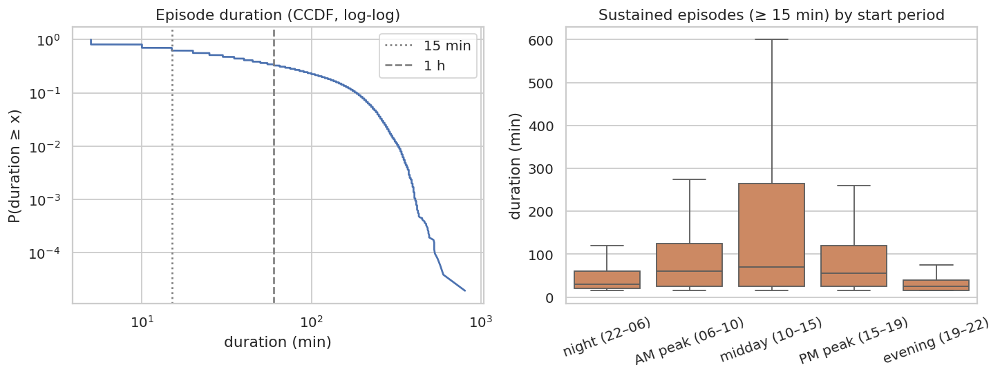
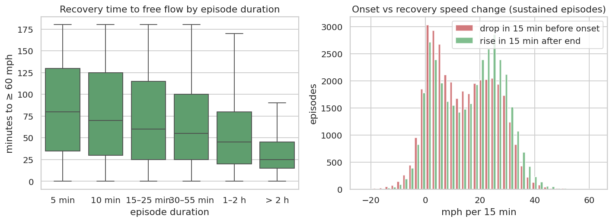

# Q3 — Congestion episode duration and recovery

**Question.** How long do congestion episodes last, when do the long ones happen, and how quickly does traffic recover to free flow after an episode ends?

## Method

- Complete 5-min grid per sensor (`clean/`). An episode is a maximal run of consecutive readings < 35 mph; a missing reading ends it.
- Run detection with window functions: `lag` state change → running `sum` = run id → `groupBy(sensor, run_id)`.
- Speed 15 min before the start (`lag(speed, 3)`) and 15 min after the end (`lead(speed, 3)`) → onset drop and recovery rise; `min_by`/`max_by` pick the values at the first and last reading of each episode.
- Recovery time = minutes from the episode end until the speed first reaches free flow (≥ 60 mph). Found in one pass with a descending running window: `last(ts where speed ≥ 60, ignorenulls)` gives the next free-flow time.

## Key findings

- 52,017 episodes on 319 sensors. The median lasts **30 min** (p90 185 min, longest 13.4 h), and 70.1% last ≥ 15 min (the Caltrans duration criterion).
- Duration is heavy-tailed: episodes ≥ 1 h are 34.4% of episodes but **80.5% of all congested minutes**.
- AM peak episodes last longer (median 35 min, 37.0% ≥ 1 h) than PM peak episodes (median 25 min, 33.0% ≥ 1 h); PM peak has 23,470 episodes vs 19,533 (more, shorter episodes).
- Recovery to free flow (≥ 60 mph) takes a median **50 min** after the episode ends (p90 145 min); 17.2% of episodes do not reach free flow within 3 h.
- In sustained episodes (≥ 15 min), speed falls a median 13.1 mph in the 15 min before onset and rises 17.6 mph in the 15 min after the end. The first rebound is quick, but the last stretch to free flow is slow (median 50 min).

## Tables

**Episode duration and recovery summary** ([CSV](tables/q3_summary.csv))

| episodes | sensors | median_min | mean_min | p75_min | p90_min | p99_min | max_min | share_ge_15min | share_ge_60min | minutes_in_ge_60min_episodes | median_recovery_min | p90_recovery_min | share_not_recovered_3h |
|---|---|---|---|---|---|---|---|---|---|---|---|---|---|
| 52,017 | 319 | 30.000 | 63.959 | 90.000 | 185.000 | 325.000 | 805 | 0.701 | 0.344 | 0.805 | 50.000 | 145.000 | 0.172 |

**Episodes by start period (local time)** ([CSV](tables/q3_by_start_period.csv))

| period | episodes | median_duration_min | p90_duration_min | share_ge_60min | median_recovery_min | median_min_speed |
|---|---|---|---|---|---|---|
| night (22–06) | 722 | 10.000 | 60.000 | 0.112 | 30.000 | 28.700 |
| AM peak (06–10) | 19,533 | 35.000 | 165.000 | 0.370 | 65.000 | 27.200 |
| midday (10–15) | 7,126 | 35.000 | 300.000 | 0.389 | 50.000 | 25.600 |
| PM peak (15–19) | 23,470 | 25.000 | 165.000 | 0.330 | 70.000 | 29.200 |
| evening (19–22) | 1,166 | 10.000 | 45.000 | 0.045 | 25.000 | 31.600 |

**Episodes by duration bucket: severity, onset/recovery speed changes, recovery time** ([CSV](tables/q3_by_duration.csv))

| bucket | episodes | median_min_speed | median_onset_drop_mph | median_recovery_rise_mph | median_recovery_min | share_recovered_3h | share_of_episodes |
|---|---|---|---|---|---|---|---|
| 5 min | 9,856 | 34.100 | 4.400 | 4.000 | 120.000 | 0.714 | 0.189 |
| 10 min | 5,700 | 32.600 | 6.300 | 6.400 | 105.000 | 0.742 | 0.110 |
| 15–25 min | 9,817 | 30.100 | 8.300 | 9.800 | 90.000 | 0.779 | 0.189 |
| 30–55 min | 8,764 | 26.100 | 11.300 | 13.000 | 70.000 | 0.832 | 0.168 |
| 1–2 h | 7,612 | 21.800 | 13.900 | 17.800 | 50.000 | 0.907 | 0.146 |
| > 2 h | 10,268 | 16.600 | 17.900 | 24.200 | 25.000 | 0.967 | 0.197 |

**Ten longest episodes** ([CSV](tables/q3_longest.csv))

| sensor_id | start_local | duration_min | min_speed | mean_speed | recovery_min |
|---|---|---|---|---|---|
| 407,339 | 2017-01-18 07:05 | 805 | 15.000 | 27.576 | 210.000 |
| 407,372 | 2017-05-14 11:00 | 600 | 24.400 | 28.849 | 10.000 |
| 400,970 | 2017-03-01 21:50 | 575 | 20.700 | 26.982 | 1,020.000 |
| 400,065 | 2017-06-18 11:45 | 555 | 5.000 | 23.341 | 10.000 |
| 400,832 | 2017-05-20 09:10 | 535 | 17.500 | 20.739 | 30.000 |
| 407,360 | 2017-05-20 10:10 | 530 | 27.700 | 30.625 | 125.000 |
| 407,360 | 2017-05-13 10:10 | 530 | 25.800 | 30.379 | 125.000 |
| 400,073 | 2017-05-20 09:10 | 530 | 4.400 | 9.636 | 10.000 |
| 407,360 | 2017-06-24 10:15 | 525 | 25.300 | 28.924 | 125.000 |
| 400,172 | 2017-02-17 11:20 | 495 | 17.400 | 21.968 | 85.000 |

## Figures

**Duration distribution (heavy tail) and duration by start period**

**Recovery time and onset/recovery asymmetry**

## Interpretation & implications for TrafficSense

- Most episodes are short, but most congested **time** falls in long (≥ 1 h) episodes. A 5-minute-ahead model therefore mainly has to get onset and clearance right; inside a long episode, persistence is already accurate.
- Full recovery to free flow lags the end of congestion. The dashboard should show a 'recovering' state (35–60 mph after an episode) rather than an immediate 'all clear'.
- Episode duration and recovery are inputs to the severity index (Q9).

## Limitations

- Short gaps (≤ 15 min) were forward-filled during cleaning, so an episode can span a filled reading; longer gaps split episodes.
- Episodes that reach the end of the data have no observed recovery and are counted as 'not recovered'.
- Local wall-clock hours are used for start periods (DST-aware), while durations use true UTC time.

_Computed in 45.7 s · 2026-10-20 12:30 UTC._
