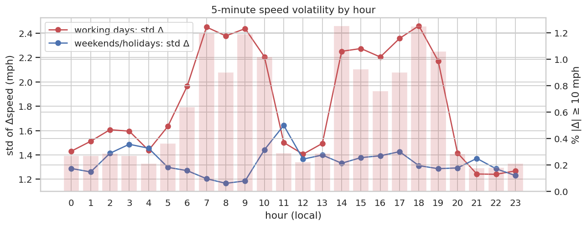
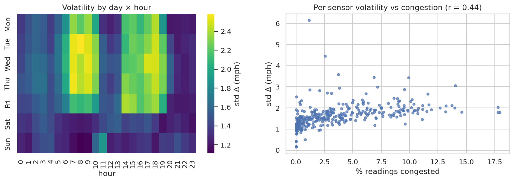

# Q4 — Temporal speed volatility

**Question.** When and where are speeds most volatile from one 5-minute interval to the next, and is volatility linked to congestion?

## Method

- 5-minute speed change Δ = speed(t) − speed(t−5 min), computed with `lag` over a window partitioned by sensor and ordered by UTC time, only when both readings are observed.
- Volatility = standard deviation of Δ. Also the mean |Δ|, the coefficient of variation of speed, and the share of sudden changes (|Δ| ≥ 10 mph).
- Aggregated by (working day, hour), by (day of week, hour), and per sensor. Pearson correlation between per-sensor volatility and congestion rate.

## Key findings

- Across 16,880,017 consecutive observed pairs, the 5-min speed change has std **1.75 mph**; 0.48% are sudden (|Δ| ≥ 10 mph).
- On working days volatility peaks at **18:00** (std Δ 2.46 mph), 1.6× the 01–04h level (1.54 mph). Weekends peak at 11:00 with 1.64 mph.
- Sudden changes are 3.7× more frequent in the working-day PM peak (0.96%) than at night (0.26%).
- Per sensor, volatility rises with congestion: Pearson r = 0.44 (Spearman 0.67) between std Δ and congestion rate over 325 sensors. The most volatile sensor is 401351 (std Δ 6.15 mph, 1.1% congested).

## Tables

**Volatility by working day × hour** ([CSV](tables/q4_hourly.csv))

| is_workday | hour | vol_std_delta | mean_abs_delta | sudden_share | speed_cv | n |
|---|---|---|---|---|---|---|
| no | 0 | 1.288 | 0.681 | 0.002 | 0.039 | 213,748 |
| no | 1 | 1.260 | 0.677 | 0.002 | 0.041 | 214,117 |
| no | 2 | 1.413 | 0.756 | 0.002 | 0.042 | 210,199 |
| no | 3 | 1.487 | 0.823 | 0.002 | 0.043 | 214,051 |
| no | 4 | 1.455 | 0.797 | 0.002 | 0.042 | 214,026 |
| no | 5 | 1.298 | 0.721 | 0.002 | 0.041 | 214,000 |
| no | 6 | 1.271 | 0.726 | 0.002 | 0.047 | 213,998 |
| no | 7 | 1.204 | 0.706 | 0.001 | 0.052 | 214,013 |
| no | 8 | 1.166 | 0.698 | 0.001 | 0.056 | 214,011 |
| no | 9 | 1.186 | 0.700 | 0.001 | 0.065 | 213,900 |
| no | 10 | 1.442 | 0.784 | 0.002 | 0.074 | 213,887 |
| no | 11 | 1.642 | 0.831 | 0.003 | 0.079 | 213,736 |

_12 of 48 rows shown; full table in the CSV._

**Ten most volatile sensors** ([CSV](tables/q4_top_volatile_sensors.csv))

| sensor_id | vol_std_delta | pm_peak_vol | mean_abs_delta | sudden_share | speed_cv | congestion_rate |
|---|---|---|---|---|---|---|
| 401,351 | 6.152 | 5.462 | 4.317 | 0.104 | 0.133 | 0.011 |
| 407,335 | 4.451 | 3.127 | 3.028 | 0.049 | 0.143 | 0.026 |
| 407,336 | 3.577 | 2.920 | 2.170 | 0.027 | 0.154 | 0.037 |
| 401,890 | 3.453 | 2.464 | 2.498 | 0.014 | 0.193 | 0.069 |
| 400,970 | 3.440 | 3.036 | 2.496 | 0.016 | 0.236 | 0.099 |
| 400,971 | 3.063 | 3.184 | 2.114 | 0.011 | 0.261 | 0.140 |
| 407,185 | 2.984 | 4.331 | 1.631 | 0.017 | 0.216 | 0.072 |
| 407,204 | 2.949 | 3.318 | 2.029 | 0.011 | 0.141 | 0.038 |
| 407,364 | 2.881 | 2.327 | 1.604 | 0.018 | 0.192 | 0.095 |
| 402,118 | 2.860 | 3.494 | 1.913 | 0.007 | 0.107 | 0.012 |

**Per-sensor volatility metrics** ([CSV](tables/q4_sensors.csv))

| sensor_id | vol_std_delta | mean_abs_delta | sudden_share | speed_cv | n | congestion_rate | pm_peak_vol |
|---|---|---|---|---|---|---|---|
| 400,435 | 2.031 | 1.164 | 0.008 | 0.195 | 52,115 | 0.083 | 3.475 |
| 400,709 | 1.619 | 0.930 | 0.004 | 0.134 | 52,113 | 0.027 | 2.783 |
| 400,869 | 1.703 | 0.938 | 0.005 | 0.105 | 52,113 | 0.018 | 3.486 |
| 401,817 | 1.144 | 0.601 | 0.001 | 0.104 | 52,111 | 0.008 | 0.721 |
| 403,414 | 1.998 | 1.050 | 0.009 | 0.272 | 52,111 | 0.127 | 2.904 |
| 407,181 | 0.814 | 0.532 | 0.000 | 0.049 | 52,109 | 0.001 | 0.749 |
| 400,429 | 1.640 | 0.955 | 0.004 | 0.201 | 52,111 | 0.092 | 3.067 |
| 400,934 | 2.061 | 1.106 | 0.009 | 0.233 | 51,772 | 0.090 | 3.878 |
| 401,996 | 1.393 | 0.789 | 0.003 | 0.149 | 52,115 | 0.044 | 0.905 |
| 402,282 | 1.868 | 1.065 | 0.006 | 0.208 | 52,111 | 0.095 | 3.636 |
| 403,329 | 1.286 | 0.743 | 0.002 | 0.052 | 52,109 | 0.002 | 1.150 |
| 413,878 | 1.056 | 0.640 | 0.001 | 0.073 | 52,109 | 0.002 | 1.353 |

_12 of 325 rows shown; full table in the CSV._

## Figures

**Volatility (std of 5-min speed change) and sudden-change share by hour**

**Volatility heat-map and per-sensor relation to congestion**

## Interpretation & implications for TrafficSense

- Volatility is concentrated at congestion onset/clearance times, so the model gets `delta_5m`, `delta_15m`, `roll_std_60m` and `roll_min_60m` features.
- High-volatility sensors are where 5-minute predictions will be hardest; report per-sensor error alongside volatility.
- For the dashboard, smooth with a short rolling mean before displaying, to avoid flicker from 5-minute noise.

## Limitations

- Δ is only computed between two consecutive observed readings; forward-filled values are excluded.
- Volatility reflects both real traffic dynamics and detector noise, which cannot be separated without ground truth.

_Computed in 18.2 s · 2026-10-20 12:26 UTC._
