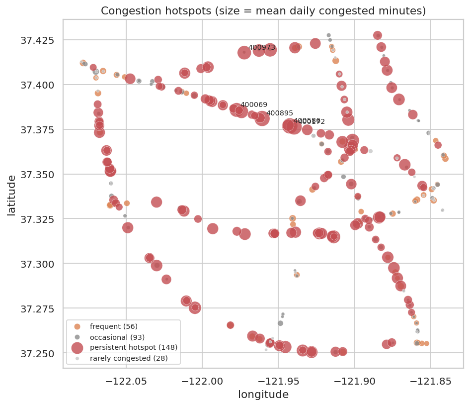
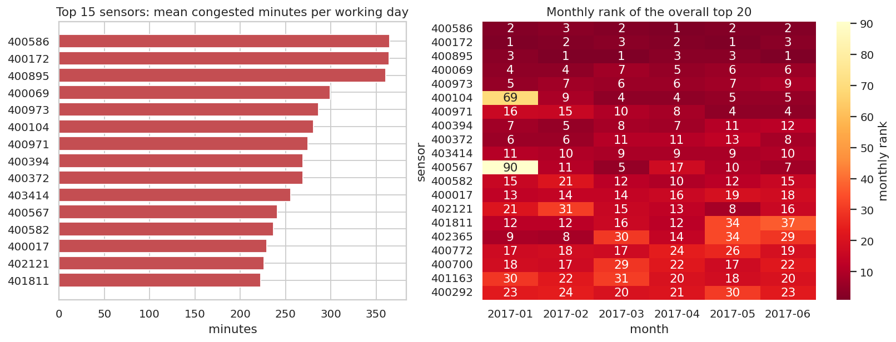

# Q5 — Persistent congestion hotspots

**Question.** Which sensors are congested persistently (most working days, for substantial time), are the hotspots stable month to month, and do they cluster along the road network?

## Method

- Working days, observed readings. Per (sensor, day): congested minutes = 5 × congested readings.
- Persistence = share of working days with ≥ 60 congested minutes. A **persistent hotspot** has persistence ≥ 50%.
- Monthly stability: rank sensors by mean daily congested minutes per month; Spearman correlation of ranks between consecutive months and Jaccard overlap of the monthly top 20.
- Spatial clustering: share of hotspot→hotspot edges in the road-graph adjacency vs the share expected if hotspots were placed at random.

## Key findings

- **148 persistent hotspots** (45.5% of sensors) have ≥ 60 congested minutes on at least half of working days. A further 56 sensors reach that on 20–50% of working days, and 28 never do (sensitivity: 179 hotspots at ≥ 30 min, 148 hotspots at ≥ 60 min, 97 hotspots at ≥ 120 min).
- Congestion is concentrated: the top 10 sensors (3.1% of sensors) account for 11.8% of all working-day congested minutes. The #1 sensor 400586 averages 365 congested min/day (persistence 100.0%).
- Hotspots are stable: month-to-month Spearman rank correlation 0.94–0.97, top-20 Jaccard overlap 0.65 on average; 10 sensors are in the top 20 in every month.
- Spatial clustering is weak: 59.9% of a hotspot's graph neighbours are hotspots vs 45.4% at random (1.3× lift).

## Tables

**Fifteen most congested sensors (working days)** ([CSV](tables/q5_top_hotspots.csv))

| rank | sensor_id | class | mean_daily_congested_min | persistence | max_daily_congested_min | latitude | longitude |
|---|---|---|---|---|---|---|---|
| 1 | 400,586 | persistent hotspot | 364.722 | 1.000 | 490 | 37.377 | -121.943 |
| 2 | 400,172 | persistent hotspot | 364.405 | 1.000 | 495 | 37.376 | -121.940 |
| 3 | 400,895 | persistent hotspot | 360.675 | 0.992 | 495 | 37.381 | -121.961 |
| 4 | 400,069 | persistent hotspot | 299.325 | 1.000 | 395 | 37.386 | -121.977 |
| 5 | 400,973 | persistent hotspot | 286.349 | 1.000 | 460 | 37.418 | -121.972 |
| 6 | 400,104 | persistent hotspot | 281.071 | 0.929 | 395 | 37.419 | -121.955 |
| 7 | 400,971 | persistent hotspot | 274.643 | 1.000 | 485 | 37.369 | -121.901 |
| 8 | 400,394 | persistent hotspot | 269.008 | 1.000 | 465 | 37.364 | -121.903 |
| 9 | 400,372 | persistent hotspot | 268.968 | 0.937 | 450 | 37.385 | -121.974 |
| 10 | 403,414 | persistent hotspot | 255.913 | 0.992 | 360 | 37.315 | -121.914 |
| 11 | 400,567 | persistent hotspot | 240.635 | 0.889 | 420 | 37.419 | -121.963 |
| 12 | 400,582 | persistent hotspot | 236.825 | 0.984 | 330 | 37.275 | -122.005 |

_12 of 15 rows shown; full table in the CSV._

**Month-to-month stability of the hotspot ranking** ([CSV](tables/q5_monthly_stability.csv))

| from | to | spearman_rank_corr | top20_jaccard |
|---|---|---|---|
| 2017-01 | 2017-02 | 0.970 | 0.667 |
| 2017-02 | 2017-03 | 0.946 | 0.600 |
| 2017-03 | 2017-04 | 0.940 | 0.667 |
| 2017-04 | 2017-05 | 0.937 | 0.600 |
| 2017-05 | 2017-06 | 0.947 | 0.739 |

**Hotspot count and spatial clustering for different daily-minute thresholds (≥ 50% of working days)** ([CSV](tables/q5_threshold_sensitivity.csv))

| daily_congested_min_threshold | hotspots | share_of_sensors | hotspot_neighbour_share | random_expectation | lift |
|---|---|---|---|---|---|
| 30 | 179 | 0.551 | 0.644 | 0.549 | 1.172 |
| 60 | 148 | 0.455 | 0.599 | 0.454 | 1.319 |
| 120 | 97 | 0.298 | 0.444 | 0.296 | 1.499 |

**Sensor classes** ([CSV](tables/q5_classes.csv))

| class | sensors |
|---|---|
| persistent hotspot | 148 |
| frequent | 56 |
| occasional | 93 |
| rarely congested | 28 |

**Hotspot metrics for all sensors** ([CSV](tables/q5_all_sensors.csv))

| sensor_id | mean_daily_congested_min | persistence_30 | persistence_60 | persistence_120 | max_daily_congested_min | workdays | persistence | latitude | longitude | class | rank |
|---|---|---|---|---|---|---|---|---|---|---|---|
| 400,586 | 364.722 | 1.000 | 1.000 | 1.000 | 490 | 126 | 1.000 | 37.377 | -121.943 | persistent hotspot | 1 |
| 400,172 | 364.405 | 1.000 | 1.000 | 1.000 | 495 | 126 | 1.000 | 37.376 | -121.940 | persistent hotspot | 2 |
| 400,895 | 360.675 | 0.992 | 0.992 | 0.992 | 495 | 126 | 0.992 | 37.381 | -121.961 | persistent hotspot | 3 |
| 400,069 | 299.325 | 1.000 | 1.000 | 1.000 | 395 | 126 | 1.000 | 37.386 | -121.977 | persistent hotspot | 4 |
| 400,973 | 286.349 | 1.000 | 1.000 | 0.992 | 460 | 126 | 1.000 | 37.418 | -121.972 | persistent hotspot | 5 |
| 400,104 | 281.071 | 0.937 | 0.929 | 0.913 | 395 | 126 | 0.929 | 37.419 | -121.955 | persistent hotspot | 6 |
| 400,971 | 274.643 | 1.000 | 1.000 | 1.000 | 485 | 126 | 1.000 | 37.369 | -121.901 | persistent hotspot | 7 |
| 400,394 | 269.008 | 1.000 | 1.000 | 1.000 | 465 | 126 | 1.000 | 37.364 | -121.903 | persistent hotspot | 8 |
| 400,372 | 268.968 | 0.944 | 0.937 | 0.921 | 450 | 126 | 0.937 | 37.385 | -121.974 | persistent hotspot | 9 |
| 403,414 | 255.913 | 0.992 | 0.992 | 0.984 | 360 | 126 | 0.992 | 37.315 | -121.914 | persistent hotspot | 10 |
| 400,567 | 240.635 | 0.889 | 0.889 | 0.857 | 420 | 126 | 0.889 | 37.419 | -121.963 | persistent hotspot | 11 |
| 400,582 | 236.825 | 1.000 | 0.984 | 0.960 | 330 | 126 | 0.984 | 37.275 | -122.005 | persistent hotspot | 12 |

_12 of 325 rows shown; full table in the CSV._

## Figures

**Hotspot map**

**Top hotspots and their month-by-month rank**

## Interpretation & implications for TrafficSense

- A small, stable set of hotspots carries most congestion. The dashboard should give them a fixed watch-list panel, and model metrics should be reported for hotspot vs non-hotspot sensors.
- Stable rankings justify train-period per-sensor statistics (`sensor_congested_rate`, `hist_*`) as features: they stay valid in the test months.
- Neighbour features (`nbr_up_*`, `nbr_down_*`) let the model use congestion at adjacent sensors; Q7 quantifies how strongly and with what lag neighbours are linked.

## Limitations

- The hotspot definition (≥ 60 min on ≥ 50% of working days) is a transparent convention; the sensitivity table and the per-sensor CSV allow other cut-offs.
- Sensor locations are points; one congested freeway segment can contain several sensors.

_Computed in 5.4 s · 2026-10-20 12:26 UTC._
