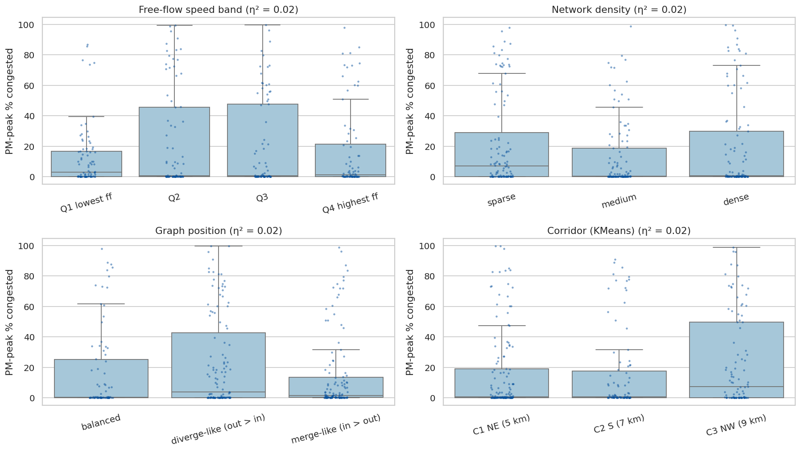
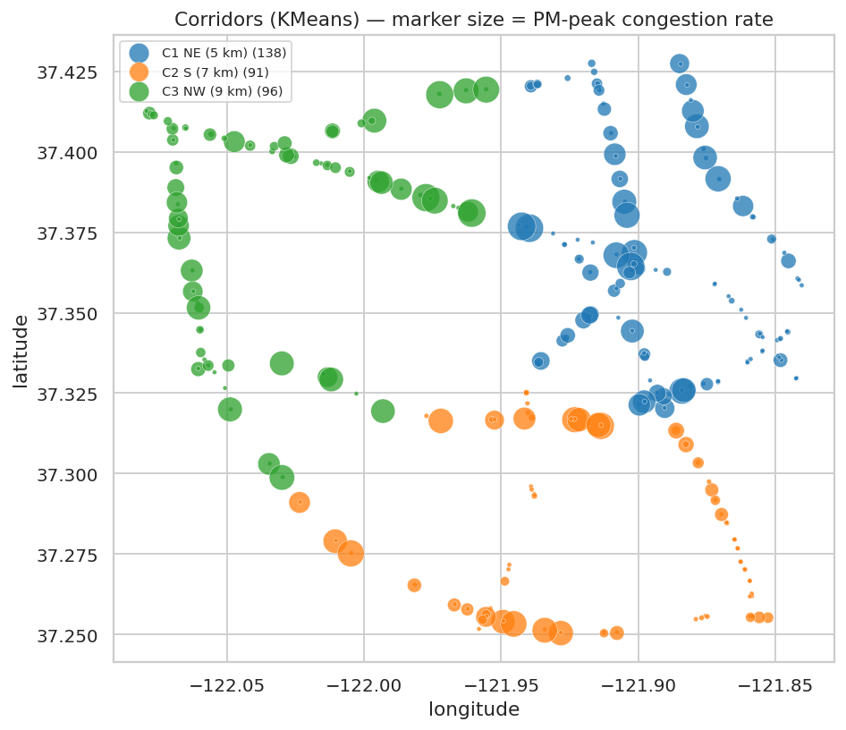

# Q6 — Congestion by road characteristics

**Question.** Do sensors with different road characteristics (design speed, network density, merge/diverge position, corridor) experience systematically different congestion?

## Method

- Per-sensor working-day congestion rate and PM-peak congestion rate (observed readings).
- Derived characteristics (PEMS-BAY has no lane or road-class data): **free-flow band** = quartile of the train-period 85th-percentile speed; **network density** = tercile of in+out graph degree (sensors within road-network reach); **graph position** = in-degree vs out-degree (merge-like / diverge-like / balanced); **corridor** = Spark MLlib KMeans on coordinates projected to km, k chosen by silhouette score (3–6).
- Per characteristic: group means/medians and η² (share of variance in the PM-peak rate explained by the group); Spearman correlation for the continuous variables.

## Key findings

- **None of the derived characteristics explains much of the congestion differences**: the largest η² is 0.021 (Free-flow speed band), a small effect, and all four lie between 0.016 and 0.021. Congestion is site-specific rather than determined by these coarse attributes.
- Free-flow speed band: 12.5% PM-peak congestion in the lowest band vs 16.5% in the highest; Spearman ρ = -0.03, i.e. no meaningful monotonic relation.
- Network density: Spearman ρ = -0.02 between graph degree and PM-peak congestion (no meaningful relation); the highest graph-position group is 'diverge-like (out > in)'.
- KMeans found 3 corridors (silhouette 0.61); most congested: C3 NW (9 km), least congested: C2 S (7 km) (η² 0.016).

## Tables

**How much of the PM-peak congestion variance each characteristic explains (η²)** ([CSV](tables/q6_effects.csv))

| characteristic | groups | eta_squared_pm_peak | eta_squared_overall | highest_group | lowest_group |
|---|---|---|---|---|---|
| Free-flow speed band | 4 | 0.021 | 0.009 | Q2 | Q1 lowest ff |
| Graph position | 3 | 0.018 | 0.013 | diverge-like (out > in) | merge-like (in > out) |
| Network density | 3 | 0.016 | 0.005 | sparse | medium |
| Corridor (KMeans) | 3 | 0.016 | 0.021 | C3 NW (9 km) | C2 S (7 km) |

**Congestion by characteristic group** ([CSV](tables/q6_groups.csv))

| characteristic | group | sensors | mean_congestion_rate | median_congestion_rate | mean_pm_peak_rate | mean_ff_speed | mean_speed |
|---|---|---|---|---|---|---|---|
| Free-flow speed band | Q1 lowest ff | 83 | 0.047 | 0.037 | 0.125 | 65.189 | 59.418 |
| Free-flow speed band | Q2 | 80 | 0.058 | 0.033 | 0.233 | 67.425 | 61.095 |
| Free-flow speed band | Q3 | 82 | 0.061 | 0.055 | 0.203 | 68.166 | 61.813 |
| Free-flow speed band | Q4 highest ff | 80 | 0.054 | 0.039 | 0.165 | 69.732 | 63.423 |
| Network density | sparse | 108 | 0.053 | 0.031 | 0.218 | 67.684 | 61.717 |
| Network density | medium | 108 | 0.052 | 0.040 | 0.133 | 67.607 | 61.593 |
| Network density | dense | 109 | 0.060 | 0.045 | 0.192 | 67.536 | 60.957 |
| Graph position | balanced | 82 | 0.052 | 0.039 | 0.166 | 67.884 | 61.858 |
| Graph position | diverge-like (out > in) | 119 | 0.063 | 0.045 | 0.229 | 67.452 | 60.952 |
| Graph position | merge-like (in > out) | 124 | 0.050 | 0.027 | 0.145 | 67.577 | 61.582 |
| Corridor (KMeans) | C1 NE (5 km) | 138 | 0.047 | 0.027 | 0.161 | 67.767 | 61.710 |
| Corridor (KMeans) | C2 S (7 km) | 91 | 0.057 | 0.041 | 0.155 | 67.209 | 61.435 |

_12 of 13 rows shown; full table in the CSV._

**KMeans model selection** ([CSV](tables/q6_kmeans_silhouette.csv))

| k | silhouette |
|---|---|
| 3 | 0.614 |
| 4 | 0.581 |
| 5 | 0.582 |
| 6 | 0.552 |

**Per-sensor characteristics and congestion** ([CSV](tables/q6_sensors.csv))

| sensor_id | latitude | longitude | in_degree | out_degree | ff_speed | sensor_congested_rate | train_observed_readings | congestion_rate | pm_peak_rate | mean_speed | corridor | free_flow_band | degree | network_density | graph_position |
|---|---|---|---|---|---|---|---|---|---|---|---|---|---|---|---|
| 400,045 | 37.363 | -121.902 | 18 | 16 | 70.200 | 0.059 | 36,373 | 0.085 | 0.003 | 59.638 | C1 NE (5 km) | Q4 highest ff | 34 | dense | merge-like (in > out) |
| 400,088 | 37.415 | -121.913 | 6 | 8 | 67.000 | 0.001 | 36,552 | 0.001 | 0.003 | 63.524 | C1 NE (5 km) | Q2 | 14 | medium | diverge-like (out > in) |
| 400,185 | 37.303 | -122.035 | 5 | 8 | 68.300 | 0.043 | 36,552 | 0.063 | 0.000 | 61.325 | C3 NW (9 km) | Q3 | 13 | medium | diverge-like (out > in) |
| 400,238 | 37.413 | -121.912 | 2 | 8 | 64.800 | 0.028 | 36,552 | 0.044 | 0.224 | 58.675 | C1 NE (5 km) | Q1 lowest ff | 10 | sparse | diverge-like (out > in) |
| 400,240 | 37.258 | -121.954 | 0 | 0 | 68.000 | 0.000 | 36,551 | 0.000 | 0.000 | 64.705 | C2 S (7 km) | Q3 | 0 | sparse | balanced |
| 400,280 | 37.262 | -121.858 | 6 | 1 | 68.900 | 0.009 | 36,551 | 0.010 | 0.005 | 64.972 | C2 S (7 km) | Q4 highest ff | 7 | sparse | merge-like (in > out) |
| 400,296 | 37.420 | -121.939 | 5 | 7 | 67.700 | 0.025 | 36,250 | 0.034 | 0.188 | 60.040 | C1 NE (5 km) | Q2 | 12 | medium | diverge-like (out > in) |
| 400,353 | 37.383 | -121.967 | 5 | 13 | 68.400 | 0.042 | 36,552 | 0.069 | 0.003 | 61.395 | C3 NW (9 km) | Q3 | 18 | medium | diverge-like (out > in) |
| 400,414 | 37.318 | -121.977 | 8 | 1 | 68.000 | 0.052 | 36,551 | 0.082 | 0.005 | 61.591 | C2 S (7 km) | Q3 | 9 | sparse | merge-like (in > out) |
| 400,418 | 37.292 | -121.872 | 13 | 10 | 68.400 | 0.091 | 36,551 | 0.133 | 0.003 | 60.540 | C2 S (7 km) | Q3 | 23 | dense | merge-like (in > out) |
| 400,429 | 37.319 | -121.993 | 5 | 3 | 67.000 | 0.085 | 36,551 | 0.132 | 0.724 | 58.358 | C3 NW (9 km) | Q2 | 8 | sparse | merge-like (in > out) |
| 400,435 | 37.403 | -122.047 | 6 | 9 | 68.700 | 0.077 | 36,552 | 0.119 | 0.569 | 59.022 | C3 NW (9 km) | Q4 highest ff | 15 | medium | diverge-like (out > in) |

_12 of 325 rows shown; full table in the CSV._

## Figures

**PM-peak congestion by derived road characteristic**

**Geographic corridors and congestion**

## Interpretation & implications for TrafficSense

- Coarse sensor-level characteristics explain little; per-sensor history features (`ff_speed`, `sensor_congested_rate`, slot profile) and live features capture site effects directly. Adding characteristic groups as model features is unlikely to help.
- Corridor membership remains useful for **reporting** (per-corridor dashboard views and evaluation), even if it adds little predictive power.

## Limitations

- **No true road attributes**: PEMS-BAY lacks lane counts, functional class, ramp locations and volumes, so these are proxies. With PeMS station metadata (lanes, freeway, direction) this analysis can be redone directly.
- Graph degree reflects how many sensors lie within the DCRNN distance threshold, so it measures sensor density, not road topology.
- η² is descriptive (no causal claim); groups are unbalanced in size.

_Computed in 14.0 s · 2026-10-20 12:30 UTC._
