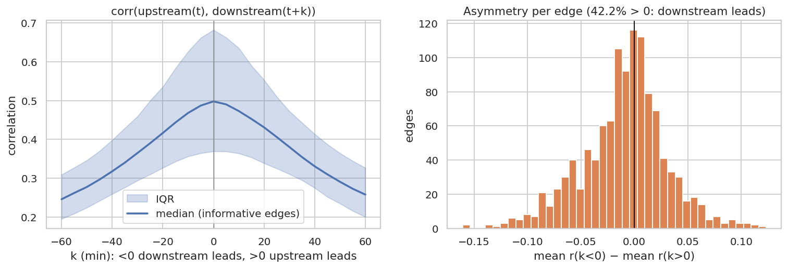
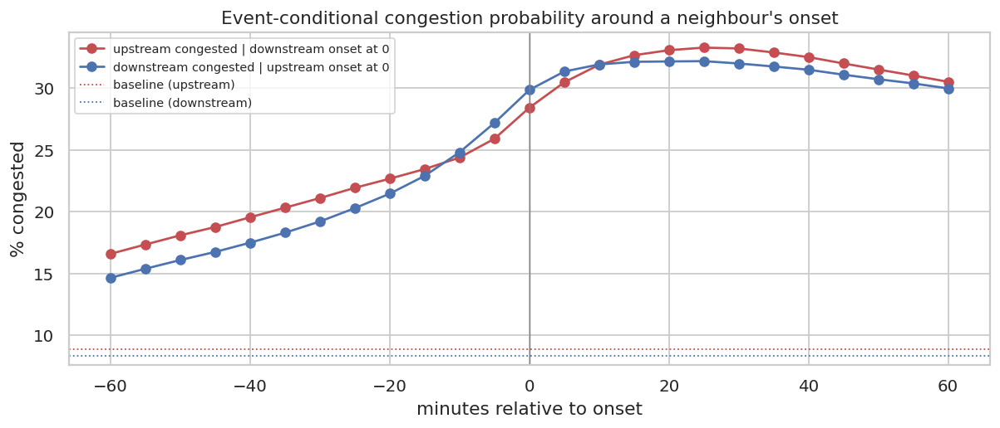

# Q7 — Congestion propagation (lagged associations)

**Question.** Does congestion travel along the road network, in which direction (with or against the traffic flow), and with what time lag?

## Method

- Spark `groupBy(ts).pivot(sensor_id)` turns the complete clean grid into a 52,116 × 325 speed matrix (rows are consecutive 5-min UTC slots, so a row shift of k equals k × 5 minutes).
- Working days 05:00–21:00. Speeds are converted to anomalies (minus each sensor's working-day mean for that 5-min slot) to remove the shared daily cycle.
- For every directed edge upstream i → downstream j of the DCRNN road graph (2,369 edges): correlation of anomaly_i(t) with anomaly_j(t+k), k = −60…+60 min. **k > 0: upstream leads**, i.e. propagation in the direction of travel. **k < 0: downstream leads**, i.e. a queue spreading backwards against the flow.
- Asymmetry per edge = mean correlation at k = −5…−30 min minus mean at k = +5…+30 min (> 0 means downstream leads).
- Event view: P(sensor congested at t+k | congestion onset at its neighbour at t), in both directions, against the baseline congestion probability.

## Key findings

- Neighbouring sensors move together: median correlation of same-time speed anomalies 0.27 over 2,369 directed edges; 1,147 edges (48.4%) have a peak correlation ≥ 0.3.
- Direction at 5-minute resolution: **no dominant direction**. On 42.2% of the informative edges the downstream sensor leads (asymmetry > 0); 53.6% peak at lag 0 (median peak lag +0 min, IQR +0 to +5). Linked sensors are a median 2.2 km apart (straight line). Vehicles cover that in about 1 min at 60 mph, and a backward-moving queue front (typically ~15–20 km/h) in about 7–9 min, at or below the 5-minute resolution, so the direction is hard to resolve.
- Event view: 15 min after a downstream onset, the upstream neighbour is congested with probability 32.7% (3.7× its baseline 8.85%); after an upstream onset, the downstream neighbour is congested with probability 32.1% (3.9× baseline). The two directions are practically symmetric.
- Each sensor's own anomaly persists: median autocorrelation 0.95 at 5 min, 0.81 at 15 min, 0.63 at 30 min and 0.43 at 60 min. This memory is why the persistence baseline is strong at 5 minutes.

## Tables

**Lagged correlation and event-conditional probabilities (lag = t_response − t_trigger)** ([CSV](tables/q7_lag_curves.csv))

| lag_min | mean_corr_all_edges | median_corr_informative | p_upstream_cong_after_downstream_onset | p_downstream_cong_after_upstream_onset |
|---|---|---|---|---|
| -60 | 0.168 | 0.246 | 0.166 | 0.147 |
| -55 | 0.177 | 0.262 | 0.174 | 0.154 |
| -50 | 0.187 | 0.277 | 0.181 | 0.161 |
| -45 | 0.199 | 0.296 | 0.188 | 0.168 |
| -40 | 0.211 | 0.318 | 0.196 | 0.175 |
| -35 | 0.224 | 0.340 | 0.203 | 0.183 |
| -30 | 0.239 | 0.365 | 0.211 | 0.192 |
| -25 | 0.255 | 0.390 | 0.219 | 0.203 |
| -20 | 0.271 | 0.416 | 0.227 | 0.215 |
| -15 | 0.287 | 0.443 | 0.234 | 0.229 |
| -10 | 0.302 | 0.468 | 0.244 | 0.248 |
| -5 | 0.315 | 0.487 | 0.259 | 0.272 |

_12 of 25 rows shown; full table in the CSV._

**Strongest-linked edges (src = upstream, dst = downstream)** ([CSV](tables/q7_edges_top.csv))

| src | dst | weight | distance_km | corr_0 | peak_corr | peak_lag_min | asymmetry |
|---|---|---|---|---|---|---|---|
| 405,701 | 401,167 | 0.999 | 0.113 | 0.972 | 0.972 | 0 | 0.016 |
| 401,167 | 405,701 | 0.999 | 0.113 | 0.972 | 0.972 | 0 | -0.016 |
| 404,753 | 402,364 | 0.975 | 0.575 | 0.970 | 0.970 | 0 | 0.015 |
| 400,743 | 400,330 | 0.998 | 0.144 | 0.970 | 0.970 | 0 | -0.015 |
| 400,479 | 400,030 | 0.983 | 0.475 | 0.970 | 0.970 | 0 | 0.012 |
| 401,440 | 403,225 | 0.910 | 1.105 | 0.962 | 0.962 | 0 | -0.005 |
| 400,178 | 401,567 | 0.992 | 0.322 | 0.961 | 0.961 | 0 | 0.013 |
| 400,794 | 400,643 | 0.999 | 0.112 | 0.961 | 0.961 | 0 | 0.023 |
| 400,643 | 400,794 | 0.999 | 0.112 | 0.961 | 0.961 | 0 | -0.023 |
| 401,163 | 403,419 | 0.998 | 0.145 | 0.959 | 0.959 | 0 | -0.006 |
| 403,419 | 401,163 | 0.998 | 0.145 | 0.959 | 0.959 | 0 | 0.006 |
| 400,904 | 404,553 | 0.102 | 0.273 | 0.956 | 0.956 | 0 | 0.009 |

_12 of 20 rows shown; full table in the CSV._

**All edges** ([CSV](tables/q7_edges.csv))

| src | dst | weight | distance_km | corr_0 | peak_corr | peak_lag_min | asymmetry |
|---|---|---|---|---|---|---|---|
| 400,030 | 400,045 | 0.137 | 0.612 | 0.147 | 0.175 | 40 | -0.034 |
| 400,030 | 400,122 | 0.105 | 0.918 | 0.106 | 0.117 | 40 | -0.020 |
| 400,030 | 400,253 | 0.626 | 2.468 | 0.227 | 0.231 | -10 | 0.010 |
| 400,030 | 400,508 | 0.793 | 1.739 | 0.299 | 0.299 | 0 | -0.003 |
| 400,030 | 400,709 | 0.566 | 2.724 | 0.115 | 0.117 | 5 | -0.006 |
| 400,030 | 400,723 | 0.324 | 3.835 | 0.175 | 0.184 | -20 | 0.013 |
| 400,030 | 401,440 | 0.992 | 0.321 | 0.338 | 0.338 | 0 | 0.006 |
| 400,030 | 401,560 | 0.140 | 0.210 | 0.164 | 0.175 | 25 | -0.022 |
| 400,030 | 402,057 | 0.101 | 2.644 | 0.152 | 0.154 | -10 | 0.009 |
| 400,030 | 403,225 | 0.856 | 1.426 | 0.320 | 0.321 | -5 | 0.002 |
| 400,030 | 403,265 | 0.847 | 1.474 | 0.297 | 0.297 | 0 | -0.003 |
| 400,030 | 408,911 | 0.150 | 4.842 | 0.199 | 0.243 | -45 | 0.020 |

_12 of 2,369 rows shown; full table in the CSV._

## Figures

**Lagged correlation along road-graph edges**

**How an onset at one sensor raises its neighbour's congestion probability over time**

## Interpretation & implications for TrafficSense

- An onset at a neighbour raises a sensor's congestion probability 3.7–3.9× within 15 minutes, so the `nbr_*` features carry real predictive signal in both directions.
- Because most co-movement happens within the same 5-minute interval, same-time neighbour features matter more than lagged neighbour features at this horizon. Longer horizons (15–30 min) are where lagged spatial features should add the most.
- In the dashboard, a fresh onset can trigger an early warning for the adjacent sensors in both directions.

## Limitations

- Correlation is not causation: shared demand surges can make neighbours co-move without propagation.
- With a 5-minute resolution and linked sensors a median 2.2 km apart, propagation faster than one interval looks simultaneous; finer data (30 s PeMS) would be needed to resolve the direction.
- Graph edges come from the DCRNN road-distance kernel; distances above are straight-line, not along the road, so propagation speeds are not derived.
- Autocorrelation is computed on every 5th sensor, for speed.

_Computed in 92.5 s · 2026-10-20 12:28 UTC._
