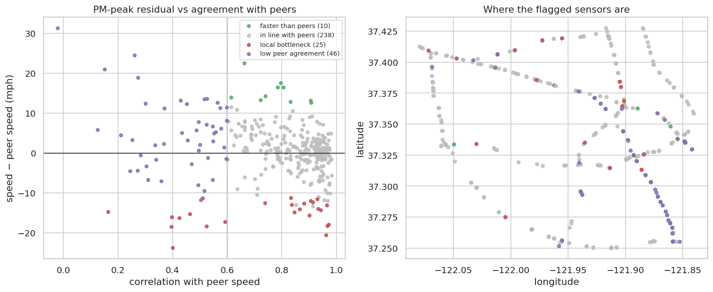

# Q8 — Sensor performance relative to peers

**Question.** Which sensors are consistently slower or more congested than their neighbouring sensors (local bottlenecks), and which disagree with their peers in ways that suggest detector problems?

## Method

- Feature table (all splits, 16.1M rows). Peer speed = mean of the adjacency-weighted upstream and downstream neighbour speeds (only the existing side for sensors without upstream or downstream neighbours; sensors with neither are excluded).
- Per sensor: mean residual (speed − peer speed) overall and in the working-day PM peak; mean |residual|; Pearson correlation of speed with peer speed (Spark `corr` aggregate); own congestion rate vs peer congestion share.
- Peer z-score of the PM-peak residual across sensors. **Local bottleneck**: z ≤ −1.5 and own congestion ≥ 1.5× the peers'. **Low peer agreement**: correlation < 0.6, cross-checked against the share of readings that were not observed (missing or stuck) in cleaning.

## Key findings

- Most sensors track their peers closely: median correlation with peer speed **0.84**, median |residual| 3.4 mph (6 isolated sensors without graph neighbours excluded).
- **25 local bottlenecks** are much slower than their neighbours in the PM peak (z ≤ −1.5) and congested ≥ 1.5× as often; worst 402117: -23.7 mph vs peers, 67.8% vs 5.5% congested.
- 46 sensors have low agreement with their peers (r < 0.6). Their data quality is only marginally different (0.62% vs 0.29% non-observed; Spearman ρ = -0.10), so low agreement more likely reflects genuinely local traffic conditions than detector faults, though detector drift cannot be ruled out.
- 10 sensors are consistently faster than their peers (z ≥ +1.5); 7 of them are directly downstream of a flagged bottleneck, where traffic discharges after the restriction.

## Tables

**Local bottlenecks (slower and more congested than peers in the PM peak)** ([CSV](tables/q8_bottlenecks.csv))

| sensor_id | flag | pm_residual_mph | pm_residual_z | pm_congestion_rate | pm_peer_congestion | congestion_vs_peers | peer_corr | mean_abs_residual_mph | not_observed_share |
|---|---|---|---|---|---|---|---|---|---|
| 402,117 | local bottleneck | -23.698 | -3.162 | 0.678 | 0.055 | 11.364 | 0.400 | 5.596 | 0.000 |
| 400,069 | local bottleneck | -20.503 | -2.742 | 0.960 | 0.581 | 1.647 | 0.962 | 4.420 | 0.000 |
| 400,970 | local bottleneck | -18.477 | -2.476 | 0.737 | 0.341 | 2.141 | 0.395 | 11.877 | 0.000 |
| 400,995 | local bottleneck | -18.391 | -2.465 | 0.314 | 0.089 | 3.385 | 0.525 | 6.451 | 0.000 |
| 400,394 | local bottleneck | -18.303 | -2.453 | 0.981 | 0.285 | 3.404 | 0.966 | 6.695 | 0.000 |
| 403,414 | local bottleneck | -17.882 | -2.398 | 0.913 | 0.559 | 1.625 | 0.971 | 3.967 | 0.000 |
| 404,461 | local bottleneck | -17.233 | -2.313 | 0.298 | 0.091 | 3.144 | 0.592 | 4.697 | 0.000 |
| 400,065 | local bottleneck | -16.267 | -2.186 | 0.471 | 0.106 | 4.300 | 0.424 | 5.938 | 0.014 |
| 400,236 | local bottleneck | -15.997 | -2.150 | 0.366 | 0.067 | 5.155 | 0.397 | 4.826 | 0.024 |
| 402,121 | local bottleneck | -15.624 | -2.101 | 0.827 | 0.383 | 2.143 | 0.901 | 4.704 | 0.002 |
| 401,606 | local bottleneck | -15.245 | -2.051 | 0.210 | 0.044 | 4.407 | 0.463 | 6.301 | 0.000 |
| 400,057 | local bottleneck | -14.896 | -2.005 | 0.397 | 0.048 | 7.611 | 0.845 | 4.423 | 0.001 |

_12 of 25 rows shown; full table in the CSV._

**Sensors with low agreement with their peers** ([CSV](tables/q8_low_agreement.csv))

| sensor_id | flag | pm_residual_mph | pm_residual_z | pm_congestion_rate | pm_peer_congestion | congestion_vs_peers | peer_corr | mean_abs_residual_mph | not_observed_share |
|---|---|---|---|---|---|---|---|---|---|
| 400,964 | low peer agreement | 31.285 | 4.061 | 0.000 | 0.601 | 0.009 | -0.022 | 9.176 | 0.000 |
| 407,323 | low peer agreement | 5.756 | 0.707 | 0.000 | 0.028 | 0.152 | 0.126 | 3.712 | 0.000 |
| 402,118 | low peer agreement | 20.968 | 2.706 | 0.000 | 0.467 | 0.011 | 0.151 | 5.955 | 0.000 |
| 400,457 | low peer agreement | 4.517 | 0.545 | 0.004 | 0.032 | 0.250 | 0.210 | 4.978 | 0.000 |
| 401,495 | low peer agreement | -4.494 | -0.639 | 0.100 | 0.024 | 3.646 | 0.244 | 3.758 | 0.000 |
| 404,462 | low peer agreement | 3.315 | 0.387 | 0.003 | 0.026 | 0.271 | 0.252 | 4.323 | 0.006 |
| 404,585 | low peer agreement | 24.502 | 3.170 | 0.190 | 0.745 | 0.260 | 0.260 | 12.445 | 0.000 |
| 401,457 | low peer agreement | -4.389 | -0.625 | 0.004 | 0.034 | 0.241 | 0.271 | 6.258 | 0.003 |
| 402,056 | low peer agreement | 18.907 | 2.435 | 0.000 | 0.241 | 0.020 | 0.272 | 6.168 | 0.006 |
| 401,958 | low peer agreement | -0.532 | -0.119 | 0.003 | 0.011 | 0.473 | 0.282 | 3.028 | 0.023 |
| 400,664 | low peer agreement | 12.391 | 1.579 | 0.014 | 0.245 | 0.076 | 0.300 | 8.589 | 0.000 |
| 400,440 | low peer agreement | -3.362 | -0.490 | 0.024 | 0.015 | 1.437 | 0.303 | 3.513 | 0.000 |

_12 of 46 rows shown; full table in the CSV._

**Sensor classification** ([CSV](tables/q8_flags.csv))

| flag | sensors |
|---|---|
| in line with peers | 238 |
| low peer agreement | 46 |
| local bottleneck | 25 |
| faster than peers | 10 |

**Peer metrics for all sensors** ([CSV](tables/q8_all_sensors.csv))

| sensor_id | mean_residual_mph | pm_residual_mph | mean_abs_residual_mph | peer_corr | congestion_rate | peer_congestion | pm_congestion_rate | pm_peer_congestion | rows | in_degree | out_degree | latitude | longitude | not_observed_share | pm_residual_z | congestion_vs_peers | flag |
|---|---|---|---|---|---|---|---|---|---|---|---|---|---|---|---|---|---|
| 402,117 | -1.022 | -23.698 | 5.596 | 0.400 | 0.082 | 0.018 | 0.678 | 0.055 | 50,075 | 1 | 7 | 37.344 | -121.902 | 0.000 | -3.162 | 11.364 | local bottleneck |
| 400,069 | -2.392 | -20.503 | 4.420 | 0.962 | 0.147 | 0.093 | 0.960 | 0.581 | 50,076 | 14 | 8 | 37.386 | -121.977 | 0.000 | -2.742 | 1.647 | local bottleneck |
| 400,970 | -7.479 | -18.477 | 11.877 | 0.395 | 0.100 | 0.097 | 0.737 | 0.341 | 50,075 | 1 | 8 | 37.410 | -121.996 | 0.000 | -2.476 | 2.141 | local bottleneck |
| 400,995 | 1.124 | -18.391 | 6.451 | 0.525 | 0.039 | 0.030 | 0.314 | 0.089 | 50,073 | 18 | 5 | 37.313 | -121.886 | 0.000 | -2.465 | 3.385 | local bottleneck |
| 400,394 | 1.307 | -18.303 | 6.695 | 0.966 | 0.132 | 0.041 | 0.981 | 0.285 | 50,075 | 5 | 5 | 37.364 | -121.903 | 0.000 | -2.453 | 3.404 | local bottleneck |
| 403,414 | -3.640 | -17.882 | 3.967 | 0.971 | 0.128 | 0.075 | 0.913 | 0.559 | 50,074 | 8 | 20 | 37.315 | -121.914 | 0.000 | -2.398 | 1.625 | local bottleneck |
| 404,461 | -1.504 | -17.233 | 4.697 | 0.592 | 0.038 | 0.031 | 0.298 | 0.091 | 50,072 | 19 | 7 | 37.309 | -121.883 | 0.000 | -2.313 | 3.144 | local bottleneck |
| 400,065 | 0.715 | -16.267 | 5.938 | 0.424 | 0.060 | 0.040 | 0.471 | 0.106 | 48,396 | 5 | 2 | 37.320 | -121.890 | 0.014 | -2.186 | 4.300 | local bottleneck |
| 400,236 | -1.292 | -15.997 | 4.826 | 0.397 | 0.044 | 0.024 | 0.366 | 0.067 | 46,461 | 14 | 7 | 37.325 | -121.893 | 0.024 | -2.150 | 5.155 | local bottleneck |
| 402,121 | -0.089 | -15.624 | 4.704 | 0.901 | 0.112 | 0.064 | 0.827 | 0.383 | 49,747 | 8 | 14 | 37.380 | -121.904 | 0.002 | -2.101 | 2.143 | local bottleneck |
| 401,606 | -1.899 | -15.245 | 6.301 | 0.463 | 0.031 | 0.032 | 0.210 | 0.044 | 50,073 | 11 | 14 | 37.287 | -121.870 | 0.000 | -2.051 | 4.407 | local bottleneck |
| 400,057 | -3.200 | -14.896 | 4.423 | 0.845 | 0.087 | 0.022 | 0.397 | 0.048 | 49,938 | 0 | 8 | 37.335 | -121.936 | 0.001 | -2.005 | 7.611 | local bottleneck |

_12 of 319 rows shown; full table in the CSV._

## Figures

**Peer-relative performance and sensor flags**

## Interpretation & implications for TrafficSense

- Local bottlenecks are where congestion **originates**; they are the natural anchor points for early warnings to adjacent sensors (Q7).
- Low-agreement sensors should be marked on the dashboard and their model errors read with care. The `imputed_count_60m` feature already gives the model a data-quality signal.

## Limitations

- Peer speeds are adjacency-weighted means; a sensor at a true bottleneck has slower upstream and faster downstream neighbours, which partly cancel in the average.
- The feature table excludes the first 7 days (lag warm-up) and rows with gaps; cleaning-stage missingness is used for the quality cross-check.

_Computed in 5.1 s · 2026-10-20 12:28 UTC._
