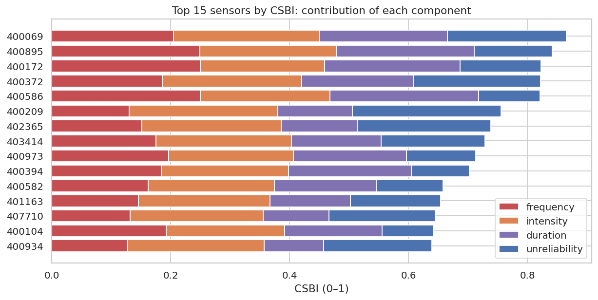
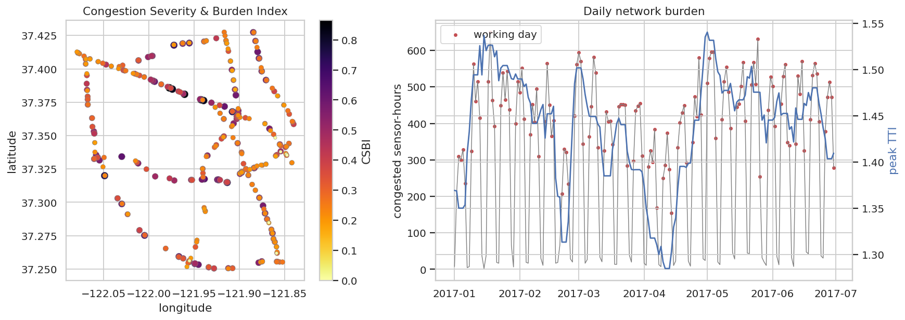

# Q9 — Combined congestion severity and burden

**Question.** Which sensors and days carry the greatest overall congestion burden when frequency, intensity, duration and travel-time reliability are combined, and is the ranking robust?

## Method

- Free-flow speed per sensor = train-period 85th percentile (`sensor_stats/`). Peaks = working days 06–10h and 15–19h.
- Standard mobility measures per sensor (FHWA-style): **Travel Time Index** TTI = mean(ff / speed) in the peaks; **Planning Time Index** PTI = ff / 5th-percentile peak speed; **excess travel time** = mean(max(0, 60/speed − 60/ff)) minutes per mile in the peaks; congested hours per working day.
- Composite **Congestion Severity & Burden Index (CSBI)** = mean of min–max-normalised components: frequency (share of working-day readings congested); intensity (mean speed deficit while congested: 1 − speed / free-flow); duration (mean working-day episode duration (min)); unreliability (Planning Time Index in the peaks: free-flow / 5th-percentile speed).
- Robustness: Spearman correlation and top-10 overlap between the CSBI and every drop-one-component variant.
- Daily network burden: congested sensor-hours and network-mean TTI per day (Spark `groupBy(date)`).

## Key findings

- Highest burden: sensor **400069** (CSBI 0.87): 20.8% of working-day readings congested, 77.7% below free flow while congested, 237-min average episodes, PTI 6.5 (to be on time 95% of the time, a traveller must budget 6.5× the free-flow travel time).
- Burden is concentrated: the 10 highest-CSBI sensors (3.1% of sensors) carry 11.2% of all congested hours per working day; network peak TTI averages 1.44, with a mean excess of 23 s per mile in the peaks.
- The ranking is robust: dropping any single component keeps Spearman ρ ≥ 0.98 with the full index and at least 8/10 of the top 10.
- Components are related but not redundant (Spearman: frequency–unreliability 0.89, frequency–intensity 0.48, frequency–duration 0.86).
- Worst day for the network: Wed 2017-01-18 with 650 congested sensor-hours (working-day mean 428); peak TTI that day 1.66.

## Tables

**Fifteen highest-burden sensors (CSBI)** ([CSV](tables/q9_top_sensors.csv))

| rank | sensor_id | csbi | frequency | intensity | duration | unreliability | tti_peak | excess_min_per_mile_peak | congested_hours_per_workday | ff_speed |
|---|---|---|---|---|---|---|---|---|---|---|
| 1 | 400,069 | 0.865 | 0.208 | 0.777 | 237.201 | 6.529 | 3.088 | 1.845 | 4.989 | 67.900 |
| 2 | 400,895 | 0.842 | 0.252 | 0.730 | 255.309 | 4.655 | 2.634 | 1.453 | 6.011 | 67.500 |
| 3 | 400,172 | 0.823 | 0.253 | 0.663 | 250.902 | 4.787 | 2.191 | 1.059 | 6.073 | 67.500 |
| 4 | 400,372 | 0.822 | 0.188 | 0.745 | 206.829 | 6.915 | 2.662 | 1.537 | 4.483 | 65.000 |
| 5 | 400,586 | 0.821 | 0.253 | 0.692 | 275.180 | 3.880 | 2.289 | 1.139 | 6.079 | 67.900 |
| 6 | 400,209 | 0.756 | 0.132 | 0.795 | 138.509 | 7.898 | 2.865 | 1.611 | 3.158 | 69.500 |
| 7 | 402,365 | 0.738 | 0.153 | 0.746 | 140.404 | 7.212 | 2.651 | 1.388 | 3.677 | 71.400 |
| 8 | 403,414 | 0.729 | 0.178 | 0.723 | 166.211 | 5.835 | 2.504 | 1.346 | 4.265 | 67.100 |
| 9 | 400,973 | 0.713 | 0.199 | 0.667 | 209.767 | 4.245 | 2.078 | 0.959 | 4.772 | 67.500 |
| 10 | 400,394 | 0.703 | 0.187 | 0.679 | 227.483 | 3.731 | 2.130 | 0.942 | 4.483 | 72.000 |
| 11 | 400,582 | 0.658 | 0.164 | 0.673 | 188.861 | 4.127 | 2.037 | 0.914 | 3.947 | 68.100 |
| 12 | 401,163 | 0.654 | 0.148 | 0.704 | 148.361 | 5.213 | 2.194 | 1.011 | 3.532 | 70.900 |

_12 of 15 rows shown; full table in the CSV._

**Robustness of the CSBI ranking to dropping one component** ([CSV](tables/q9_robustness.csv))

| variant | spearman_vs_csbi | top10_overlap |
|---|---|---|
| without frequency | 0.981 | 8 |
| without intensity | 0.980 | 10 |
| without duration | 0.994 | 8 |
| without unreliability | 0.988 | 8 |

**Spearman correlation between components** ([CSV](tables/q9_component_correlation.csv))

| component | frequency | intensity | duration | unreliability |
|---|---|---|---|---|
| frequency | 1.000 | 0.477 | 0.864 | 0.894 |
| intensity | 0.477 | 1.000 | 0.668 | 0.639 |
| duration | 0.864 | 0.668 | 1.000 | 0.848 |
| unreliability | 0.894 | 0.639 | 0.848 | 1.000 |

**Ten days with the highest network burden** ([CSV](tables/q9_worst_days.csv))

| date_local | is_workday | congested_sensor_hours | network_tti | network_peak_tti |
|---|---|---|---|---|
| 2017-01-18 | yes | 650.083 | 1.298 | 1.661 |
| 2017-05-25 | yes | 630.917 | 1.257 | 1.607 |
| 2017-05-03 | yes | 596.000 | 1.241 | 1.582 |
| 2017-05-04 | yes | 595.417 | 1.249 | 1.592 |
| 2017-03-01 | yes | 594.083 | 1.287 | 1.621 |
| 2017-03-08 | yes | 582.000 | 1.235 | 1.558 |
| 2017-04-27 | yes | 579.667 | 1.240 | 1.565 |
| 2017-05-02 | yes | 579.333 | 1.248 | 1.596 |
| 2017-06-15 | yes | 570.583 | 1.242 | 1.550 |
| 2017-03-02 | yes | 570.333 | 1.279 | 1.591 |

**CSBI and components for all sensors** ([CSV](tables/q9_all_sensors.csv))

| sensor_id | frequency | intensity | tti_peak | p05_peak_speed | excess_min_per_mile_peak | congested_hours_per_workday | ff_speed | unreliability | duration | latitude | longitude | frequency_norm | intensity_norm | duration_norm | unreliability_norm | csbi | rank |
|---|---|---|---|---|---|---|---|---|---|---|---|---|---|---|---|---|---|
| 400,069 | 0.208 | 0.777 | 3.088 | 10.400 | 1.845 | 4.989 | 67.900 | 6.529 | 237.201 | 37.386 | -121.977 | 0.821 | 0.977 | 0.862 | 0.800 | 0.865 | 1 |
| 400,895 | 0.252 | 0.730 | 2.634 | 14.500 | 1.453 | 6.011 | 67.500 | 4.655 | 255.309 | 37.381 | -121.961 | 0.995 | 0.918 | 0.928 | 0.526 | 0.842 | 2 |
| 400,172 | 0.253 | 0.663 | 2.191 | 14.100 | 1.059 | 6.073 | 67.500 | 4.787 | 250.902 | 37.376 | -121.940 | 0.999 | 0.835 | 0.912 | 0.546 | 0.823 | 3 |
| 400,372 | 0.188 | 0.745 | 2.662 | 9.400 | 1.537 | 4.483 | 65.000 | 6.915 | 206.829 | 37.385 | -121.974 | 0.743 | 0.937 | 0.752 | 0.856 | 0.822 | 4 |
| 400,586 | 0.253 | 0.692 | 2.289 | 17.500 | 1.139 | 6.079 | 67.900 | 3.880 | 275.180 | 37.377 | -121.943 | 1.000 | 0.871 | 1.000 | 0.413 | 0.821 | 5 |
| 400,209 | 0.132 | 0.795 | 2.865 | 8.800 | 1.611 | 3.158 | 69.500 | 7.898 | 138.509 | 37.320 | -122.049 | 0.520 | 1.000 | 0.503 | 1.000 | 0.756 | 6 |
| 402,365 | 0.153 | 0.746 | 2.651 | 9.900 | 1.388 | 3.677 | 71.400 | 7.212 | 140.404 | 37.368 | -121.908 | 0.605 | 0.938 | 0.510 | 0.900 | 0.738 | 7 |
| 403,414 | 0.178 | 0.723 | 2.504 | 11.500 | 1.346 | 4.265 | 67.100 | 5.835 | 166.211 | 37.315 | -121.914 | 0.702 | 0.910 | 0.604 | 0.699 | 0.729 | 8 |
| 400,973 | 0.199 | 0.667 | 2.078 | 15.900 | 0.959 | 4.772 | 67.500 | 4.245 | 209.767 | 37.418 | -121.972 | 0.785 | 0.839 | 0.762 | 0.466 | 0.713 | 9 |
| 400,394 | 0.187 | 0.679 | 2.130 | 19.300 | 0.942 | 4.483 | 72.000 | 3.731 | 227.483 | 37.364 | -121.903 | 0.738 | 0.855 | 0.827 | 0.391 | 0.703 | 10 |
| 400,582 | 0.164 | 0.673 | 2.037 | 16.500 | 0.914 | 3.947 | 68.100 | 4.127 | 188.861 | 37.275 | -122.005 | 0.649 | 0.847 | 0.686 | 0.449 | 0.658 | 11 |
| 401,163 | 0.148 | 0.704 | 2.194 | 13.600 | 1.011 | 3.532 | 70.900 | 5.213 | 148.361 | 37.317 | -121.923 | 0.583 | 0.886 | 0.539 | 0.608 | 0.654 | 12 |

_12 of 325 rows shown; full table in the CSV._

**Daily network burden** ([CSV](tables/q9_daily.csv))

| date_local | is_workday | congested_sensor_hours | network_tti | network_peak_tti |
|---|---|---|---|---|
| 2017-01-01 | no | 7.500 | 1.013 | - |
| 2017-01-02 | no | 207.917 | 1.096 | - |
| 2017-01-03 | yes | 309.500 | 1.161 | 1.364 |
| 2017-01-04 | yes | 299.833 | 1.164 | 1.374 |
| 2017-01-05 | yes | 328.167 | 1.159 | 1.368 |
| 2017-01-06 | yes | 235.167 | 1.126 | 1.294 |
| 2017-01-07 | no | 4.583 | 1.056 | - |
| 2017-01-08 | no | 7.417 | 1.069 | - |
| 2017-01-09 | yes | 324.000 | 1.159 | 1.368 |
| 2017-01-10 | yes | 563.167 | 1.285 | 1.644 |
| 2017-01-11 | yes | 460.167 | 1.208 | 1.490 |
| 2017-01-12 | yes | 515.083 | 1.218 | 1.543 |

_12 of 181 rows shown; full table in the CSV._

## Figures

**CSBI decomposition for the highest-burden sensors**

**Where the burden is (map) and when (daily series)**

## Interpretation & implications for TrafficSense

- The CSBI gives the dashboard a single, explainable ranking (with component breakdown) for prioritising sensors.
- TTI/PTI use standard FHWA reliability measures, so results are comparable with published mobility reports.
- High-PTI sensors are where predictions add the most value to travellers, because travel time is least reliable there.

## Limitations

- No traffic volumes in PEMS-BAY, so burden is per sensor-reading, not per vehicle (vehicle-hours of delay cannot be computed).
- Equal weights are a transparent default; the robustness table shows the ranking is not driven by any one component.
- Free-flow speed comes from the training period (Jan–May 7) for consistency with the model features.

_Computed in 10.9 s · 2026-10-20 12:28 UTC._
