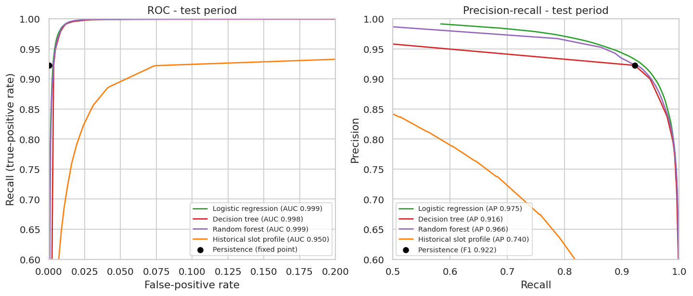
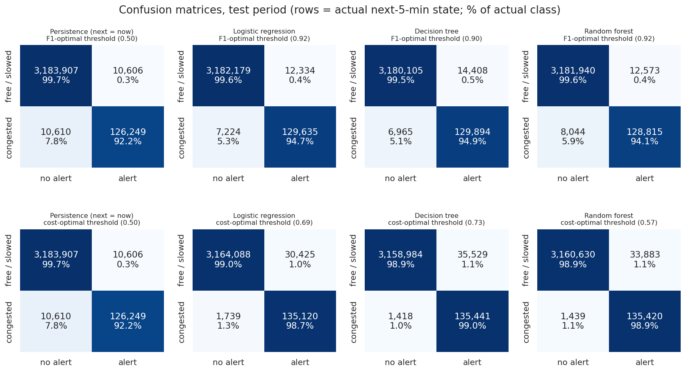
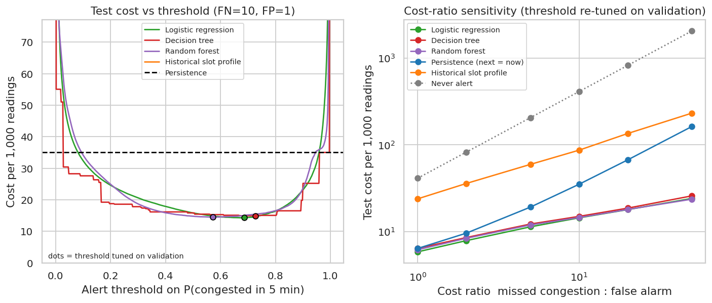

# Phase 7 - Evaluation on the test period

**Question.** Which tuned MLlib pipeline best predicts congestion 5 minutes ahead, and what do missed congestion and false alarms cost?

## Method

- Models: the three saved 7-stage pipelines (Logistic regression, Decision tree, Random forest) plus two baselines. Test period: 3,331,372 readings,
  136,859 congested (4.1%), strictly after training and validation.
- Thresholds: F1-optimal and cost-optimal, both chosen on **validation** and applied unchanged to **test**. Persistence (next = now) is a fixed 0/1 rule.
- Cost model: missed congestion = 10, false alarm = 1 (alert is worthwhile when P(congestion) > 0.091; class-weighted
  probabilities are not calibrated, so thresholds are tuned empirically). Sensitivity over ratios [1, 2, 5, 10, 20, 50].
- Metrics from one Spark aggregation per model and split (500 probability buckets); confidence intervals from a day-block bootstrap of test days.

## Key findings

- Selected on validation (lowest expected cost): **Logistic regression**. On the untouched test period at its F1-optimal threshold it scores precision 0.913, recall 0.947, F1 0.930 (persistence F1 0.922), PR-AUC 0.975, ROC-AUC 0.999. At its cost-optimal (deployed) threshold: precision 0.816, recall 0.987, F1 0.894.
- F1 gain over persistence: +0.007 (95% day-block CI +0.006 to +0.008; better in 100.0% of resamples).
- Cost at FN:FP = 10:1: Logistic regression 14.35 per 1,000 readings vs persistence 35.03 (59.0% saving, 95% CI 53,803 to 83,971 cost units; cheaper in 100.0% of resamples). Never alerting costs 410.82; always alerting 958.92.
- Missed congestion vs false alarms: at the cost-optimal point Logistic regression has 1.3% misses (1,739 readings, 36.4% of its cost) and a 0.62% false-alarm rate on stable free-flow rows; persistence misses 7.8% (every onset).
- Onsets (free/slowed now, congested in 5 min): Logistic regression recalls 33.9% at the F1 point and 83.6% at the cost point; persistence 0% by construction.
- Across cost ratios 1-50:1 Logistic regression beats persistence from ratio 1:1 upward (at 50:1: 24.04 vs 162.43).

## Test metrics

| label | point | threshold | precision | recall | f1 | pr_auc | roc_auc | onset_recall | false_alarm_rate | cost_per_1000 |
|---|---|---|---|---|---|---|---|---|---|---|
| Persistence (next = now) | F1-optimal threshold | 0.500 | 0.923 | 0.922 | 0.922 | 0.854 | 0.960 | 0.000 | 0.000 | 35.032 |
| Persistence (next = now) | cost-optimal threshold | 0.500 | 0.923 | 0.922 | 0.922 | 0.854 | 0.960 | 0.000 | 0.000 | 35.032 |
| Historical slot profile | F1-optimal threshold | 0.278 | 0.675 | 0.757 | 0.714 | 0.740 | 0.950 | 0.507 | 0.014 | 114.723 |
| Historical slot profile | cost-optimal threshold | 0.062 | 0.479 | 0.885 | 0.622 | 0.740 | 0.950 | 0.759 | 0.039 | 86.608 |
| Logistic regression | F1-optimal threshold | 0.918 | 0.913 | 0.947 | 0.930 | 0.975 | 0.999 | 0.339 | 0.001 | 25.387 |
| Logistic regression | cost-optimal threshold | 0.686 | 0.816 | 0.987 | 0.894 | 0.975 | 0.999 | 0.836 | 0.006 | 14.353 |
| Decision tree | F1-optimal threshold | 0.900 | 0.900 | 0.949 | 0.924 | 0.916 | 0.998 | 0.344 | 0.001 | 25.232 |
| Decision tree | cost-optimal threshold | 0.726 | 0.792 | 0.990 | 0.880 | 0.916 | 0.998 | 0.866 | 0.008 | 14.921 |
| Random forest | F1-optimal threshold | 0.918 | 0.911 | 0.941 | 0.926 | 0.966 | 0.999 | 0.244 | 0.001 | 27.920 |
| Random forest | cost-optimal threshold | 0.572 | 0.800 | 0.989 | 0.885 | 0.966 | 0.999 | 0.864 | 0.007 | 14.490 |

## Confusion matrices (test)

| label | point | threshold | tp | fp | fn | tn |
|---|---|---|---|---|---|---|
| Persistence (next = now) | F1-optimal threshold | 0.500 | 126,249 | 10,606 | 10,610 | 3,183,907 |
| Persistence (next = now) | cost-optimal threshold | 0.500 | 126,249 | 10,606 | 10,610 | 3,183,907 |
| Historical slot profile | F1-optimal threshold | 0.278 | 103,638 | 49,976 | 33,221 | 3,144,537 |
| Historical slot profile | cost-optimal threshold | 0.062 | 121,186 | 131,793 | 15,673 | 3,062,720 |
| Logistic regression | F1-optimal threshold | 0.918 | 129,635 | 12,334 | 7,224 | 3,182,179 |
| Logistic regression | cost-optimal threshold | 0.686 | 135,120 | 30,425 | 1,739 | 3,164,088 |
| Decision tree | F1-optimal threshold | 0.900 | 129,894 | 14,408 | 6,965 | 3,180,105 |
| Decision tree | cost-optimal threshold | 0.726 | 135,441 | 35,529 | 1,418 | 3,158,984 |
| Random forest | F1-optimal threshold | 0.918 | 128,815 | 12,573 | 8,044 | 3,181,940 |
| Random forest | cost-optimal threshold | 0.572 | 135,420 | 33,883 | 1,439 | 3,160,630 |

## Cost of missed congestion vs false alarms

| model | total_cost | saving_vs_persistence | saving_pct | saving_ci_low | saving_ci_high | share_boot_cheaper | days |
|---|---|---|---|---|---|---|---|
| Persistence (next = now) | 116,706.000 | 0.000 | 0.000 | 0.000 | 0.000 | 0.000 | 36 |
| Historical slot profile | 288,523.000 | -171,817.000 | -1.472 | -196,536.900 | -147,354.550 | 0.000 | 36 |
| Logistic regression | 47,815.000 | 68,891.000 | 0.590 | 53,803.375 | 83,971.450 | 1.000 | 36 |
| Decision tree | 49,709.000 | 66,997.000 | 0.574 | 52,598.375 | 81,335.050 | 1.000 | 36 |
| Random forest | 48,273.000 | 68,433.000 | 0.586 | 53,938.725 | 83,019.125 | 1.000 | 36 |

Cost sensitivity (test cost per 1,000 readings, threshold re-tuned on validation for each ratio):

| fn_fp_ratio | decision_tree | historical_profile | logistic_regression | never_alert | persistence | random_forest |
|---|---|---|---|---|---|---|
| 1 | 6.369 | 23.767 | 5.816 | 41.082 | 6.369 | 6.146 |
| 2 | 8.506 | 35.740 | 7.834 | 82.164 | 9.553 | 8.335 |
| 5 | 12.179 | 59.385 | 11.311 | 205.409 | 19.108 | 11.890 |
| 10 | 14.921 | 86.608 | 14.353 | 410.819 | 35.032 | 14.490 |
| 20 | 18.572 | 134.702 | 17.852 | 821.637 | 66.881 | 17.916 |
| 50 | 25.722 | 231.550 | 24.038 | 2,054.094 | 162.427 | 23.565 |

## F1 and cost against persistence (day-block bootstrap)

| label | f1 | f1_ci_low | f1_ci_high | delta_vs_persistence | delta_ci_low | delta_ci_high | saving_pct | saving_ci_low | saving_ci_high |
|---|---|---|---|---|---|---|---|---|---|
| Persistence (next = now) | 0.922 | 0.919 | 0.926 | 0.000 | 0.000 | 0.000 | 0.000 | 0.000 | 0.000 |
| Historical slot profile | 0.714 | 0.674 | 0.741 | -0.209 | -0.247 | -0.183 | -1.472 | -196,536.900 | -147,354.550 |
| Logistic regression | 0.930 | 0.926 | 0.933 | 0.007 | 0.006 | 0.008 | 0.590 | 53,803.375 | 83,971.450 |
| Decision tree | 0.924 | 0.920 | 0.927 | 0.001 | 0.001 | 0.002 | 0.574 | 52,598.375 | 81,335.050 |
| Random forest | 0.926 | 0.922 | 0.929 | 0.003 | 0.003 | 0.004 | 0.586 | 53,938.725 | 83,019.125 |

## Recommendations

- Deploy the `best/` bundle with its validation-tuned threshold (0.686) for alerting; revisit the threshold whenever the FN:FP cost ratio changes (`python -m src.ml.evaluate_model --cost-fn X --cost-fp Y`).
- Alert on the cost-optimal threshold for operations (misses are expensive) and keep the F1-optimal threshold for dashboards that need balanced precision/recall.
- Monitor onset recall and false-alarm rate per week; overall accuracy and F1 are dominated by stable rows that persistence already gets right.

## Serialization / reload verification

Reloaded `best/` (Logistic regression) from disk and re-scored 170 deterministic validation rows (the reference sample recorded at save time; test
data is never touched during training): **PASSED**, max |Δp| vs saved probabilities = 5.0e-11; checks {"stage_count": true, "stage_types_match_metadata": true, "reference_rows_found": true, "probabilities_identical": true, "predict_adds_alert": true}.
All test metrics above were themselves produced by models loaded from disk.

Tables: [tables/eval_metrics.csv](tables/eval_metrics.csv), [tables/eval_confusion_matrices.csv](tables/eval_confusion_matrices.csv), [tables/eval_cost_sensitivity.csv](tables/eval_cost_sensitivity.csv), [tables/eval_bootstrap_vs_persistence.csv](tables/eval_bootstrap_vs_persistence.csv). Evaluation took 6.3 min.
