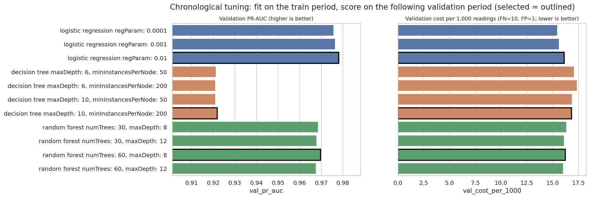

# Phase 7 - MLlib pipeline training and tuning

## Pipeline (7 stages)

`Imputer (median, 39 numeric features)` → `StringIndexer (hour_cat, dow_cat, speed_state)` → `OneHotEncoder` →
`VectorAssembler (numeric)` → `StandardScaler (mean 0, sd 1)` → `VectorAssembler (scaled numeric + one-hot → features)` →
`Estimator` (logistic regression | decision tree | random forest, class-weighted).

## Protocol

- Training data: random 8% sample of the **training period only** (890,194 rows, 3.83% congested next slot),
  class weights w₊ = 13.1, w₋ = 0.52 so both classes carry equal total weight. Imputation medians, scaler
  statistics and category indices are learned on this sample only.
- Tuning is chronological: each of the 11 grid candidates is fitted on the train period and scored on the **following**
  validation period (no random folds). Best hyper-parameters per algorithm = highest validation PR-AUC (threshold-free).
- Optimal model = lowest validation cost per 1,000 readings at its own cost-optimal threshold, with cost(missed congestion) = 10
  and cost(false alarm) = 1 (break-even probability 0.091; configurable with `--cost-fn/--cost-fp`).
- The test period is not used in this step.

## Selected model per algorithm (validation)

| algorithm | params | val_pr_auc | val_roc_auc | val_f1 | cost_threshold | val_cost_per_1000 | optimal |
|---|---|---|---|---|---|---|---|
| Logistic regression | {"regParam": 0.01} | 0.9781 | 0.9989 | 0.9346 | 0.6860 | 16.1035 | yes |
| Decision tree | {"maxDepth": 10, "minInstancesPerNode": 200} | 0.9218 | 0.9973 | 0.9291 | 0.7260 | 16.8196 | no |
| Random forest | {"numTrees": 60, "maxDepth": 8} | 0.9696 | 0.9987 | 0.9313 | 0.5720 | 16.2148 | no |

**Optimal: Logistic regression** ({"regParam": 0.01}), operating threshold 0.686.

## All candidates

| algorithm | params | train_s | val_pr_auc | val_roc_auc | val_f1 | val_cost_per_1000 | cost_threshold | selected |
|---|---|---|---|---|---|---|---|---|
| logistic_regression | {"regParam": 0.0001} | 47.3172 | 0.9757 | 0.9989 | 0.9362 | 15.4553 | 0.7140 | no |
| logistic_regression | {"regParam": 0.001} | 39.2318 | 0.9764 | 0.9989 | 0.9361 | 15.6262 | 0.6920 | no |
| logistic_regression | {"regParam": 0.01} | 35.9298 | 0.9781 | 0.9989 | 0.9346 | 16.1035 | 0.6860 | yes |
| decision_tree | {"maxDepth": 6, "minInstancesPerNode": 50} | 39.2627 | 0.9213 | 0.9968 | 0.9291 | 17.0898 | 0.7260 | no |
| decision_tree | {"maxDepth": 6, "minInstancesPerNode": 200} | 37.7229 | 0.9211 | 0.9968 | 0.9291 | 17.3763 | 0.7260 | no |
| decision_tree | {"maxDepth": 10, "minInstancesPerNode": 50} | 39.9203 | 0.9210 | 0.9963 | 0.9291 | 16.8786 | 0.7140 | no |
| decision_tree | {"maxDepth": 10, "minInstancesPerNode": 200} | 39.0138 | 0.9218 | 0.9973 | 0.9291 | 16.8196 | 0.7260 | yes |
| random_forest | {"numTrees": 30, "maxDepth": 8} | 52.3060 | 0.9686 | 0.9986 | 0.9305 | 16.3514 | 0.5460 | no |
| random_forest | {"numTrees": 30, "maxDepth": 12} | 63.0259 | 0.9679 | 0.9987 | 0.9316 | 16.1077 | 0.5500 | no |
| random_forest | {"numTrees": 60, "maxDepth": 8} | 73.9370 | 0.9696 | 0.9987 | 0.9313 | 16.2148 | 0.5720 | yes |
| random_forest | {"numTrees": 60, "maxDepth": 12} | 96.8478 | 0.9676 | 0.9987 | 0.9324 | 16.0174 | 0.5260 | no |

## Missing values repaired by the Imputer (training sample)

No numeric feature has missing values in the training sample: Phase 3 already drops rows with unobserved inputs, so the Imputer is a guard for inference-time data (exercised by `tests/test_ml.py`).

Tables: [tables/tuning_candidates.csv](tables/tuning_candidates.csv), [tables/tuning_missing_values.csv](tables/tuning_missing_values.csv).

## Serialization check

Saved bundles under `/mnt/c/Users/ssis/Desktop/bdaa/data/models/pems_bay/ml_pipeline` (one per algorithm plus `best/`). Reload check of `best/` on validation rows:
**PASSED** - 170 reference rows, max |Δp| = 5.0e-11, checks: {"stage_count": true, "stage_types_match_metadata": true, "reference_rows_found": true, "probabilities_identical": true, "predict_adds_alert": true}.

Total training time 17.3 min.
