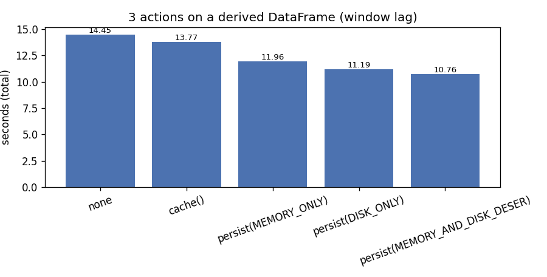
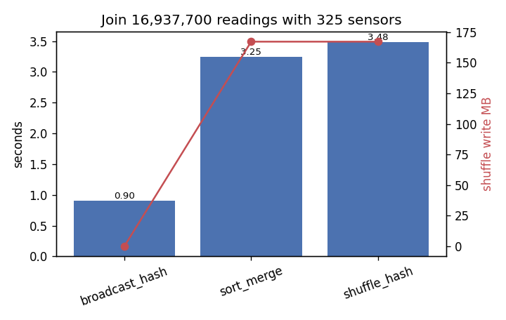

# Caching, persistence & shuffle analysis

_Spark 3.5.9 · local[*] (12 cores) · driver 3g · 7.6 GB RAM · AQE true · 2026-10-20T11:32:09+00:00_

Data: cleaned PEMS-BAY readings, all 6 months, 16,937,700 rows

## Key findings

- Caching: reusing the windowed DataFrame took 0.57s with persist(MEMORY_AND_DISK_DESER) vs 11.10s uncached (19× faster; uncached recomputed the window and shuffled 333.7 MB). End-to-end 10.76s vs 14.45s, because the first action pays to materialise the cache.
- Footprint: cache() 464.0 MB memory + 0 B disk; DISK_ONLY 324.7 MB disk; MEMORY_ONLY cached 48 partition(s). unpersist() left 0 storage entries.
- SQL CACHE TABLE is eager (9.71s, isCached=True); the follow-up query took 0.49s; UNCACHE TABLE → isCached=False.
- Joins: broadcast hash 0.90s / 0 B shuffled vs sort-merge 3.25s / 167.2 MB vs shuffle hash 3.48s / 167.2 MB.
- Aggregation over 2,890,110 readings: RDD groupByKey shuffled 8.2 MB vs reduceByKey 4.6 KB and DataFrame groupBy 7.6 KB; times 7.24s / 6.41s / 0.20s; results agree: True.

Methodology: join and aggregation cases use 3 measured run(s) after 1 warm-up. Caching cycles run once per strategy (`--cache-repeats` 1), because each cycle changes cache state. Metrics come from the Spark REST API.

## C1. Caching strategies

Workload: `derived = observed readings + lag() window per sensor + derived columns`, then 3 actions: congestion rate by hour, count of sudden drops (> 20 mph in 5 min), and worst drop per sensor.

| Strategy | StorageLevel | 1st action s | Actions 2+3 s | Total s | Shuffle write | Cached in memory | Cached on disk | Cached partitions | Storage entries after unpersist |
|---|---|---|---|---|---|---|---|---|---|
| none | - | 3.35 | 11.10 | 14.45 | 333.7 MB | 0 B | 0 B | 0 | - |
| cache() | Disk Memory Deserialized 1x Replicated | 12.20 | 1.56 | 13.77 | 225.9 MB | 464.0 MB | 0 B | 48 | 0 |
| persist(MEMORY_ONLY) | Memory Serialized 1x Replicated | 10.80 | 1.16 | 11.96 | 225.9 MB | 324.7 MB | 0 B | 48 | 0 |
| persist(DISK_ONLY) | Disk Serialized 1x Replicated | 10.32 | 0.86 | 11.19 | 225.9 MB | 0 B | 324.7 MB | 48 | 0 |
| persist(MEMORY_AND_DISK_DESER) | Disk Memory Deserialized 1x Replicated | 10.19 | 0.57 | 10.76 | 225.9 MB | 464.0 MB | 0 B | 48 | 0 |

- `cache()` on a DataFrame is `persist(MEMORY_AND_DISK)`. Data is stored in compressed columnar form in memory and spills to disk only when memory is short.
- The first action pays for computing and storing the data. Later actions read the cached blocks, so the window shuffle is not repeated (no shuffle write).
- `MEMORY_ONLY` silently skips partitions that do not fit, which are then recomputed. `DISK_ONLY` trades speed for memory safety.
- `unpersist(blocking=True)` releases the blocks; the storage REST endpoint shows no remaining entries.
- **Why uncached action 1 is fast:** it only needs `hour` and `congested`, so Catalyst pruned the unused `lag()` window (shuffle write 8.2 KB vs 225.9 MB for the cached first action). A cached DataFrame must materialise **every** column, including the window, so caching only pays off when the DataFrame is reused (actions 2 and 3).
- **Serialized vs deserialized:** in PySpark, `MEMORY_ONLY`/`DISK_ONLY` are *serialized* levels (324.7 MB), while `cache()`/`MEMORY_AND_DISK_DESER` keep deserialized columnar batches (464.0 MB). Serialized storage is smaller but costs CPU on every read.
- `cache()` and `persist(MEMORY_AND_DISK_DESER)` use the same storage level (`Disk Memory Deserialized 1x Replicated`), so the gap between their reuse times (1.56s vs 0.57s) is run-to-run variance (`cache()` ran first, straight after the uncached cycle). Use `--cache-repeats 3` for medians.

## C2. SQL `CACHE TABLE`

| CACHE TABLE s (eager) | Query s | Memory used | isCached | isCached after UNCACHE |
|---|---|---|---|---|
| 9.71 | 0.49 | 464.0 MB | yes | no |

## S1. Join strategies (16.9M-row fact table ⋈ 325-row dimension)

| Hint | Physical join | Exchanges | Median s | Shuffle write | Shuffle read | Tasks |
|---|---|---|---|---|---|---|
| broadcast_hash | BroadcastHashJoin | 1 | 0.90 | 0 B | 0 B | 13 |
| sort_merge | SortMergeJoin | 2 | 3.25 | 167.2 MB | 167.2 MB | 28 |
| shuffle_hash | ShuffledHashJoin | 2 | 3.48 | 167.2 MB | 167.2 MB | 28 |

A broadcast hash join sends the small table to every task, so the 16.9M-row side is never shuffled. Sort-merge and shuffle-hash joins repartition **both** sides by `sensor_id`. Plans are in `plans/join_*.txt`. With `spark.sql.autoBroadcastJoinThreshold` (10 MB by default), Spark picks the broadcast automatically.

## S2. Aggregation shuffles: average speed per sensor (2,890,110 readings, 2017-01)

| Method | Median s | Shuffle write | Shuffle records* | Tasks |
|---|---|---|---|---|
| DataFrame groupBy().agg(avg) | 0.20 | 7.6 KB | 325 | 6 |
| RDD reduceByKey | 6.41 | 4.6 KB | 20 | 10 |
| RDD groupByKey | 7.24 | 8.2 MB | 25 | 10 |

`groupByKey` ships every speed value across the shuffle before averaging. `reduceByKey` combines (sum, count) inside each map task first, so only one small tuple per sensor per task is shuffled. The DataFrame `groupBy` does the same partial aggregation (`HashAggregate` partial → `Exchange` → final) in the JVM, without Python serialization, which makes it the fastest.

\* PySpark serializes RDD records in pickled **batches**, and its `groupByKey` already merges values into per-key lists inside each task. RDD record counts therefore count batches, not individual values; **shuffle bytes** are the comparable measure.

