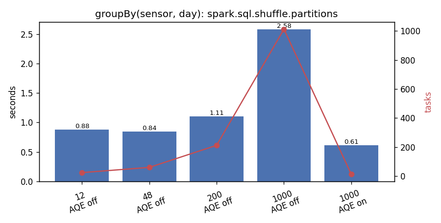

# Partitioning benchmarks

_Spark 3.5.9 · local[*] (12 cores) · driver 3g · 7.6 GB RAM · AQE true · 2026-10-20T11:22:00+00:00_

Data: cleaned PEMS-BAY readings, all 6 months, 16,937,700 rows

## Key findings

- coalesce(200→12) took 0.63s with 0 B shuffled; repartition(12) took 3.91s and shuffled 318.8 MB. Partition balance (max/mean): coalesce 1.02×, repartition 1.00×.
- Increasing partitions: coalesce(400) left 200 partitions; repartition(400) gave 400.
- Shuffle partitions (AQE off): best 48 → 0.84s, worst 1000 → 2.58s (1,012 tasks). With AQE on, 1000 requested partitions ran as 13 tasks in 0.61s.
- Pre-partitioning by sensor: three sensor-keyed operations needed 3 Exchange(s) and 6.15s on the raw data, vs 0 Exchange(s) and 2.64s after a one-time repartition+cache (7.75s).
- Small files: partitionBy(sensor_id) wrote 1,950 files (avg 71.7 KB) vs 6 for partitionBy(month); the full scan took 2.95s vs 0.98s.

Methodology: 3 measured run(s) after 1 warm-up, `noop` sink, metrics from the Spark REST API. 12 cores (`local[*]`).

## P1. Reducing partitions: 200 → 12

| Operation | Median s | Shuffle write | Shuffle read | Tasks | Exchange in plan | Min rows/part | Max rows/part | Max/mean | CV |
|---|---|---|---|---|---|---|---|---|---|
| coalesce(12) | 0.63 | 0 B | 0 B | 12 | no | 1,355,016 | 1,439,705 | 1.0× | 2.8% |
| repartition(12) | 3.91 | 318.8 MB | 318.8 MB | 212 | yes | 1,411,465 | 1,411,485 | 1.0× | 0.0% |

`coalesce` merges existing partitions on the same executor, a narrow dependency with no shuffle, but the merged partitions can be uneven. `repartition` does a full shuffle (round-robin) and produces evenly sized partitions.

## P2. Increasing partitions: 200 → 400

`coalesce(400)` → **200** partitions (it can only merge). `repartition(400)` → **400** partitions.

## P3. `spark.sql.shuffle.partitions` for `groupBy(sensor_id, date_local)`

| Shuffle partitions | AQE | Median s | Shuffle write | Shuffle read | Tasks |
|---|---|---|---|---|---|
| 12 | off | 0.88 | 797.7 KB | 797.7 KB | 24 |
| 48 | off | 0.84 | 863.7 KB | 863.7 KB | 60 |
| 200 | off | 1.11 | 984.3 KB | 984.3 KB | 212 |
| 1,000 | off | 2.58 | 1.3 MB | 1.3 MB | 1,012 |
| 1,000 | on | 0.61 | 1.3 MB | 1.3 MB | 13 |

Too few partitions under-use the cores and make large tasks. Too many add scheduling overhead per tiny task. Adaptive Query Execution (AQE) merges small post-shuffle partitions at runtime (`AQEShuffleRead`), so a generous setting costs little.

## P4. Pre-partitioning by key (`repartition("sensor_id")` + cache)

| Case | Exchanges in plan | Median s | Shuffle write | Shuffle read | Tasks |
|---|---|---|---|---|---|
| plain_avg_by_sensor | 1 | 0.53 | 45.5 KB | 45.5 KB | 13 |
| plain_max_drop_by_sensor | 1 | 0.52 | 47.3 KB | 47.3 KB | 13 |
| plain_lag_window_by_sensor | 1 | 5.10 | 173.5 MB | 173.5 MB | 27 |
| prepartitioned_avg_by_sensor | 0 | 0.43 | 0 B | 0 B | 48 |
| prepartitioned_max_drop_by_sensor | 0 | 0.37 | 0 B | 0 B | 48 |
| prepartitioned_lag_window_by_sensor | 0 | 1.84 | 0 B | 0 B | 48 |

One-time cost of `repartition("sensor_id").persist()`: 7.75s, 173.5 MB shuffled. When the data is already hash-partitioned by the key, later `groupBy`/`Window` on that key need no `Exchange`.

## P5. Output layout and the small-files problem

| Layout | Files | Size | Avg file | Write s | Full scan s | Scan tasks |
|---|---|---|---|---|---|---|
| partitionBy(month) | 6 | 48.5 MB | 8.1 MB | 8.16 | 0.98 | 13 |
| partitionBy(sensor_id) | 1,950 | 136.6 MB | 71.7 KB | 25.09 | 2.95 | 387 |

Partitioning by a high-cardinality column creates many tiny files, which slows writes, file listing and scans. Choose partition columns with low cardinality that match common filters (here `month`).

