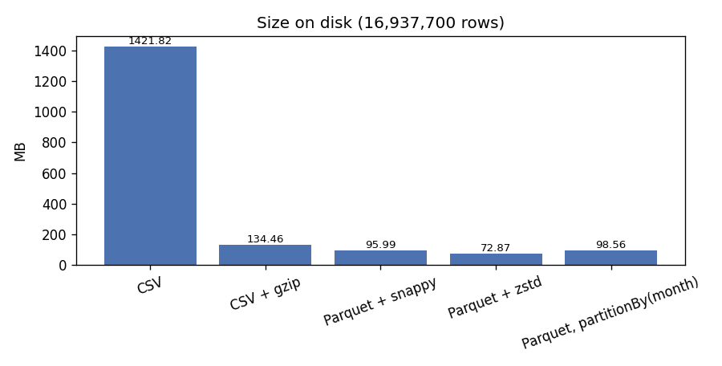
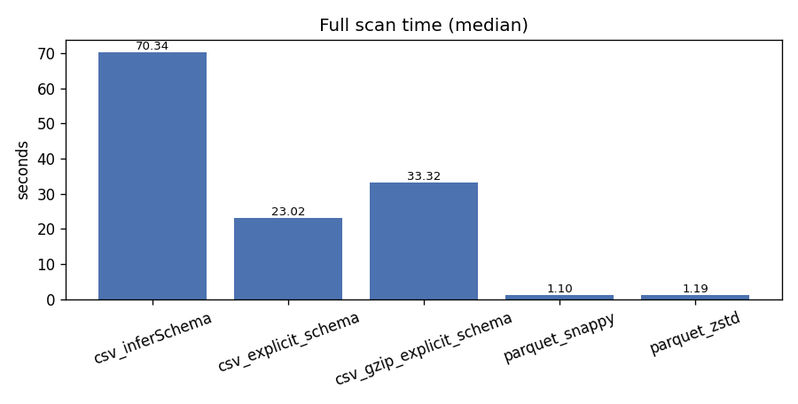

# Storage benchmarks: CSV vs Parquet

_Spark 3.5.9 · local[*] (12 cores) · driver 3g · 7.6 GB RAM · AQE true · 2026-10-20T11:42:38+00:00_

Data: cleaned PEMS-BAY readings, all 6 months, 16,937,700 rows × 9 columns

## Key findings

- Size: Parquet+snappy is 6.8% of CSV (96.0 MB vs 1.4 GB); zstd 5.1%; gzip-CSV 9.5%.
- Full scan: Parquet 1.10s vs CSV 23.02s with an explicit schema (20.9× faster) and 70.34s with inferSchema (CSV read twice: 2.8 GB).
- Column pruning: a 2-column aggregate read 21.1 MB from Parquet vs 1.4 GB from CSV (15.1× faster).
- Predicate pushdown (sensor 400001, speed < 35): Parquet 0.24s with pushdown vs 0.37s without, CSV 4.23s; input 2.4 MB vs 21.1 MB.
- Partition pruning (month 2017-04): 0.49s / 16.7 MB / 6 tasks with partitionBy(month) vs 0.72s / 16.6 MB / 13 tasks on a flat layout.
- Location: the same Parquet scans in 1.52s on WSL ext4 vs 2.61s on the Windows drive (9p) — 1.7× slower across the VM boundary.

Methodology: 3 measured run(s) after 1 warm-up per read case (writes: 1 run). Source data cached in memory before writing, so write times exclude reading the source. Reads use the `noop` sink (full materialisation, no output). Byte/record/task counts come from Spark's REST API for the measured run. Files are on the WSL ext4 scratch disk, and the OS page cache is warm for every format.

## W. Write cost and size on disk

| Format | Write s | Size | % of CSV | Bytes/row | Files |
|---|---|---|---|---|---|
| CSV | 11.88 | 1.4 GB | 100.0% | 88.000 | 6 |
| CSV + gzip | 18.39 | 134.5 MB | 9.5% | 8.300 | 6 |
| Parquet + snappy | 6.86 | 96.0 MB | 6.8% | 5.900 | 6 |
| Parquet + zstd | 5.98 | 72.9 MB | 5.1% | 4.500 | 6 |
| Parquet, partitionBy(month) | 10.65 | 98.6 MB | 6.9% | 6.100 | 6 |

## R1. Full scan (all columns)

| Reader | Median s | Min s | Bytes read | Records read | Tasks |
|---|---|---|---|---|---|
| csv_inferSchema | 70.34 | 46.48 | 2.8 GB | 33,875,407 | 25 |
| csv_explicit_schema | 23.02 | 22.18 | 1.4 GB | 16,937,700 | 12 |
| csv_gzip_explicit_schema | 33.32 | 28.70 | 135.5 MB | 16,937,700 | 6 |
| parquet_snappy | 1.10 | 1.04 | 96.8 MB | 16,937,700 | 13 |
| parquet_zstd | 1.19 | 1.09 | 73.5 MB | 16,937,700 | 13 |

`inferSchema` makes Spark read the whole CSV once to guess types, then again to load it, which is why its bytes read double.

## R2. Column pruning (`avg(speed_mph)` by `sensor_id`)

| Reader | Median s | Min s | Bytes read | Records read | Tasks |
|---|---|---|---|---|---|
| csv_explicit_schema | 6.16 | 6.04 | 1.4 GB | 16,937,700 | 13 |
| parquet_snappy | 0.41 | 0.40 | 21.1 MB | 16,937,700 | 14 |

Parquet stores each column separately, so only `sensor_id` and `speed_mph` are read. CSV must parse every byte of every row.

## R3. Predicate pushdown

Filter: `sensor_id = 400001 AND speed_mph < 35` → 1090 rows.

Plan evidence: `PushedFilters: [IsNotNull(sensor_id), IsNotNull(speed_mph), EqualTo(sensor_id,400001), LessThan(speed_mph,35.0)]`

| Reader | Pushdown | Median s | Min s | Bytes read | Records read | Tasks |
|---|---|---|---|---|---|---|
| csv_explicit_schema | n/a (CSV) | 4.23 | 4.15 | 1.4 GB | 1,090 | 13 |
| parquet_snappy | on | 0.24 | 0.23 | 2.4 MB | 240,000 | 14 |
| parquet_snappy | off | 0.37 | 0.36 | 21.1 MB | 16,937,700 | 14 |

With pushdown, the Parquet reader uses row-group/page min-max statistics to skip data and filters inside the vectorized reader. With it off, every row is decoded and passed to a separate Filter operator.

## R4. Partition pruning

Query: all columns of month `2017-04` (6 months available).

Plan evidence: `PartitionFilters: [isnotnull(month#3312), (month#3312 = 2017-04)]`

| Layout | Median s | Min s | Bytes read | Records read | Tasks |
|---|---|---|---|---|---|
| flat parquet (filter on column) | 0.72 | 0.72 | 16.6 MB | 2,808,000 | 13 |
| partitionBy(month) (partition pruning) | 0.49 | 0.47 | 16.7 MB | 2,808,000 | 6 |

Here both layouts read about the same bytes (16.6 MB vs 16.7 MB): the flat files were written from month-ordered input, so Parquet min/max statistics on `month` already skip the other months' row groups. Partition pruning still wins because the other months' files are never opened or scheduled (6 vs 13 tasks), and it works regardless of how rows are ordered.

## R5. Storage location

| Location | Median s | Min s | Bytes read | Records read | Tasks |
|---|---|---|---|---|---|
| Windows drive via 9p (/mnt/c/Users/ssis/Desktop/bdaa/data/processed/pems_bay/clean) | 2.61 | 2.39 | 96.5 MB | 16,937,700 | 13 |
| WSL ext4 (/home/wsluser/.cache/trafficsense/bench/storage/parquet_by_month) | 1.52 | 1.30 | 99.4 MB | 16,937,700 | 13 |

This is why scratch data, the Python venv and Spark spill files live on the WSL disk, while the project deliverables stay on the Windows drive.

