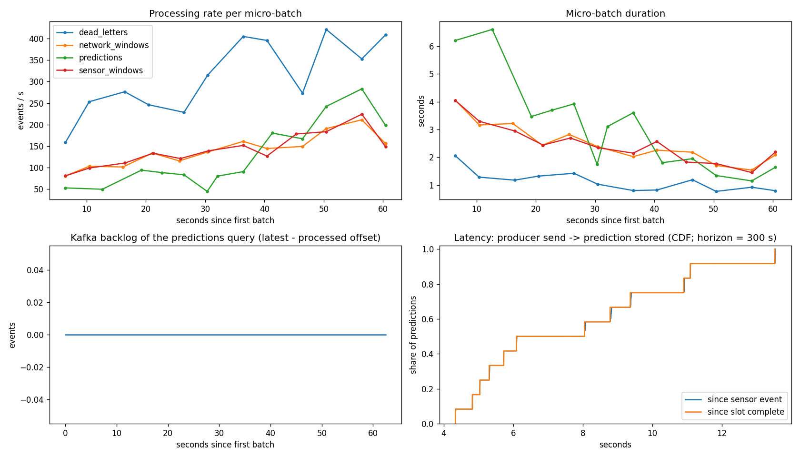

# Streaming metrics - run `live_rt`

Source: StreamingQueryProgress events of every micro-batch (81 records in 1 file(s); `runs_seen` > 1 means the application was restarted).

## Per query

| query | batches_with_data | input_rows | runs_seen | rows_per_s_overall | batch_ms_p50 | batch_ms_p95 | max_backlog_events | final_backlog_events | max_state_rows | rows_dropped_by_watermark |
|---|---|---|---|---|---|---|---|---|---|---|
| dead_letters | 12 | 3,900 | 1 | 262.238 | 1,103.500 | 1,706.500 | 0 | 0 | 0 | 0 |
| network_windows | 12 | 3,900 | 1 | 74.347 | 2,319.500 | 3,590.100 | 0 | 0 | 981 | 0 |
| predictions | 13 | 3,900 | 1 | 79.516 | 3,104.000 | 6,359.800 | 0 | 0 | 975 | 0 |
| sensor_windows | 12 | 3,900 | 1 | 72.650 | 2,390.500 | 3,628.150 | 0 | 0 | 2,925 | 0 |

## End-to-end latency (producer send -> prediction stored in MongoDB)

`since sensor event` includes the deliberate wait for the slot to complete (event-time grace); `since slot complete` is the latency from the LAST event of the slot to its predictions (in deterministic mode this still contains the wait for the next slot's first events, one slot period = 5 s at 60x, 300 s at real time); `after warmup` skips the first 4 slots (JVM/model warm-up, initial backlog).

| measured from | predictions | p50_s | p95_s | p99_s | max_s | mean_s | share_under_5_min_horizon |
|---|---|---|---|---|---|---|---|
| since sensor event | 3,900 | 7.075 | 13.529 | 13.537 | 13.539 | 7.760 | 1.000 |
| since slot complete | 3,900 | 7.069 | 13.525 | 13.525 | 13.525 | 7.752 | 1.000 |
| since slot complete after warmup | 2,600 | 5.514 | 9.364 | 9.364 | 9.364 | 6.182 | 1.000 |

Slots finalized by: {'idle': 2925, 'grace': 975}

## MongoDB document counts

| readings | predictions | sensor_windows | network_windows | dead_letters | late_events | batch_log |
|---|---|---|---|---|---|---|
| 3,900 | 3,900 | 2,925 | 9 | 0 | 0 | 13 |

